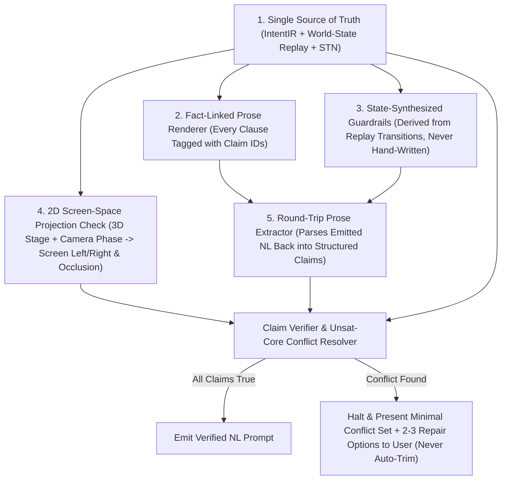

# ADR: Semantic Verification & Claim-Checked Renderer Architecture

- **Status:** Proposed / Captured in Backlog for Dedicated Compiler Engineering Session
- **Date:** 2026-10-23
- **Active Branch Context:** `exp/latent-sakuga-causal-readability` (Current focus: Pure Natural-Language Prompt Engineering A/B Testing; Compiler/Verifier implementation deferred to dedicated engineering session)
- **Related Modules:** `fight_move_system/validator.py`, `fight_move_system/state.py`, `fight_move_system/dyad.py`, `fight_move_system/causal_readability_compiler.py`, `scripts/sakuga_compiler.py`

---

## 1. Context & Post-Mortem: The 6 Semantic Contradictions Uncaught in `LBN-2.3-ADV v3`

When recompiling the `LBN-2.3-ADV v3` Pillar Fight score into our prompt arms, the following **6 semantic and physical contradictions** in the source score / template assembly passed through without being caught, flagged, or prevented by our existing schema and validator checks:

| Bug ID | Exact Contradiction in Emitted Prompt | Root Cause Class | Why Existing JSON Schema / Validators Missed It |
| :--- | :--- | :--- | :--- |
| **`SEM-BUG-01`** | Unchecked style/franchise reference (`"Naruto Shippuden and Sword of the Stranger style"`) | **Ungoverned Template Literal** | Style string was hand-authored in prose rather than emitted from a governed style token in the Intermediate Representation (IR). |
| **`SEM-BUG-02`** | Header claims **`"SIX tracked props"`**, but the numbered ledger only lists **5 items** (`(1)` through `(5)`, merging `smoke_pellet` and `substitution_log` into item `(3)`). | **Double-Authored Fact Drift (`Count != len(items)`)** | The word `"SIX"` and the 5 numbered list entries were hand-written separately instead of rendered from `len(ir.props)`. |
| **`SEM-BUG-03`** | Negative guardrail says **`"no B standing up after 5.00s knockdown"`**, yet between `5.50s` and `7.05s` Fighter B throws a shuriken volley (`5.50s`), lands braced (`6.30s`), grapples A's left elbow (`6.60s–6.80s`), and throws A into the pillar (`7.00s`). The actual terminal knockdown occurs at **`8.75s–8.77s`** (`9.00s` prone). | **Stale Guardrail vs. World-State Replay Contradiction** | The `"5.00s knockdown"` rule came from a stale score/template string rather than being synthesized from the actual `B.support -> prone` state transition at `t=8.77s`, and PDDL precondition checking (`grapple requires B.standing`) was not run against the guardrail claim. |
| **`SEM-BUG-04`** | Global lock says **`"Fighter A stays on screen-left facing right"`**, which directly conflicts with: (a) A reappearing **behind B** at `4.40s` (`x=4.4` behind B's facing direction), and (b) B throwing A into the **stone pillar at `7.00s`**, which is located on the **right** (`x=6.0` plane). | **Qualitative Spatial / 2D Screen-Space Projection Contradiction** | The compiler asserted `"A stays on screen-left"` as a static string without projecting the 3D stage trajectory (`A.x`, `B.x`, `pillar.x=6.0`, `B.facing`) through the camera's 2D view plane. |
| **`SEM-BUG-05`** | `Beat 1` header is labeled **`0.00s–0.60s`**, yet the action inside `Beat 1` includes A's vertical sprint down the pillar face, which runs from **`0.60s` to `1.60s`** (`Beat 2` starts at `1.60s`). | **Allen Interval / STN Containment Error** | Beat interval bounds `[t_start, t_end]` were hand-labeled instead of computed as the convex hull `[min(sub_events.t), max(sub_events.t)]` in the Simple Temporal Network (STN). |
| **`SEM-BUG-06`** | B throws the kunai upward at **`0.50s`** from `1.0m` horizontal distance, and it does not reach A's kicking foot until **`2.50s`** (`2.0 seconds` of flight time across a few meters, reading like a slow-motion float). | **Ballistic / Projectile Kinematics Implausibility** | Projectile flight duration $\Delta t = t_{\text{intercept}} - t_{\text{release}} = 2.0\text{s}$ was never checked against realistic ballistic velocity bounds ($v_{\text{throw}} \in [8, 20]\text{ m/s} \implies \Delta t \le 0.35\text{s}$ for a $3\text{–}5\text{m}$ gap). |

---

## 2. Part 1: Proven Compiler, Planner & Verifier Methods to Wire into `Movement_Prose`

These 7 established computer-science techniques directly address the failure modes above:

1. **Single Source of Truth (`IR -> Prose` Generation):**
   - *Rule:* Never author the same fact twice. Every count (`"SIX tracked props"`), timestamp range (`"Beat 1 (0.00s–1.60s)"`), and terminal guardrail (`"no B standing after 8.77s knockdown"`) must be deterministically computed from the single Intermediate Representation (`IntentIR`).
2. **State Replay / Event Sourcing (Petri-Net Conservation):**
   - *Rule:* Replay every event in chronological order against a single world state (`WorldStateAtTime[t]`) tracking each fighter's `support`, `pos`, `facing`, and each prop's `owner` / `location`.
   - *Catches:* A prop in two hands at once; a fighter performing a standing action while in `airborne` or `prone` state; missing or duplicated props.
3. **Precondition & Effect Checking (PDDL / VAL Plan Validation):**
   - *Rule:* Every move/event card declares formal `preconditions` (e.g., `FE2_elbow_catch_throw` requires `B.support == "standing"` and `distance(A, B) <= grapple_reach`) and `effects` (e.g., `FE4_ground_slam` sets `B.support = "prone"`, `B.knocked_down = True` at `t=8.77s`).
   - *Catches:* Any action occurring after a terminal knockdown or without required support/prop ownership (`SEM-BUG-03`).
4. **Temporal Constraint Networks (Allen's Interval Algebra & Dechter's STN):**
   - *Rule:* Represent every beat, sub-action, and projectile flight as an STN interval $[t_i^-, t_i^+]$ with Allen interval relations (`contains`, `meets`, `before`, `overlaps`) and physical duration bounds:
     $$\text{Beat}_k.\text{interval} = \left[\min_{e \in \text{Beat}_k} e.t_{\text{start}},\; \max_{e \in \text{Beat}_k} e.t_{\text{end}}\right]$$
     $$\Delta t_{\text{projectile}} = t_{\text{hit}} - t_{\text{throw}} \in \left[\frac{d}{v_{\max}},\; \frac{d}{v_{\min}}\right]$$
   - *Catches:* `Beat 1 (0.00s–0.60s)` containing a `0.60s–1.60s` sprint (`SEM-BUG-05`), and the `2.0s` floating kunai (`SEM-BUG-06`).
5. **Qualitative Spatial Reasoning (Left/Right & Front/Behind Calculi):**
   - *Rule:* Maintain 1D/2D qualitative spatial relations (`screen_left_of(A, B)`, `in_front_of(A, B)`, `at_landmark(A, pillar_right)`).
   - *Catches:* `"A stays screen-left facing right"` vs. `"A reappears behind B"` or `"B throws A into the right-side pillar"` (`SEM-BUG-04`).
6. **SAT/SMT Constraint Solving & Unsat-Core Extraction (Z3-Style):**
   - *Rule:* Encode world-state transitions, temporal intervals, spatial relations, and prompt claims as logical clauses. When unsatisfiable, extract the **minimal unsat core** (the exact 2–3 conflicting clauses) instead of failing with an opaque traceback.
7. **Recognition of JSON Schema Limits:**
   - *Rule:* JSON Schema (`schemas/*.schema.json`) only validates structural shape (keys and types), never semantic truth. Semantic verification must run on the replayed world state and the rendered prose.

---

## 3. Part 2: The 5-Part "Claim-Checked Renderer" Architecture

To guarantee that **the final natural-language prompt itself** cannot introduce or preserve contradictions (even from templates or prose joins), the compiler will implement a **Claim-Checked Renderer**:

### The 5 Architectural Components:
1. **Fact-Linked Sentence IDs (`ClaimProvenance`):**
   - Every sentence/clause emitted by the renderer carries an internal `claim_id` linking it to the exact world-state facts and time intervals it asserts (e.g., `"B lies prone from 9.00s to 10.00s"` $\leftrightarrow$ `Fact(actor="B", support="prone", interval=[9.00, 10.00])`).
   - Any sentence with no backing fact in the replayed world state is flagged as unverified decoration; any sentence whose linked fact evaluates to `False` in the replay fails the compile.
2. **Round-Trip Prose Parse & Graph Diff (`ProseClaimExtractor`):**
   - After rendering the natural-language prompt, a lightweight deterministic extractor parses the emitted prose back into structured claims: `(actor, action/posture, prop, hand/limb, time_interval, screen_side, count)`.
   - It diffs those extracted prose claims against the replayed world state. This catches renderer/template bugs that bypassed the IR — such as a stale `"no B standing after 5.00s knockdown"` string or `"SIX tracked props"` when `5` items are listed.
3. **State-Generated Guardrails (Never Hand-Written):**
   - Negative guardrails and conservation locks are synthesized directly from state transitions in the replay graph:
     - `terminal_knockdown_t = find_terminal_prone_transition(actor="B")` $\to$ generates `"no B standing up after 8.77s knockdown"` (or omits any timestamp in pure zero-digit prose: `"B remains prone and motionless after the final ground slam"`).
     - `prop_count_word = num_to_word(len(ir.props))` $\to$ generates `"SIX tracked props"` only when `len(rendered_prop_ledger) == 6`.
4. **2D Screen-Space Projection & Visibility Check (`ScreenSpaceProjector`):**
   - For every beat $k$, project the 3D coordinates of Fighter A, Fighter B, active props, and stage landmarks (`pillar at x=6.0`) through Beat $k$'s active camera (`cam.pos`, `cam.look`, `cam.fov`) into 2D normalized screen coordinates $(u_A, v_A), (u_B, v_B)$:
     - Verify whether $u_A < u_B$ (`A on screen-left`) holds, or whether A physically crosses screen center (`u_A > u_B` during `4.40s` flank reappearance or `7.00s` right-pillar wall plant).
     - Verify line-of-sight occlusion (`depth(contact_point) < depth(torso)` or lateral profile angle) so `correct_visible` is mathematically checked.
5. **Human-in-the-Loop Conflict Resolution (Zero Silent Trimming):**
   - When the verifier detects a conflict (an unsat core of 2–3 clauses), it **never silently deletes or rewrites user choreography**.
   - Instead, it halts and outputs the minimal conflict set with **2–3 concrete repair options** for the user to pick, e.g.:
     - *Conflict (`SEM-BUG-03`):* Clause A (`Guardrail: "no B standing after 5.00s"`) conflicts with Clause B (`Beat 6 at 6.80s: "B stands grounded and locks A's left elbow"`).
       - **Option 1:** Update guardrail knockdown timestamp to `8.77s` (when `FE4_ground_slam` sets `B.support = prone`).
       - **Option 2:** Keep knockdown at `5.00s` and convert Beats 5–8 into ground-grappling exchanges.
     - *Conflict (`SEM-BUG-04`):* Clause A (`Global Lock: "A stays strictly on screen-left"`) conflicts with Clause B (`Beat 3 at 4.40s: "A reappears behind B"` / `Beat 6 at 7.00s: "B hurls A into right-side stone pillar"`).
       - **Option 1:** Replace static screen-left lock with explicit physical screen-cross rule (`"180-degree front-hemisphere camera locked: A starts screen-left, physically crosses behind B to screen-right at 4.40s and plants on the right-side pillar at 7.00s"`).
       - **Option 2:** Move the stone pillar to screen-left (`x=0.0`) so A remains on screen-left throughout.

---

## 4. Actionable To-Do List for Future Compiler Engineering Session

When we switch from Prompt Engineering A/B Testing back to Compiler Engineering, execute these tasks in order:

- [ ] **TODO-1 (`fight_move_system/ir_single_source.py`):** Enforce Single-Source-of-Truth rendering so all counts (`len(props)`), beat header intervals (`[min_t, max_t]`), and prop ledger items are generated from `IntentIR` with zero hand-typed duplicate facts (`Fixes SEM-BUG-01, SEM-BUG-02, SEM-BUG-05`).
- [ ] **TODO-2 (`fight_move_system/world_replay.py`):** Extend `FighterState` / `DyadState` into a full chronological `WorldStateReplay` engine with PDDL-style preconditions/effects for every move and prop transition (`Fixes SEM-BUG-03`).
- [ ] **TODO-3 (`fight_move_system/stn_ballistics.py`):** Add Allen interval containment checks (`Beat` interval must equal the hull of its sub-events) and projectile flight-time bounds ($\Delta t_{\text{flight}} \le d / v_{\min}$, flagging or repairing `2.0s` floating projectiles unless explicitly marked as high-arc lob or delayed re-throw) (`Fixes SEM-BUG-05, SEM-BUG-06`).
- [ ] **TODO-4 (`fight_move_system/screen_space_verifier.py`):** Implement 2D camera projection (`project_to_screen(pos_3d, cam)`) and qualitative spatial reasoning (`left_of`, `behind`, `at_landmark`) to verify 180-degree hemisphere rules, physical screen-side crosses, and contact visibility (`Fixes SEM-BUG-04`).
- [ ] **TODO-5 (`fight_move_system/claim_checked_renderer.py`):** Implement the 5-part **Claim-Checked Renderer**:
  - [ ] `5a.` Attach `claim_id` provenance links from every rendered sentence to `WorldStateReplay` intervals.
  - [ ] `5b.` Synthesize all negative guardrails from `WorldStateReplay` transitions (never from static template strings).
  - [ ] `5c.` Build the **Round-Trip Prose Extractor (`ProseClaimExtractor`)** that parses rendered NL sentences back into `(actor, posture, prop, interval, screen_side, count)` claims and diffs them against `WorldStateReplay`.
  - [ ] `5d.` Build the **Unsat-Core Conflict Reporter** that presents minimal conflicting clauses + 2–3 repair options to the user without auto-trimming.
- [ ] **TODO-6 (`tests/test_claim_checked_renderer.py`):** Add regression test suite containing all 6 `LBN-2.3-ADV v3` semantic bugs (`SEM-BUG-01` through `SEM-BUG-06`) and assert that every single one is caught and surfaces a clean conflict report with repair options.
