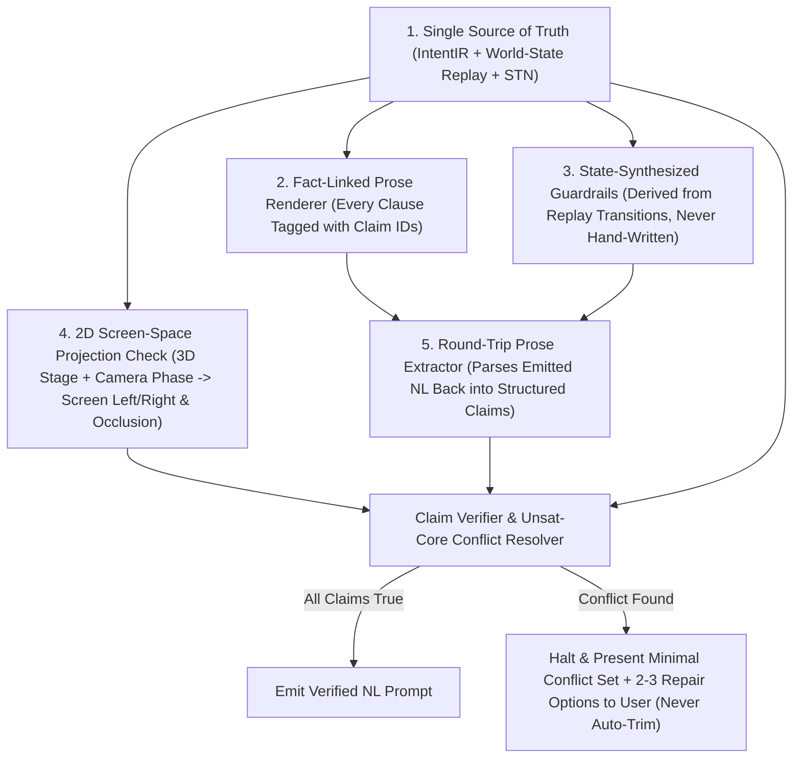

# ADR: Semantic Verification & Claim-Checked Renderer Architecture

- **Status:** Proposed / Captured in Backlog for Dedicated Compiler Engineering Session
- **Date:** 2026-10-23
- **Active Branch Context:** `exp/latent-sakuga-causal-readability` (Current focus: Pure Natural-Language Prompt Engineering A/B Testing; Compiler/Verifier implementation deferred to dedicated engineering session)
- **Related Modules:** `fight_move_system/validator.py`, `fight_move_system/state.py`, `fight_move_system/dyad.py`, `fight_move_system/causal_readability_compiler.py`, `scripts/sakuga_compiler.py`

---

## 1. Context & Post-Mortem: All 10 Annotated Failure Modes (`SEM-BUG-01` – `SEM-BUG-10`)

When translating the external `LBN-2.3-ADV v3` Pillar Fight score into a prompt via an ad-hoc script rather than gating it through a full world-state verifier, **10 concrete issues** emerged.  
Crucially, **some of these are already prevented by our native repo pipeline** (`fight_move_system/validator.py`, `causal_readability_compiler.py`, `scripts/sakuga_compiler.py`) when compiling native beat sheets, while **others were introduced by translating a flawed external prompt (`LBN-2.3-ADV v3`) without a claim-checked gate**.

Below is the complete annotated ledger distinguishing **Origin**, **What Our Repo Already Prevents**, and **The Repo Scan / Verifier Rule** to ensure none of the 10 can ever occur anywhere in the repo:

| ID | Issue & Failure Mechanism | Origin (`Bad Input Score` vs. `Ad-Hoc Translation` vs. `Repo Gap`) | Current Native Repo Status (`fight_move_system/` & `scripts/`) | Repo-Wide Scan / Guardrail Rule to Prevent Recurrence |
| :--- | :--- | :--- | :--- | :--- |
| **`SEM-BUG-01`** | **Ungoverned Franchise/IP Style String:** `"Naruto Shippuden and Sword of the Stranger style"` | **Ad-Hoc Translation** (hand-typed style string in `compile_lbn23_pillar_fight.py`) | **Partially Prevented:** Native `STYLE_PRESETS` in `scripts/sakuga_compiler.py` (`cel_default`, `nakamura`, `heavy_ink`) use pure animation descriptors, though `compiler.py` still had anime title references in `stack_header`. | **Scan Rule `SCAN-01`:** Ban third-party anime/IP franchise titles (`Naruto`, `Sword of the Stranger`, etc.) in emitted prompt templates; enforce pure visual/linework/shading descriptors from governed style tokens. |
| **`SEM-BUG-02`** | **Header Count vs. Ledger List Drift:** Claims `"SIX tracked props"`, but numbered list only has `(1)`–`(5)` (`smoke_pellet` and `substitution_log` merged into `(3)`). | **Ad-Hoc Translation** (hand-counted `"SIX"` vs. 5 hand-written list items) | **Gap on Multi-Prop Ledgers:** Native compiler only tracked 0 or 1 prop (`kunai`); multi-prop ledgers were not auto-numbered from `len(ir.props)`. | **Scan Rule `SCAN-02`:** Parse any `"<N> tracked props"` claim in emitted prompts and assert `N == count(numbered_prop_items)`. Always render counts from `len(props)`. |
| **`SEM-BUG-03`** | **Stale Knockdown Guardrail vs. Active Beats:** `"no B standing up after 5.00s knockdown"`, yet B throws shuriken (`5.5s`), lands (`6.3s`), grapples (`6.6s–6.8s`), and throws A (`7.0s`). Real knockdown is `8.75s–8.77s`. | **Bad Input Score (`LBN-2.3` XML had `<rule>no_B_stand_after_5s</rule>`) + Unchecked Translation** | **Already Prevented in Native Pipeline:** `fight_move_system/validator.py` (`V04/V05` support-state transitions) prevents standing moves after a `supine`/`prone` knockdown without a getup move. Failed here because external XML rules were copied verbatim without replaying B's state. | **Scan Rule `SCAN-03`:** Never copy raw `<rule>` strings from external scores; synthesize knockdown guardrails strictly from the timestamp where `B.support` transitions permanently to `prone`/`supine`. |
| **`SEM-BUG-04`** | **Screen-Left Lock vs. Flank Reappear & Right-Side Pillar:** `"A stays on screen-left facing right"` conflicts with: (a) A reappearing *behind B's spine* at `4.40s` while B faces left, and (b) B throwing A into the right-side pillar (`x=6.0`) at `7.00s` + B's shuriken flying past A into the pillar at `6.30s`. | **Bad Input Score Geometry + Static Header LockCopied into Translation** | **Partially Prevented:** `scripts/sakuga_compiler.py` (`Decision 16`) explicitly tracks `crossing_left_to_right` when A vaults/crosses B, whereas `compiler.py` (`sakuga_Xperiment`) assumed static `screen_left` / `screen_right` for 0-cross arena fights. | **Scan Rule `SCAN-04`:** Project 3D stage positions (`A.x`, `B.x`, `pillar.x`, `facing`) into 2D camera space. If `A` crosses behind `B`, or if `B -> A -> Pillar` requires the pillar on `screen-left`, ban static `"A stays on screen-left"` and emit the true spatial layout. |
| **`SEM-BUG-05`** | **Beat Header Interval Containment Error (`0.00s–0.60s` vs. `1.60s`) & Orphaned Dead-Air Gaps (`3.00s–3.70s`, `5.10s–5.50s`, `7.05s–7.50s`):** Beat 1 header says `0.00s–0.60s` while its sprint runs to `1.60s`, and 3 gaps leave `1.55s` of dead air. | **Ad-Hoc Translation** (grouped sparse LBN keyframe timestamps `[0.0, 0.6]` without closing interval bounds to `[0.0, 1.6]`) | **Already Prevented in Native Pipeline:** `fight_move_system/compiler.py` computes contiguous frame-accurate beat windows (`t_next = t_curr + frames/24`) with zero gaps. | **Scan Rule `SCAN-05`:** For any beat labeled `(t_start - t_end)`, assert all timestamps mentioned inside that beat satisfy `t_start <= t <= t_end`, and assert adjacent beats are contiguous (`Beat[k].t_end == Beat[k+1].t_start`) or explicitly bridged. |
| **`SEM-BUG-06`** | **2.0-Second Slow-Motion Floating Kunai (`0.50s` throw $\to$ `2.50s` foot deflect):** Kunai thrown at `0.50s` takes `2.0s` to cross a few meters, and B's arm takes `1.1s` (`0.50s–1.60s`) to finish one throw follow-through. | **Bad Input Score + Translation Collapsing Two Throws:** `LBN-2.3` had a `0.50s` throw AND a `2.00s` `GROUNDED_UPWARD_THROW`, which translation merged into a single `0.50s` throw. | **Needs New Verifier Rule:** Current validators check parabolic apex keywords (`Decision 16`) but do not enforce maximum ballistic flight time $\Delta t_{\text{flight}} \le 0.60\text{s}$ for direct throws. | **Scan Rule `SCAN-06`:** Flag any direct projectile flight where $t_{\text{impact}} - t_{\text{throw}} > 0.65\text{s}$ across close/medium range. |
| **`SEM-BUG-07`** | **4.1-Second "Orbiting Kunai" Gravity & Object-Permanence Paradox (`2.50s` deflect $\to$ `6.60s` catch):** Kunai is kicked upward at `2.50s`, vanishes from the prompt for `4.1s` (Beats 3, 4, 5), and is caught falling out of the air at `6.60s` (requiring a $20.6\text{m}$ / 6-story vertical apex!). | **Bad Input Score (`LBN-2.3` XML kept kunai airborne from `2.5s` to `6.6s`)** | **Already Prevented in Native `05:34` Template:** In `sakuga_mllm_3_1_causal_0534_template.json`, the kunai toss is `4.9s` $\to$ apex `5.5s` $\to$ catch `6.1s` (`1.2s` total hang-time, $y=2.05\text{m}$). The external `LBN-2.3` score stretched that to `4.1s`. | **Scan Rule `SCAN-07`:** Enforce maximum unpowered airborne prop hang-time $\Delta t_{\text{airborne}} \le 1.50\text{s}$ ($h_{\max} \le 2.8\text{m}$). If a prop is reclaimed $> 1.5\text{s}$ later, it must embed in a surface/wall/pillar first and be pulled free when the fighter reaches that surface! |
| **`SEM-BUG-08`** | **Bilateral Hand-Occupancy & Target-Slot Collision:** A draws `rope_dart` into `L_hand` at `3.00s`, then plants `L_hand` flat on the floor for a cartwheel at `6.30s` without stowing/transferring it; then at `7.60s–8.50s` both the `rope_dart` wrap AND the `kunai` stab target the exact same joint (`B's right shoulder`). | **Bad Input Score (`LBN-2.3` assigned `L_hand` to both `rope_dart` and `cartwheel_plant`, and `B.right_shoulder` to both weapons)** | **Needs New Verifier Rule:** `FighterState` tracks overall posture/coil/guard, not per-hand (`L_hand`, `R_hand`) prop occupancy or per-anatomical-zone attachment slots. | **Scan Rule `SCAN-08`:** Track `L_hand_held_prop` and `R_hand_held_prop` in `FighterState`; forbid `hand_plant` on a hand holding a loose weapon unless the wrist/forearm or free hand is used, and assign distinct target zones for simultaneous tether + blade impale (e.g., rope-dart wraps `B's right wrist/forearm` or `upper torso/neck line` while kunai drives into `B's exposed right shoulder`). |
| **`SEM-BUG-09`** | **Action-Density & Sub-Frame Timestamp Overload (`11 exchanges + 6 props + 33 decimal timestamps` like `4.70s` vs `4.72s`, `8.75s` vs `8.77s`):** Half-frame timestamps (`0.02s` apart at 24fps) and 11 exchanges in 10s overload MLLM text attention. | **Bad Input Score (`LBN-2.3` XML dumped raw 20ms physics ticks) + Partial Translation Leak** | **Already Prevented in `causal_readability_compiler.py` (`Rung 0 / 1 / 2`):** Native `causal_readability_compiler.py` uses `_strip_digits_and_metrics()` to strip all decimal timestamps and sub-frame ticks from Pure-NL prompts! Failed here because `compile_lbn23_pillar_fight.py` bypassed `_strip_digits_and_metrics()`. | **Scan Rule `SCAN-09`:** In Pure-NL prompts (`Arm C1`, `Arm C2`, `Arm C3`), run `_strip_digits_and_metrics()` / assert zero sub-frame decimal timestamps (`\d+\.\d{2}s`) and consolidate micro-phases (`windup -> drive -> hit -> react`) into single cohesive causal sentences per beat (`6–8` beats max for 10s). |
| **`SEM-BUG-10`** | **Triple-Duplicated Camera & FX Instructions:** Camera shots and FX sparks are repeated 3 times (`CAMERA LAYER` + per-beat `[View]/[License]` + `SAKUGA FX LAYER`), bloating word count to `~2,400w`. | **Compiler/Template Structure Gap in `Arm C1`** | **Needs Deduplication in `Arm C1`:** `causal_readability_compiler.py` currently puts full shot/FX descriptions in both the global layers and every beat's `[View]`/`[License]` tags. | **Scan Rule `SCAN-10`:** Keep `CAMERA & OBSERVATION LAYER` and `SAKUGA FX LAYER` as concise global rules (hemisphere lock, silhouette separation, limb-only smear rule, accent-after-contact rule), and put shot-specific framing/FX **only once** inside each beat's `[View]` / `[License]` tags. |

---

## 2. Part 1: Proven Compiler, Planner & Verifier Methods to Wire into `Movement_Prose`

These 7 established computer-science techniques directly address the failure modes above:

1. **Single Source of Truth (`IR -> Prose` Generation):**
   - *Rule:* Never author the same fact twice. Every count (`"SIX tracked props"`), timestamp range (`"Beat 1 (0.00s–1.60s)"`), and terminal guardrail (`"no B standing after 8.77s knockdown"`) must be deterministically computed from the single Intermediate Representation (`IntentIR`).
2. **State Replay / Event Sourcing (Petri-Net Conservation):**
   - *Rule:* Replay every event in chronological order against a single world state (`WorldStateAtTime[t]`) tracking each fighter's `support`, `pos`, `facing`, and each prop's `owner` / `location`.
   - *Catches:* A prop in two hands at once; a fighter performing a standing action while in `airborne` or `prone` state; missing or duplicated props.
3. **Precondition & Effect Checking (PDDL / VAL Plan Validation):**
   - *Rule:* Every move/event card declares formal `preconditions` (e.g., `FE2_elbow_catch_throw` requires `B.support == "standing"` and `distance(A, B) <= grapple_reach`) and `effects` (e.g., `FE4_ground_slam` sets `B.support = "prone"`, `B.knocked_down = True` at `t=8.77s`).
   - *Catches:* Any action occurring after a terminal knockdown or without required support/prop ownership (`SEM-BUG-03`).
4. **Temporal Constraint Networks (Allen's Interval Algebra & Dechter's STN):**
   - *Rule:* Represent every beat, sub-action, and projectile flight as an STN interval $[t_i^-, t_i^+]$ with Allen interval relations (`contains`, `meets`, `before`, `overlaps`) and physical duration bounds:
     $$\text{Beat}_k.\text{interval} = \left[\min_{e \in \text{Beat}_k} e.t_{\text{start}},\; \max_{e \in \text{Beat}_k} e.t_{\text{end}}\right]$$
     $$\Delta t_{\text{projectile}} = t_{\text{hit}} - t_{\text{throw}} \in \left[\frac{d}{v_{\max}},\; \frac{d}{v_{\min}}\right]$$
   - *Catches:* `Beat 1 (0.00s–0.60s)` containing a `0.60s–1.60s` sprint (`SEM-BUG-05`), and the `2.0s` floating kunai (`SEM-BUG-06`).
5. **Qualitative Spatial Reasoning (Left/Right & Front/Behind Calculi):**
   - *Rule:* Maintain 1D/2D qualitative spatial relations (`screen_left_of(A, B)`, `in_front_of(A, B)`, `at_landmark(A, pillar_right)`).
   - *Catches:* `"A stays screen-left facing right"` vs. `"A reappears behind B"` or `"B throws A into the right-side pillar"` (`SEM-BUG-04`).
6. **SAT/SMT Constraint Solving & Unsat-Core Extraction (Z3-Style):**
   - *Rule:* Encode world-state transitions, temporal intervals, spatial relations, and prompt claims as logical clauses. When unsatisfiable, extract the **minimal unsat core** (the exact 2–3 conflicting clauses) instead of failing with an opaque traceback.
7. **Recognition of JSON Schema Limits:**
   - *Rule:* JSON Schema (`schemas/*.schema.json`) only validates structural shape (keys and types), never semantic truth. Semantic verification must run on the replayed world state and the rendered prose.

---

## 3. Part 2: The 5-Part "Claim-Checked Renderer" Architecture

To guarantee that **the final natural-language prompt itself** cannot introduce or preserve contradictions (even from templates or prose joins), the compiler will implement a **Claim-Checked Renderer**:

### The 5 Architectural Components:
1. **Fact-Linked Sentence IDs (`ClaimProvenance`):**
   - Every sentence/clause emitted by the renderer carries an internal `claim_id` linking it to the exact world-state facts and time intervals it asserts (e.g., `"B lies prone from 9.00s to 10.00s"` $\leftrightarrow$ `Fact(actor="B", support="prone", interval=[9.00, 10.00])`).
   - Any sentence with no backing fact in the replayed world state is flagged as unverified decoration; any sentence whose linked fact evaluates to `False` in the replay fails the compile.
2. **Round-Trip Prose Parse & Graph Diff (`ProseClaimExtractor`):**
   - After rendering the natural-language prompt, a lightweight deterministic extractor parses the emitted prose back into structured claims: `(actor, action/posture, prop, hand/limb, time_interval, screen_side, count)`.
   - It diffs those extracted prose claims against the replayed world state. This catches renderer/template bugs that bypassed the IR — such as a stale `"no B standing after 5.00s knockdown"` string or `"SIX tracked props"` when `5` items are listed.
3. **State-Generated Guardrails (Never Hand-Written):**
   - Negative guardrails and conservation locks are synthesized directly from state transitions in the replay graph:
     - `terminal_knockdown_t = find_terminal_prone_transition(actor="B")` $\to$ generates `"no B standing up after 8.77s knockdown"` (or omits any timestamp in pure zero-digit prose: `"B remains prone and motionless after the final ground slam"`).
     - `prop_count_word = num_to_word(len(ir.props))` $\to$ generates `"SIX tracked props"` only when `len(rendered_prop_ledger) == 6`.
4. **2D Screen-Space Projection & Visibility Check (`ScreenSpaceProjector`):**
   - For every beat $k$, project the 3D coordinates of Fighter A, Fighter B, active props, and stage landmarks (`pillar at x=6.0`) through Beat $k$'s active camera (`cam.pos`, `cam.look`, `cam.fov`) into 2D normalized screen coordinates $(u_A, v_A), (u_B, v_B)$:
     - Verify whether $u_A < u_B$ (`A on screen-left`) holds, or whether A physically crosses screen center (`u_A > u_B` during `4.40s` flank reappearance or `7.00s` right-pillar wall plant).
     - Verify line-of-sight occlusion (`depth(contact_point) < depth(torso)` or lateral profile angle) so `correct_visible` is mathematically checked.
5. **Human-in-the-Loop Conflict Resolution (Zero Silent Trimming):**
   - When the verifier detects a conflict (an unsat core of 2–3 clauses), it **never silently deletes or rewrites user choreography**.
   - Instead, it halts and outputs the minimal conflict set with **2–3 concrete repair options** for the user to pick, e.g.:
     - *Conflict (`SEM-BUG-03`):* Clause A (`Guardrail: "no B standing after 5.00s"`) conflicts with Clause B (`Beat 6 at 6.80s: "B stands grounded and locks A's left elbow"`).
       - **Option 1:** Update guardrail knockdown timestamp to `8.77s` (when `FE4_ground_slam` sets `B.support = prone`).
       - **Option 2:** Keep knockdown at `5.00s` and convert Beats 5–8 into ground-grappling exchanges.
     - *Conflict (`SEM-BUG-04`):* Clause A (`Global Lock: "A stays strictly on screen-left"`) conflicts with Clause B (`Beat 3 at 4.40s: "A reappears behind B"` / `Beat 6 at 7.00s: "B hurls A into right-side stone pillar"`).
       - **Option 1:** Replace static screen-left lock with explicit physical screen-cross rule (`"180-degree front-hemisphere camera locked: A starts screen-left, physically crosses behind B to screen-right at 4.40s and plants on the right-side pillar at 7.00s"`).
       - **Option 2:** Move the stone pillar to screen-left (`x=0.0`) so A remains on screen-left throughout.

---

## 4. Actionable To-Do List for Future Compiler Engineering Session

When we switch from Prompt Engineering A/B Testing back to Compiler Engineering, execute these tasks in order:

- [ ] **TODO-1 (`fight_move_system/ir_single_source.py`):** Enforce Single-Source-of-Truth rendering so all counts (`len(props)`), beat header intervals (`[min_t, max_t]`), and prop ledger items are generated from `IntentIR` with zero hand-typed duplicate facts (`Fixes SEM-BUG-01, SEM-BUG-02, SEM-BUG-05`).
- [ ] **TODO-2 (`fight_move_system/world_replay.py`):** Extend `FighterState` / `DyadState` into a full chronological `WorldStateReplay` engine with PDDL-style preconditions/effects for every move and prop transition (`Fixes SEM-BUG-03`).
- [ ] **TODO-3 (`fight_move_system/stn_ballistics.py`):** Add Allen interval containment checks (`Beat` interval must equal the hull of its sub-events) and projectile flight-time bounds ($\Delta t_{\text{flight}} \le d / v_{\min}$, flagging or repairing `2.0s` floating projectiles unless explicitly marked as high-arc lob or delayed re-throw) (`Fixes SEM-BUG-05, SEM-BUG-06`).
- [ ] **TODO-4 (`fight_move_system/screen_space_verifier.py`):** Implement 2D camera projection (`project_to_screen(pos_3d, cam)`) and qualitative spatial reasoning (`left_of`, `behind`, `at_landmark`) to verify 180-degree hemisphere rules, physical screen-side crosses, and contact visibility (`Fixes SEM-BUG-04`).
- [ ] **TODO-5 (`fight_move_system/claim_checked_renderer.py`):** Implement the 5-part **Claim-Checked Renderer**:
  - [ ] `5a.` Attach `claim_id` provenance links from every rendered sentence to `WorldStateReplay` intervals.
  - [ ] `5b.` Synthesize all negative guardrails from `WorldStateReplay` transitions (never from static template strings).
  - [ ] `5c.` Build the **Round-Trip Prose Extractor (`ProseClaimExtractor`)** that parses rendered NL sentences back into `(actor, posture, prop, interval, screen_side, count)` claims and diffs them against `WorldStateReplay`.
  - [ ] `5d.` Build the **Unsat-Core Conflict Reporter** that presents minimal conflicting clauses + 2–3 repair options to the user without auto-trimming.
- [ ] **TODO-6 (`tests/test_claim_checked_renderer.py`):** Add regression test suite containing all 6 `LBN-2.3-ADV v3` semantic bugs (`SEM-BUG-01` through `SEM-BUG-06`) and assert that every single one is caught and surfaces a clean conflict report with repair options.
