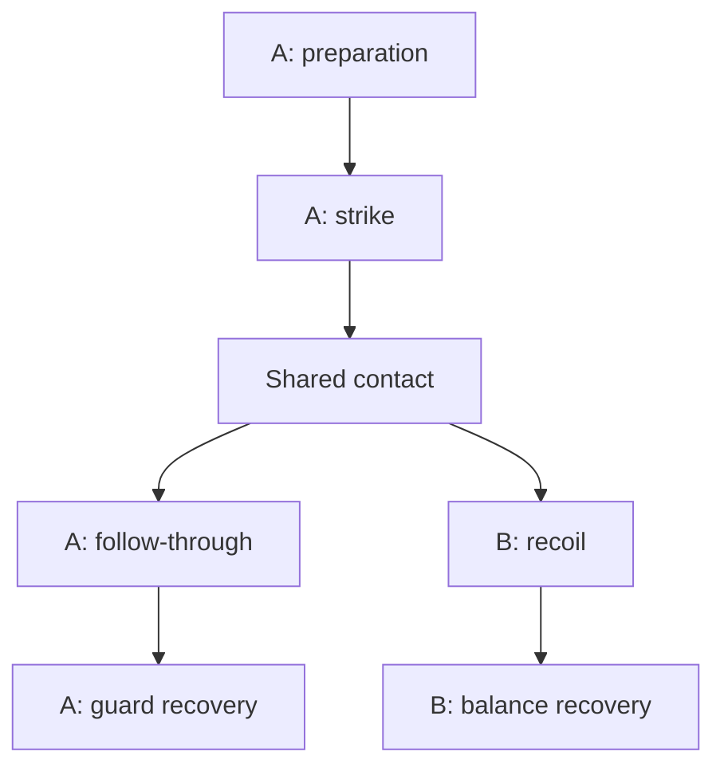

# Anime Action Lexicon and SQLite Curated Index

**Research snapshot:** 20 October 2026  
**Deliverable:** 64 authored directives, eight per functional slot, all six moment labels represented in every slot.  
**Database:** `ai_video_compiler.db`  
**Seed:** `seed_anime_directives.sql`  
**Generation evidence:** No paid or local model generation benchmark was performed.

## 1. What this library establishes

This is a usable, source-grounded starter taxonomy for anime action prompting and production planning. The SQL is executable and was ingested into the accompanying database. Every record has a concrete positive snippet, a technique-specific negative candidate, and machine-readable mechanical guidance stored in the existing TEXT column. The full per-record catalog follows the research and integration sections.

Three kinds of knowledge are deliberately separated:

| Evidence class | What it means here | What it does not establish |
| --- | --- | --- |
| Documented production practice | A practitioner describes the practice, an original published work demonstrates a motif, or official authoring documentation defines a control. | That a generative model recognizes a nickname or reproduces the practice reliably. |
| Documented engine behavior | First-party code, model cards or official product documentation exposes a field or input mode for a specific implementation. | That every model version, wrapper or checkpoint has the same behavior. |
| Authored prompt candidate | A descriptive instruction and proposed editorial recipe translate the visual intent into observable terms. | A measured success rate, guaranteed fidelity, or a universally optimal preset. |

**I cannot verify with 100% certainty that any exact negative phrase will prevent blended motion, unwanted 3D surface appearance, fused hands, or identity drift across the named engines.** No cross-engine benchmark of these exact strings was run. The files therefore mark every record `untested_prompt_candidate`, and describe failure modes as anticipated risks rather than established model-internal diagnoses.

The catalog is deliberately broader than a list of Japanese terms: it includes production terminology, community aliases, cinematographic descriptions and original English directing instructions. These categories should not be represented as if every phrase were an authentic named Japanese production technique. Artist names are research/retrieval aliases, not reserved model commands.

This is also a starter action lexicon, not an exhaustive martial-arts encyclopedia. Its core kinematic examples emphasize loading, straight strikes, blocks, recoil, recovery, supernatural displacement and aerial evasion. Additional kicks, grapples, weapon disciplines, landings and multi-actor acrobatics should be added as independently specified and validated action records.

## 2. Findings from the animator research

### Yutaka Nakamura: cubic fragments and timing contrast

Anime Style published an original Nakamura illustration and explicitly described its cube-fragment motif as familiar from his work. This supports the association behind the community alias **Yutapon cubes**, without proving that Nakamura invented cubic debris or coined the nickname. [I_NAKAMURA]

A translated 2003 interview discusses the quick/slow contrast before a sword lands. The compiler can turn that observation into separate debris and cadence choices. A rear-leg windup or rhythmic rebound remains an authored movement option; the research does not establish a universal “Nakamura bounce” formula. The translation is accessible; its original source page was not retrievable in this session. [I_NAKAMURA_TIMING]

**Operational choices:** `aa_env_yutapon_cubes` controls broken-surface fragments; `aa_material_flat_debris_faces` controls their drawn face colors. Preparation and release use their own action and timing rows. Do not let the word “cubes” transform a fighter into blocks or produce identical toy cubes everywhere.

### Yoshinori Kanada: scale, strong layouts and deliberate timing

Firsthand witnesses describe Kanada's attention to scale cues, unusual viewpoints and timing changes. Their testimony also distinguishes intentional composition from an actual perspective mistake. Consequently, “perspective break” is not permission for incoherent anatomy or an excuse for every layout error. [I_KANADA]

In a direct TRIGGER interview, the studio acknowledges Imaishi's Kanada influence when asked about fire dragons in *Promare*. The nickname **Kanada dragon** is useful as an alias; the prompt must still explain a contiguous, angular flame silhouette. [I_TRIGGER]

**Operational choices:** `aa_subject_foreshortened_fist` makes near/far proportions explicit; `aa_time_pose_snapping` specifies sharply differentiated poses; `aa_secondary_kanada_flame_dragon` describes a graphic fire effect. A 2/1/2 exposure example is a trial recipe, not Kanada's universal timing rule.

### Shinya Ohira: expressive deformation with underlying continuity

Ohira's interview describes vivid expression and animation-specific deformation. That supports controlled exaggeration as an artistic choice. The exact amount of torso compression, line doubling and return to baseline in this catalog is newly authored. [I_OHIRA]

**Operational choices:** `aa_subject_elastic_contact` permits a short expressive deformation window; `aa_material_expressive_rough` changes the line treatment. Keep identity, joint connectivity and the return pose explicit. A disconnected pelvis is not the same visual decision as a deliberately curved line of action.

### Shinji Hashimoto: atmospheric sketch-like rendering

The preserved transcript of Hashimoto's official Matrix interview discusses his preference for sketchier atmosphere and the difficulty this adds to animation work. The provenance is an archived primary interview, not a new statement by the artist. [I_HASHIMOTO]

**Operational choices:** use irregular line density and searching contours as rendering choices while keeping the action path readable. `aa_material_charcoal_impact` is an authored combination of sketch-like imagery and an impact accent; the interview does not claim that Hashimoto originated charcoal impact frames. Ohira and Hashimoto remain distinct artists.

### Norio Matsumoto: body and fabric as coordinated motion

In a direct production interview, *Inu-Oh* chief animation director Satoshi Nakano praises the realism and cloth movement of Matsumoto's drawings for that film. That is specific production testimony, not proof that all Matsumoto animation obeys a single naturalistic-physics formula. [I_MATSUMOTO]

**Operational choices:** describe support, hip/shoulder progression, fabric lag and settling separately. `aa_action_hip_led_punch` is a general authored action; it is not labeled a documented Matsumoto punch technique. A practitioner discussion also comments on selective shadow omission in his work, but that observation is not Matsumoto's own formal rule. [I_KAGENASHI]

### Ichiro Itano: trajectories, depth and different exposure rates

Itano directly describes foreground missiles on ones, middle-distance missiles on twos and distant missiles on threes, with exposure changing as a missile moves through depth. He also favors ones for a camera-following missile pan. This is the clearest primary technical counterexample to applying one low drawing cadence to everything in a shot. [I_ITANO]

**Operational choices:** `aa_action_itano_evasion` describes the evading subject; `aa_time_itano_depth` describes depth-sensitive timing. A complete occurrence must additionally bind individual missile paths and their smoke trails. Specify a target route, missile identities, near-miss corridors and camera path in the shot plan. The library row alone does not contain a solved missile simulation.

### Sushio and Hiroyuki Imaishi: explicit visual decisions instead of studio shorthand

Imaishi discusses both movement speed and the perceived speed of dense information in a publisher interview. Neither meaning determines a universal fps or motion-strength scalar. [I_IMAISHI]

A Sushio interview was located as an indexed lead, but its full page could not be opened. Its exact broader claims cannot be verified with 100% certainty here. No catalog record asserts that heavy line boil is universally Sushio's signature. His requested coverage is represented by the research limitation and by independently defined graphic-pose, staging and impact-effect options rather than an invented artist preset. [I_SUSHIO_LIMITED]

**Operational choices:** `aa_subject_angular_pose`, `aa_secondary_angular_impact_star` and `aa_material_controlled_line_boil` are distinct choices. The wedge pose and star shape are authored constructions. The TRIGGER interview also describes deliberate hand-drawn/3DCG integration, so “no 3D” is an output-look preference, not a historical authenticity test. [I_TRIGGER]

## 3. Vocabulary, slot ownership and observable output

The slot identifies the **primary responsibility of a directive**. Other slots can impose prerequisites, so single-slot classification does not mean independence.

| Slot | Responsibility | Examples in this seed |
| --- | --- | --- |
| `subject_anchor` | Character identity and graphic body construction | Loaded silhouette, attachment landmarks, foreshortened fist, temporary multi-contour smear. |
| `environment` | World state and background behavior | Directional speed void, parallax, contact-origin cracks, cubic fragments, persistent debris. |
| `primary_action` | Core actor motion and interaction | Weight load, hip-led punch, forearm block, catch step, guard recovery, flash step, evasion. |
| `secondary_motion` | Dependent body, garment, weapon or effect motion | Hair lag, cloth overshoot, contrail, shock ring, flame dragon, contact star. |
| `temporal_cadence` | Exposure, hold and spacing decisions | Tension hold, mixed ones/twos, hit-stop, pose snapping, overlap timing, moving hold. |
| `camera_optics` | Viewpoint, framing, movement and projection | Low tilt, lateral tracking, contact lock, falling track, whip reacquisition, barrel distortion, crash zoom. |
| `lighting` | Illumination and explicitly scoped shadow policy | Hard key, rim, silhouette flash, light falloff, local sparks, kagenashi override. |
| `material_shading` | Line, fill, palette and image treatment | Flat cel colors, line boil, rough ink, monochrome/inverted/charcoal impact drawings. |

### Distinctions worth preserving

- **Smear drawing versus motion blur:** a constructed graphic transition can have sharp contours. A blur filter can obscure those contours. The seed's multiple-limb smear lasts for one designated transition drawing and explicitly returns to a clean limb count.
- **Impact frame versus illumination flash:** replacing the palette is `material_shading`; changing a light event is `lighting`. They may coincide, but they are not the same control.
- **Line boil versus deformation:** contour variation can exist while the landmarks and color fills stay stable. First-person production testimony separates several kinds of boil. [P_LINE_BOIL]
- **Speed lines versus focus lines:** parallel directional strokes convey travel; convergent lines emphasize a point. The current speed-background row specifies the first. [P_SPEED_LINES]
- **Foreshortening versus barrel distortion:** near/far size relationships arise from viewpoint; curved lines at the frame edges are a projection/distortion choice. The incoming-strike camera row deliberately combines the two. [P_LENS]
- **Kagenashi versus no lighting:** the catalog uses kagenashi operationally to mean suppressing the selected character's interior form-shadow patches. Ground contact shadows can be a separate layer. The term's standardized history and precise attribution were not independently established by an accessible primary source; the linked practitioner discussion supports the narrower shadow-omission observation. [I_KAGENASHI]

## 4. Cadence and contact: what the compiler must represent

### A 24fps timeline is not 24 unique drawings per second

On a 24fps editorial timeline, exposing each character drawing for two frames gives twelve drawing changes per second. It does not require the file itself to be 12fps, and it does not require the camera or effects to share that cadence. Toon Boom documents both drawing exposures and independent transformation timing. [P_TIMING] [P_LAYER_TIMING]

All frame counts in the seed's `editorial_recipe` fields refer to a **chosen 24fps editorial timeline**. They are not claims about the model's temporal latent structure, supported output fps, minimum recognizable action duration or training cadence.

The exact frame schedule belongs in an exposure sheet, reference sequence or postproduction plan. If a model returns a different fps, map actual timestamps into the editorial timeline and inspect the result. Merely relabeling the frame rate changes playback duration; it does not produce an authored exposure schedule.

Whole-frame duplication, blending and pixel-motion synthesis are different operations in Adobe's documentation. Choose deliberately: automatic blending can replace a desired held drawing with a mixed image. Even whole-frame sampling cannot recover a contact pose that was never generated. [P_RETIME]

### Moment labels are retrieval categories

The six labels do not form one mandatory global serial chain. For one exchange:



The striker's finish and defender's recoil can overlap. A hard body block, a supernatural vanish and a weapon swing also require different event prerequisites. The table is a lexicon, not a complete event graph, pose solver or collision system.

### Store an occurrence alongside the lexicon

A minimal application-side occurrence can carry:

```json
{
  "directive_id": "aa_time_contact_hitstop",
  "actor_id": "A",
  "target_id": "B",
  "event_id": "block_contact",
  "start_frame": 24,
  "end_frame": 26,
  "interval_convention": "zero-based [start_frame,end_frame)",
  "editorial_fps": 24,
  "affected_scope": "contacting_fighters",
  "delivery_route": "editorial_exposure_control"
}
```

This is the compiler's internal representation, **not an API payload accepted by every video model**. The two-frame contact hold above covers frames 24 and 25. A monochrome accent can apply only at frame 24 while the underlying contact pose remains held through frame 25.

## 5. Engine compatibility findings

Use the exact model, checkpoint, execution path and endpoint when resolving controls. `engine_profiles.json` stores the findings and evidence limits; it contains no guessed executable API requests.

| Target | Negative conditioning | Frame-rate finding | Integration decision |
| --- | --- | --- | --- |
| Wan2.1 original Python T2V | `n_prompt` is explicitly implemented. An empty string substitutes the configured default negative. | Source constrains sampled frame count to `4n+1`; inspect actual selected configuration and export. | Do not rename CFG `guide_scale` or scheduler `shift` as motion amplitude. [E_WAN_CODE] |
| Wan2.1 official Diffusers path | Model card demonstrates `negative_prompt`. | Official example exports 81 frames at 15fps; this is an example, not a universal cadence. | Audit stock negative concepts before adding technique-specific negatives. [E_WAN_CARD] |
| LTX-Video with an active CFG path | `negative_prompt` exists; effect is configuration-dependent. | Observed inference implementation exposes `frame_rate`, default 30. | Pin the checkpoint/configuration; media conditioning is separate from prompt wording. [E_LTX_INFER] |
| LTXV 13B 0.9.8 distilled default | The field exists, but the published preset has guidance scale 1 and STG 0 in both passes. | Editorial cadence remains a separate decision. | The pipeline identifies scale 1 as no CFG. Do not assume negatives affect that preset. [E_LTX_PIPE] [E_LTX_DISTILLED] |
| Runway Gen-3 Alpha / Turbo | Historical negative behavior not reverified from the current page. | Official page reports retirement: Alpha 8 July 2026, Turbo 30 July 2026. | Preserve as a historical target; choose and audit an available model before dispatch. [E_RUNWAY_GEN3] |
| Kling, unspecified version | Dedicated negative-field contract unverified for the unspecified endpoint. | Generic fps/control contract unverified. | Keep engine scalars unset. For a concrete current example, the VIDEO 3.0 Omni guide documents reference inputs and shot instructions. [E_KLING3] |
| Seedance, unspecified version | No complete generic negative-field contract verified. | Exact model and endpoint needed. | The official API page did not expose a complete schema through retrieval; no numeric control is invented. [E_SEEDANCE_LIMITED] |

The presence of a field and the influence of that field are separate facts. The Wan source shows actual conditional/unconditional text paths; the LTX distilled exception demonstrates why an engine profile needs configuration as well as a brand name. None of these findings proves that a particular negative phrase corrects a particular anime artifact.

References, pose/depth controls and first/end-frame conditioning should be considered only when the chosen implementation supports them. A camera instruction in prose is a soft request. An API lock flag, an authored camera path and a post crop are different mechanisms.

## 6. Negative engineering without suppressing the intended technique

Treat `negative_snippet` as a **candidate field**, not as a universal always-on filter. The compiler must know whether the endpoint exposes and uses a negative-conditioning channel. Do not automatically paste an unsupported negative field into the positive prompt.

| Intended cue | Candidate negative wording | Avoid as an unconditional negative |
| --- | --- | --- |
| Multiple-contour arm smear | `persistent extra arms, detached limb copies, duplicated faces` | `extra limbs` across the smear interval. |
| Drawn contact star | `persistent star object, burst before contact, full-screen opaque explosion` | Every flash, every graphic effect. |
| Monochrome impact drawing | `permanent grayscale sequence, muddy gray gradients, crossfaded palette transition` | All color change or all flicker. |
| Expressive rough drawing | `random scribbles hiding anatomy, disconnected joints, permanent dirty texture` | All distortion, every rough line. |
| Controlled line boil | `silhouette crawling, face deformation, flickering fill colors` | All contour variation. |
| Cubic stone fragments | `rounded gravel soup, liquid rubble, endless multiplying cubes` | All cubes or all debris. |
| Clear cel surfaces | `clay skin, photoreal pores, soft blended contours` | The production method “3D” as a universal authenticity test. |
| Readable block | `merged fighters, fused forearms, contact across empty space` | Generic “bad anatomy” as the only quality criterion. |
| Held anticipation | `interpolated drift during the hold, repeated micro-windups` | All stillness or all static poses. |
| Fast action with hard drawings | `blended in-between frames, all-frame optical-flow smoothing` | All fast motion or every motion trace. |

These phrases describe unwanted appearances more concretely than “bad quality.” They still are not logical predicates executed by the model. A phrase such as “persistent extra arms” may not be honored as a temporal constraint. If correctness matters, check the rendered frames and use explicit graphic references or postproduction to confine the effect.

The stock Wan Diffusers negative example includes broad categories related to static or drawn imagery. It is an engineering concern that blindly copying such categories could oppose intentional held or illustrated frames; this task did not run an ablation to measure that effect. [E_WAN_CARD]

## 7. Compilation and conflict rules

The seed preserves the supplied eight-column schema. Additional provenance, aliases and risk text live in `anime_directives.json` and `sources.json`; concise controls, prerequisites and source IDs are encoded as JSON inside `mechanical_guidance`.

Recommended compilation order:

1. **Resolve the event.** Bind the actor, target, shot and contact anchor. **Checkpoint:** no unresolved `{actor}`, `{target}` or `{contact_origin}` placeholders.
2. **Select applicable rows.** Match moment and intended function; treat `sub_genre` as a retrieval hint, not proof of applicability. **Checkpoint:** the selected row IDs and slots are visible in a manifest.
3. **Apply scope and prerequisites.** Debris needs a fracture event; localized spark lighting needs actual sparks; a flame effect needs an attack path. **Checkpoint:** every declared prerequisite is present in the event plan.
4. **Resolve conflicts.** Check overlapping time and affected scope, not merely whether two IDs occur anywhere in the shot. **Checkpoint:** no incompatible pair remains in the same scope and interval.
5. **Bind and assemble text.** Retrieve in explicit order, substitute bindings and preserve causal clauses. **Checkpoint:** compare the assembled text against the selection manifest.
6. **Route by engine capability.** Send positive prose, supported active negatives and documented controls through their actual fields; send precise exposure/effect tasks to references or postproduction. **Checkpoint:** inspect the exact dispatch object and reject unsupported fields.
7. **Inspect the output.** Evaluate contacts, pose continuity, transient effects and final state. **Checkpoint:** the intended event is visible, not merely implied by a flash or hidden by dust.

This package implements the lexicon, deterministic selection examples and structural validation. It does **not** implement an arbitrary natural-language compiler, automatic proof of all prerequisites, model dispatch, trajectory solving or a comprehensive conflict ontology.

Examples of conflicts:

| Pair | Rule |
| --- | --- |
| Kagenashi and interior cel shadow bands | Conflict on the same character during the same interval. Different beats can intentionally switch policy. |
| Speed void and detailed parallax background | Choose one distant-background treatment for the interval. |
| Contact-lock camera and crash zoom | Conflict during the same locked contact window; a zoom can follow that window. |
| Flash-step fixed view and moving-camera row | Reject for the same interval unless a different variant is authored. |
| Monochrome, inverted and charcoal impact treatments | Choose one dominant replacement treatment for the same frame, or author an explicit layered variant. |
| Hit-stop and ongoing body penetration | The contact hold requires fixed relative contact geometry; effects can move separately. |

Selecting eight arbitrary rows is not a valid composition strategy. The three eight-slot fixtures demonstrate coverage under a coherent phase. The fourth fixture uses only five transient overrides and inherits the remaining state, which is often a better representation of a real shot.

Do not rely on `GROUP BY slot_id` to pick arbitrary nonaggregated values, or assume alphabetical ordering is a directing decision. The supplied query manifests explicitly choose IDs and order. SQLite documents that aggregate concatenation is order-sensitive; concatenating ordered rows in application code avoids implicit `group_concat` ordering. [D_ORDER]

## 8. Import, inspect and verify

The delivered database is already seeded. The commands below are for importing the SQL into a fresh database or inspecting a merge into an existing one. Re-running this seed **refreshes its 64 named `aa_*` rows**, including edits you made to those same IDs; unrelated IDs are not changed. Test a merge against a database copy if you need to inspect changes first.

The script uses `ON CONFLICT(directive_id) DO UPDATE` and requires SQLite 3.24.0 or newer. It performs no deletes. The supplied `VARCHAR` lengths remain annotations under ordinary SQLite, so the validator explicitly checks them. [D_UPSERT] [D_TYPES]

### Import with the SQLite CLI

From the directory containing the files:

```bash
sqlite3 -bail ai_video_compiler.db < seed_anime_directives.sql
```

**Checkpoint:** exit status is zero. The full SQL seed is one multi-row INSERT within a transaction. `-bail` stops CLI processing on error. See SQLite's official [CLI documentation](https://www.sqlite.org/cli.html).

### Import without the SQLite CLI

Python's standard library is sufficient:

```bash
python3 - <<'PY'
from pathlib import Path
import sqlite3

script = Path('seed_anime_directives.sql').read_text(encoding='utf-8')
with sqlite3.connect('ai_video_compiler.db') as db:
    db.executescript(script)
    result = db.execute(
        "SELECT COUNT(*) FROM semantic_directives WHERE archetype='anime_action'"
    ).fetchone()[0]
    print('anime_action rows:', result)
    print('integrity:', db.execute('PRAGMA integrity_check').fetchone()[0])
PY
```

**Checkpoint for a fresh database:** `anime_action rows: 64` and `integrity: ok`. An existing database can legitimately have more anime_action rows.

### Inspect distribution

```sql
SELECT slot_id, moment_type, COUNT(*) AS records
FROM semantic_directives
WHERE archetype = 'anime_action'
GROUP BY slot_id, moment_type
ORDER BY slot_id, moment_type;
```

**Checkpoint for this seed:** 48 slot/moment combinations, eight records per slot, and the totals shown in the coverage table below. `verify_anime_directives.sql` also checks overall count, subgenre totals and blank/overlength fields.

### Reproduce the complete validation

```bash
python3 validate_anime_seed.py \
  --db ai_video_compiler.db \
  --report validation_report.json
```

**Checkpoint:** the printed status and report status are `pass`, the process exits zero, and all six validation groups pass. The optional `--db` target is opened read-only; SQL execution tests occur in memory.

The validator checks exact equality with this standalone 64-row seed. It intentionally reports a mismatch if a merged database has extra anime_action rows. Use the distribution queries for a broader database, or adapt the comparison to the explicit seed-ID set. This avoids presenting a seed-specific assertion as a universal database invariant.

### Inspect the compilation fixtures

```bash
sqlite3 -header -column ai_video_compiler.db < compile_examples.sql
```

**Checkpoint:** the first three manifests return eight ordered rows each; the fourth returns five. Their fully bound prose and negative candidates are in `example_payloads.json`. The same file includes an illustrative 72-frame editorial exchange with a shared contact event and overlapping recoil/follow-through.

## 9. Validation boundary and an empirical next gate

Local validation establishes that the data is structurally consistent and loads as intended. It does not establish anatomy, contact physics or model obedience. The recorded checks are reproducible from the supplied artifacts.

Before labeling a row “battle-tested,” run a controlled, model-specific evaluation. Keep the following record for every output: exact checkpoint or API model ID, code revision or provider version where exposed, generation parameters, positive and negative strings, reference assets, seed if supported, output fps, output file, selected IDs and evaluation result.

Use small independent fixtures before a dense fight:

| Fixture | Observable acceptance condition | Specific comparison |
| --- | --- | --- |
| One strike and one block | Distinct named forearms meet visibly; recoil begins after contact; two actors persist. | Baseline action versus action plus explicit contact staging. |
| One multiple-contour smear | Clean limb count before and after; graphic echoes confined to the intended transition. | Broad anatomy negative versus a scoped candidate, only on an engine with active negatives. |
| One impact accent | Accent lands on the chosen contact frame and normal palette returns immediately. | Text-only request versus an explicitly authored post accent. |
| One debris burst | Major fragments originate at the fracture and retain shape; environment damage persists. | Nickname-only description versus descriptive geometry, with the same scene controls. |
| One missile evasion | Actor and missile paths remain traceable; depth groups retain planned timing differences. | A global cadence request versus a layered reference/exposure plan. |

A fixed seed is useful for matched comparisons when the implementation supports it, but it does not by itself establish identical results across hardware, software revisions or provider updates. Report the actual tested configuration and output behavior. Keep a failed visual result as a failed result even if SQL, JSON and prompt validation all passed.

For each tested row, add evidence in a separate evaluation record rather than silently replacing the meaning of `mechanical_guidance`. A useful result states the fixture, the target model, number of attempts, pass conditions and observed outcomes. No percentages or “best settings” are manufactured in this deliverable.

## 10. Measured seed coverage and validation results

| Slot | Anticipation | Execution | Impact | Recoil | Follow-through | Recovery | Total |
| --- | ---: | ---: | ---: | ---: | ---: | ---: | ---: |
| `subject_anchor` | 1 | 3 | 1 | 1 | 1 | 1 | 8 |
| `environment` | 1 | 2 | 1 | 2 | 1 | 1 | 8 |
| `primary_action` | 1 | 3 | 1 | 1 | 1 | 1 | 8 |
| `secondary_motion` | 1 | 2 | 2 | 1 | 1 | 1 | 8 |
| `temporal_cadence` | 1 | 3 | 1 | 1 | 1 | 1 | 8 |
| `camera_optics` | 1 | 2 | 2 | 1 | 1 | 1 | 8 |
| `lighting` | 1 | 2 | 2 | 1 | 1 | 1 | 8 |
| `material_shading` | 1 | 1 | 3 | 1 | 1 | 1 | 8 |
| **Total** | 8 | 18 | 13 | 9 | 8 | 8 | **64** |

Subgenres are retrieval labels. This seed includes `cyberpunk_cqc`: 7, `grounded_martial_arts`: 17, `mecha_aerobatics`: 5, `shonen_impact`: 26, `supernatural_speed`: 9.

| Validation group | Result |
| --- | --- |
| `catalog_contract` | PASS |
| `sql_first_ingestion` | PASS |
| `sql_repeat_ingestion` | PASS |
| `unrelated_row_preserved` | PASS |
| `compiled_examples` | PASS |
| `readonly_database` | PASS |

Validation used Python's SQLite library version `3.53.1`. The CLI executable was not present in the build environment; the SQL itself was executed through Python, including repeat ingestion. The delivered database returned `ok` from `PRAGMA integrity_check`. The report records four example payloads and 29 selections checked.

**Content fingerprint:** `275537d8f7c8d4bcb5a82c0d28ccf7efb5e6f6c3b8153ae35fecd971f99df639`. This hashes the canonical ordered rows, not the database file bytes.

## 11. Full directive catalog

The following 64 entries are the complete curated set, not a shortened preview. Positive and negative strings match the SQL. Frame recipes are proposed editorial targets. Risk explanations are engineering hypotheses. A source supports only its stated production principle or observation, not empirical prompt effectiveness.

### subject_anchor

#### `aa_subject_loaded_silhouette` — Readable loaded silhouette

**Moment:** `anticipation` · **Subgenre:** `grounded_martial_arts` · **Status:** `untested_prompt_candidate`

**Positive snippet / intended visual cue:**

> During the windup, keep {actor} recognizable by the same face, hair outline and costume panels. Separate both forearms from the torso in silhouette; draw taut diagonal folds across the loaded shoulder while the supporting foot remains visible.

**Negative candidate:** `merged forearms, costume redesign, hair topology changes, detached sleeves`.

**Anticipated failure:** A crowded silhouette can conceal which limb is loaded; texture changes can masquerade as costume tension.

**Camera rule:** Three-quarter full-body view; keep the supporting foot and striking arm visible.

**Cadence / mechanical recipe:** Hold the readable preparation drawing for 4 editorial frames before release; this is an authored starting recipe.

**Preferred delivery route:** `prompt_plus_reference`. **Affected scope:** `bound_actor_and_beat`.

**Observable checkpoint:** Compare face, hair and costume landmarks before and after the hold; both arm silhouettes stay legible.

**Source scope:** Sources support the underlying technique or production principle, not the effectiveness of this authored prompt. [P_PRINCIPLES]

#### `aa_subject_angular_pose` — Angular graphic pose

**Moment:** `execution` · **Subgenre:** `shonen_impact` · **Status:** `untested_prompt_candidate`

**Aliases:** angular graphic posing.

**Positive snippet / intended visual cue:**

> On the decisive action drawing, construct {actor} from bold wedges: a triangular torso, a sharply bent leading elbow and a clean zigzag line of action. Keep the face and costume markings identifiable inside the angular silhouette.

**Negative candidate:** `rounded clay anatomy, melted elbows, changing costume symbols, plush surface shading`.

**Anticipated failure:** Angular simplification may be expanded into rigid armor or change the character design.

**Camera rule:** Use a three-quarter view that separates the elbow from the ribcage.

**Cadence / mechanical recipe:** Use one emphatic action drawing between readable entry and exit drawings; its hold is set by the beat.

**Preferred delivery route:** `prompt_plus_reference`. **Affected scope:** `bound_actor_and_beat`.

**Observable checkpoint:** The pose reads as one actor with connected joints and the same costume after the exaggeration.

**Source scope:** The TRIGGER interview supports Imaishi's Kanada influence; the wedge construction and zigzag pose are an authored interpretation, not a documented studio-wide or artist-wide prescription. [I_TRIGGER] [P_PRINCIPLES]

#### `aa_subject_elastic_contact` — Bounded impact deformation

**Moment:** `impact` · **Subgenre:** `shonen_impact` · **Status:** `untested_prompt_candidate`

**Aliases:** expressive deformation.

**Positive snippet / intended visual cue:**

> At the contact beat, compress {target}'s torso into a short graphic curve and stretch the far contour with the force direction. Preserve the connected neck, shoulders, pelvis and limb roots, then restore the established body design on the next readable pose.

**Negative candidate:** `detached pelvis, permanent stretched torso, duplicated shoulders, disconnected neck`.

**Anticipated failure:** Temporary expressive distortion can persist as a new anatomy or introduce disconnected joints.

**Camera rule:** Hold a side or three-quarter view so the deformation follows the visible incoming force.

**Cadence / mechanical recipe:** Limit the deformation to 1 or 2 editorial frames; restore the model in the recoil pose.

**Preferred delivery route:** `pose_reference_or_post`. **Affected scope:** `bound_actor_and_beat`.

**Observable checkpoint:** Check joint connectivity on the effect drawing and restored proportions immediately afterward.

**Source scope:** Sources support the underlying technique or production principle, not the effectiveness of this authored prompt. [I_OHIRA] [P_PRINCIPLES]

#### `aa_subject_recoil_identity` — Recoil identity anchor

**Moment:** `recoil` · **Subgenre:** `cyberpunk_cqc` · **Status:** `untested_prompt_candidate`

**Positive snippet / intended visual cue:**

> As {target} recoils, preserve the same jaw contour, hair clumps, glove shape and jacket seam map. Keep the struck shoulder joined to the chest and the elbow visibly connected to its forearm throughout the backward bend.

**Negative candidate:** `face substitution, shoulder separation, fused glove and sleeve, mirrored costume panels`.

**Anticipated failure:** Large orientation changes can hide joint disconnections or swap identity between fighters.

**Camera rule:** Keep the struck side visible; avoid a simultaneous orbit through the contact axis.

**Cadence / mechanical recipe:** Use readable recoil keys; maintain landmarks on every held or passing drawing.

**Preferred delivery route:** `prompt_plus_reference`. **Affected scope:** `bound_actor_and_beat`.

**Observable checkpoint:** Track the same shoulder, elbow, glove and three face landmarks through the recoil.

**Source scope:** Sources support the underlying technique or production principle, not the effectiveness of this authored prompt. [P_PRINCIPLES]

#### `aa_subject_costume_attachment` — Stable costume attachment points

**Moment:** `follow_through` · **Subgenre:** `grounded_martial_arts` · **Status:** `untested_prompt_candidate`

**Positive snippet / intended visual cue:**

> During {actor}'s follow-through, keep the belt fixed to the waist, cuffs fixed to the wrists and collar fixed to the neck. Preserve the same garment panel boundaries while the torso turns; the fabric remains a distinct layer over the body.

**Negative candidate:** `sliding belt, migrating cuffs, collar fused into skin, costume panel swaps`.

**Anticipated failure:** Loose fabric descriptions can cause garment anchors to slide or become part of the anatomy.

**Camera rule:** Use enough medium-wide space to see waist and wrists.

**Cadence / mechanical recipe:** Carry the attachment landmarks continuously across the follow-through keys.

**Preferred delivery route:** `prompt_plus_reference`. **Affected scope:** `bound_actor_and_beat`.

**Observable checkpoint:** Inspect belt, collar and cuff attachment points through the body rotation.

**Source scope:** Sources support the underlying technique or production principle, not the effectiveness of this authored prompt. [P_PRINCIPLES]

#### `aa_subject_recovery_model` — Restore the model after exaggeration

**Moment:** `recovery` · **Subgenre:** `grounded_martial_arts` · **Status:** `untested_prompt_candidate`

**Positive snippet / intended visual cue:**

> In the recovery pose, return {actor} to the established face proportions, hand size and full body silhouette. Keep the same hairstyle, costume damage and left-right markings; the final readable pose matches the character established before the exchange.

**Negative candidate:** `residual stretched limbs, reset costume damage, swapped left-right markings, new hairstyle`.

**Anticipated failure:** A final hold may freeze a distorted intermediate pose or erase continuity changes.

**Camera rule:** Finish at a view that exposes the face, hands and stance.

**Cadence / mechanical recipe:** Hold a restored key for 4 editorial frames, with any breathing authored separately.

**Preferred delivery route:** `prompt_plus_reference`. **Affected scope:** `bound_actor_and_beat`.

**Observable checkpoint:** Compare the recovery key to the pre-action reference while preserving newly caused damage.

**Source scope:** Sources support the underlying technique or production principle, not the effectiveness of this authored prompt. [P_PRINCIPLES]

#### `aa_subject_foreshortened_fist` — Extreme foreshortened fist

**Moment:** `execution` · **Subgenre:** `shonen_impact` · **Status:** `untested_prompt_candidate`

**Aliases:** Kanada-associated perspective exaggeration.

**Positive snippet / intended visual cue:**

> As {actor}'s punch approaches the viewpoint, enlarge the near fist dramatically while the forearm tapers back to the same connected elbow. Keep the far shoulder and torso readable behind it; the hand keeps its original glove design and one coherent knuckle silhouette.

**Negative candidate:** `detached floating fist, swollen glove after the punch, additional forearms, finger knots`.

**Anticipated failure:** Perspective enlargement can be interpreted as permanent size change or a separate hand.

**Camera rule:** Use a deliberate near-lens strike view; resolve to a normal-scale key after passage.

**Cadence / mechanical recipe:** Use 1 or 2 strongly foreshortened drawings bracketed by readable anatomy.

**Preferred delivery route:** `pose_reference_or_post`. **Affected scope:** `bound_actor_and_beat`.

**Observable checkpoint:** Trace fist-to-elbow-to-shoulder continuity and verify apparent scale returns with depth.

**Source scope:** Sources support the underlying technique or production principle, not the effectiveness of this authored prompt. [I_KANADA] [P_LENS]

#### `aa_subject_multiple_limb_smear` — Transient multiple-contour smear

**Moment:** `execution` · **Subgenre:** `supernatural_speed` · **Status:** `untested_prompt_candidate`

**Aliases:** multiple-image smear.

**Positive snippet / intended visual cue:**

> For one transition drawing of {actor}'s rapid strike, show the leading arm plus two faint drawn contour echoes along its previous arc. All echoes belong to that same moving arm; the next clean drawing contains the original two arms and one unchanged face.

**Negative candidate:** `persistent extra arms, detached limb copies, duplicated faces, permanent ghost bodies`.

**Anticipated failure:** A model may treat a graphic motion trace as additional anatomy; a broad extra-limbs negative also conflicts with the intended smear.

**Camera rule:** Keep a fixed readable action plane; avoid overlapping the echoes with the opponent's face.

**Cadence / mechanical recipe:** Use a single editorial smear drawing; clear every contour echo on the next clean key.

**Preferred delivery route:** `post_or_drawn_reference`. **Affected scope:** `bound_actor_and_beat`.

**Observable checkpoint:** Count real limbs before and after the smear; check that echoes disappear immediately.

**Source scope:** Sources support the underlying technique or production principle, not the effectiveness of this authored prompt. [P_PRINCIPLES]

### environment

#### `aa_env_preimpact_quiet` — Quiet ground before release

**Moment:** `anticipation` · **Subgenre:** `grounded_martial_arts` · **Status:** `untested_prompt_candidate`

**Positive snippet / intended visual cue:**

> Before the release, preserve the courtyard floor in its established state, keeping pre-existing cracks, tile boundaries and loose stones fixed. Leave a clear patch of ground beneath {actor}'s support foot so the upcoming displacement has a stable visual reference.

**Negative candidate:** `premature explosion, drifting floor texture, moving horizon, floating support stones`.

**Anticipated failure:** Strong action language can trigger destruction early and erase the visual baseline.

**Camera rule:** Preserve a stable floor landmark in the frame.

**Cadence / mechanical recipe:** Keep the environment unchanged throughout the anticipation interval.

**Preferred delivery route:** `prompt_plus_reference`. **Affected scope:** `environment_and_beat`.

**Observable checkpoint:** Verify no damage or airborne debris appears before the triggering contact.

**Source scope:** Sources support the underlying technique or production principle, not the effectiveness of this authored prompt. [P_PRINCIPLES]

#### `aa_env_speed_void` — Directional speed background

**Moment:** `execution` · **Subgenre:** `supernatural_speed` · **Status:** `untested_prompt_candidate`

**Aliases:** speed lines, speed void.

**Positive snippet / intended visual cue:**

> During the dash only, replace distant scenery with flat parallel streaks along the travel axis, sweeping opposite {actor}'s screen travel. Keep the immediate ground plane and contact shadows readable; restore the established distant scenery when the dash finishes.

**Negative candidate:** `randomly oriented streaks, streaks painted over the face, permanent missing scenery, tunnel of smoke`.

**Anticipated failure:** Speed lines can be mistaken for physical rods, a new location or all-frame motion blur.

**Camera rule:** Maintain the same screen travel direction across entry and exit.

**Cadence / mechanical recipe:** Bound the speed background to the travel interval; return on the arrival key.

**Preferred delivery route:** `post_or_reference`. **Affected scope:** `background_layers_and_beat`.

**Declared conflicting IDs:** `aa_env_layered_parallax`. Apply only to overlapping affected intervals.

**Observable checkpoint:** Confirm streak direction opposes travel and the environment returns to the same location.

**Source scope:** Sources support the underlying technique or production principle, not the effectiveness of this authored prompt. [P_SPEED_LINES]

#### `aa_env_radial_fracture` — Contact-origin ground fracture

**Moment:** `impact` · **Subgenre:** `shonen_impact` · **Status:** `untested_prompt_candidate`

**Positive snippet / intended visual cue:**

> At {contact_origin}, split the struck stone surface into a few sharp radial cracks that originate at the exact contact point. The crack network expands outward while the surrounding undamaged floor retains its original perspective and texture.

**Negative candidate:** `cracks before contact, fracture on the wrong surface, liquid stone, entire ground melting`.

**Anticipated failure:** A general destruction request can start an unrelated explosion or fracture the wrong surface.

**Camera rule:** Keep the contact point and first crack junction visible.

**Cadence / mechanical recipe:** Start the first visible crack on the contact frame; enlarge it only afterward.

**Preferred delivery route:** `contact_reference_or_post`. **Affected scope:** `contact_surface_and_beat`.

**Prerequisites:** `contact_event_on_solid_surface`.

**Observable checkpoint:** Check that damage begins at the contact anchor and never precedes it.

**Source scope:** Sources support the underlying technique or production principle, not the effectiveness of this authored prompt. [P_PRINCIPLES]

#### `aa_env_yutapon_cubes` — Cubic debris fan

**Moment:** `recoil` · **Subgenre:** `shonen_impact` · **Status:** `untested_prompt_candidate`

**Aliases:** Yutapon cubes, Nakamura cubic debris.

**Positive snippet / intended visual cue:**

> After the surface breaks, eject a limited cluster of angular cuboid stone fragments from {contact_origin}. Show flat faces and crisp corners; larger blocks follow readable outward arcs while a few smaller chips trail behind. The debris remains separate from both fighters.

**Negative candidate:** `rounded gravel soup, liquid rubble, endless multiplying cubes, fighter converted into blocks`.

**Anticipated failure:** An unexplained cube nickname may produce abstract cubes or transform the subject rather than the broken surface.

**Camera rule:** Use a side or three-quarter view with negative space around the debris fan.

**Cadence / mechanical recipe:** Begin after contact; stagger fragment motion across the recoil interval.

**Preferred delivery route:** `reference_or_post`. **Affected scope:** `debris_and_beat`.

**Prerequisites:** `surface_fracture_event`.

**Observable checkpoint:** Trace every major block back to the damaged surface; check stable shape and finite count.

**Source scope:** Sources support the underlying technique or production principle, not the effectiveness of this authored prompt. [I_NAKAMURA]

#### `aa_env_layered_dust` — Layered dust billow

**Moment:** `follow_through` · **Subgenre:** `shonen_impact` · **Status:** `untested_prompt_candidate`

**Positive snippet / intended visual cue:**

> From the damaged ground, roll a low dust front outward in distinct flat lobes while a softer upper plume rises behind it. Keep a readable opening around the fighters' silhouettes; the dust follows the debris event and gradually loses density.

**Negative candidate:** `opaque full-screen fog, dust before impact, boiling liquid ground, smoke attached to the face`.

**Anticipated failure:** Dense atmosphere can hide contacts and make an already ambiguous action impossible to inspect.

**Camera rule:** Keep the dust source and at least one fighter outline visible.

**Cadence / mechanical recipe:** Start after the fracture; let the heavier front slow before the upper plume disperses.

**Preferred delivery route:** `reference_or_post`. **Affected scope:** `environment_and_beat`.

**Prerequisites:** `surface_fracture_event`.

**Observable checkpoint:** Check source continuity, silhouette visibility and decreasing density after the burst.

**Source scope:** Sources support the underlying technique or production principle, not the effectiveness of this authored prompt. [P_PRINCIPLES]

#### `aa_env_debris_settle` — Persistent debris and damage

**Moment:** `recovery` · **Subgenre:** `shonen_impact` · **Status:** `untested_prompt_candidate`

**Positive snippet / intended visual cue:**

> As the exchange settles, keep the new crater, cracks and fallen blocks in their established positions. Let only the last few small chips bounce to rest; the thinning dust reveals the same damaged ground beneath the recovering fighters.

**Negative candidate:** `restored pristine ground, disappearing blocks, new unexplained crater, perpetual dust eruption`.

**Anticipated failure:** A scene may reset its environment once action pressure decreases unless changed state is retained.

**Camera rule:** Retain visible damage landmarks into the closing view.

**Cadence / mechanical recipe:** Use diminishing chip bounces, then a stable environmental hold.

**Preferred delivery route:** `prompt_plus_reference`. **Affected scope:** `environment_and_beat`.

**Prerequisites:** `established_damage_state`.

**Observable checkpoint:** Match crater and large-block positions between recoil and recovery.

**Source scope:** Sources support the underlying technique or production principle, not the effectiveness of this authored prompt. [P_PRINCIPLES]

#### `aa_env_layered_parallax` — Depth-separated background parallax

**Moment:** `execution` · **Subgenre:** `mecha_aerobatics` · **Status:** `untested_prompt_candidate`

**Positive snippet / intended visual cue:**

> During the lateral pursuit, move nearby structural beams fastest across the frame, the middle-distance buildings more slowly and the distant skyline slowest. Preserve each layer's shape and the same horizon while {actor} remains clearly separated from the background.

**Negative candidate:** `all layers sliding at one speed, bending buildings, moving horizon independent of camera, liquid scenery`.

**Anticipated failure:** An unspecified moving background can become one flat texture sliding behind the subject.

**Camera rule:** Pair with a single lateral tracking move; keep the background depth order fixed.

**Cadence / mechanical recipe:** Maintain consistent parallax through the whole tracked interval; no cadence reset midshot.

**Preferred delivery route:** `prompt_plus_reference`. **Affected scope:** `background_layers_and_beat`.

**Declared conflicting IDs:** `aa_env_speed_void`. Apply only to overlapping affected intervals.

**Observable checkpoint:** Compare landmark screen displacement across foreground, midground and background.

**Source scope:** Sources support the underlying technique or production principle, not the effectiveness of this authored prompt. [P_CAMERA] [I_ITANO]

#### `aa_env_skid_gouge` — Grounded skid gouge

**Moment:** `recoil` · **Subgenre:** `grounded_martial_arts` · **Status:** `untested_prompt_candidate`

**Positive snippet / intended visual cue:**

> As {target} slides backward, carve a narrow continuous gouge directly beneath the contacting heel. Push small chips outward along the two edges of the track; the groove begins at the landing point and ends where the foot stops.

**Negative candidate:** `groove ahead of the foot, floating skid, disconnected track, shoe fused into stone`.

**Anticipated failure:** A dramatic skid can leave a track detached from the foot or continue through airborne travel.

**Camera rule:** Use a low three-quarter view that shows the contacting heel and the track behind it.

**Cadence / mechanical recipe:** Extend the track only while the heel moves in contact with the ground.

**Preferred delivery route:** `contact_reference_or_post`. **Affected scope:** `bound_actor_and_beat`.

**Prerequisites:** `heel_ground_contact_interval`.

**Observable checkpoint:** Track heel contact and groove endpoint on each sampled frame.

**Source scope:** Sources support the underlying technique or production principle, not the effectiveness of this authored prompt. [P_PRINCIPLES]

### primary_action

#### `aa_action_weight_load` — Load the support before striking

**Moment:** `anticipation` · **Subgenre:** `grounded_martial_arts` · **Status:** `untested_prompt_candidate`

**Aliases:** exaggerated anticipation.

**Positive snippet / intended visual cue:**

> Before striking, {actor} lowers the pelvis over the rear support leg, bends the rear knee and draws the striking elbow back. The chest turns slightly away from {target}; the rear foot keeps firm ground contact until the forward drive begins.

**Negative candidate:** `floating planted foot, sliding support heel, knee bending backward, strike before weight load`.

**Anticipated failure:** A windup described only as power can become arbitrary arm waving without a loaded base.

**Camera rule:** Frame both feet and the loaded hip in a three-quarter full-body view.

**Cadence / mechanical recipe:** Use a compact loading interval followed by a 4-frame held key; customize to the shot.

**Preferred delivery route:** `prompt_plus_reference`. **Affected scope:** `bound_actor_and_beat`.

**Observable checkpoint:** Verify support contact and visible load before forward travel.

**Source scope:** Sources support the underlying technique or production principle, not the effectiveness of this authored prompt. [P_PRINCIPLES]

#### `aa_action_hip_led_punch` — Hip-led straight punch

**Moment:** `execution` · **Subgenre:** `grounded_martial_arts` · **Status:** `untested_prompt_candidate`

**Aliases:** momentum transfer, hip-led punch.

**Positive snippet / intended visual cue:**

> {actor} drives from the rear foot and rotates the pelvis toward {target}; the shoulder follows, then the fist extends along one clear path. Keep the opposite hand near the face and finish the strike without locking the elbow backward.

**Negative candidate:** `arm detached from torso, reversed elbow, fist teleporting between poses, support foot skating`.

**Anticipated failure:** A punch keyword alone may generate repeated arm motion with no body transfer or a discontinuous hand trajectory.

**Camera rule:** Use a three-quarter or side view to show hip-to-shoulder sequencing.

**Cadence / mechanical recipe:** Use closer pose spacing at launch and wider spacing toward contact; timing is authored.

**Preferred delivery route:** `prompt_plus_reference`. **Affected scope:** `bound_actor_and_beat`.

**Observable checkpoint:** Observe ordered pelvis, shoulder and fist motion with a continuous fist path.

**Source scope:** Sources support the underlying technique or production principle, not the effectiveness of this authored prompt. [P_PRINCIPLES]

#### `aa_action_forearm_block` — Readable forearm block

**Moment:** `impact` · **Subgenre:** `cyberpunk_cqc` · **Status:** `untested_prompt_candidate`

**Positive snippet / intended visual cue:**

> At the contact beat, {target} meets {actor}'s incoming forearm with the outside of one raised forearm. Show the two distinct limbs touching at one visible point; the defender's elbow remains bent and both torsos stay separated.

**Negative candidate:** `merged fighters, fused forearms, contact across empty space, palm passing through wrist`.

**Anticipated failure:** Occluded hands and generic clash wording make it difficult to distinguish contact from overlap or fusion.

**Camera rule:** Keep the contact point unobscured in a side or three-quarter medium-wide view.

**Cadence / mechanical recipe:** Align contact and any effect to the same editorial frame; hold 2 frames only if the shot uses hit-stop.

**Preferred delivery route:** `contact_reference_or_post`. **Affected scope:** `actor_target_contact`.

**Observable checkpoint:** Verify the same two named limbs meet at one contact and separate afterward.

**Source scope:** Sources support the underlying technique or production principle, not the effectiveness of this authored prompt. [P_PRINCIPLES]

#### `aa_action_absorb_recoil` — Absorb force with a recovery step

**Moment:** `recoil` · **Subgenre:** `grounded_martial_arts` · **Status:** `untested_prompt_candidate`

**Positive snippet / intended visual cue:**

> After contact, {target}'s struck shoulder moves backward first; the torso follows and one foot steps behind to catch the weight. Keep the other foot as a temporary pivot, then settle the pelvis over the widened stance.

**Negative candidate:** `reaction before contact, sliding both feet, backward knee, torso moving without the struck shoulder`.

**Anticipated failure:** Unscoped recoil language can move the wrong fighter or produce a weightless backwards glide.

**Camera rule:** Keep both feet and the struck shoulder visible.

**Cadence / mechanical recipe:** Start recoil after contact; author the catch step before the body reaches its final position.

**Preferred delivery route:** `prompt_plus_reference`. **Affected scope:** `bound_actor_and_beat`.

**Observable checkpoint:** Confirm impact precedes recoil and the new support foot lands before the final settle.

**Source scope:** Sources support the underlying technique or production principle, not the effectiveness of this authored prompt. [P_PRINCIPLES]

#### `aa_action_followthrough_arc` — Continuous strike follow-through

**Moment:** `follow_through` · **Subgenre:** `grounded_martial_arts` · **Status:** `untested_prompt_candidate`

**Positive snippet / intended visual cue:**

> After the strike reaches its contact or authored miss point, {actor}'s shoulder and torso continue a short distance along the established arc. The arm decelerates with the body turn while the support foot pivots; the motion finishes before the guard is rebuilt.

**Negative candidate:** `instant pose reset, reversed follow-through, elbow hyperextension, pivot foot sliding sideways`.

**Anticipated failure:** A multi-phase prompt may skip the finish and snap directly to an unrelated idle pose.

**Camera rule:** Preserve the action side and show the pivoting support foot when possible.

**Cadence / mechanical recipe:** Use progressively tighter spacing as the motion decelerates; overlap defender recoil if required.

**Preferred delivery route:** `prompt_plus_reference`. **Affected scope:** `bound_actor_and_beat`.

**Observable checkpoint:** Check that the post-contact path continues the incoming direction before slowing.

**Source scope:** Sources support the underlying technique or production principle, not the effectiveness of this authored prompt. [P_PRINCIPLES]

#### `aa_action_guard_recovery` — Return to balanced guard

**Moment:** `recovery` · **Subgenre:** `grounded_martial_arts` · **Status:** `untested_prompt_candidate`

**Positive snippet / intended visual cue:**

> After the motion has finished, {actor} brings the striking hand back toward the face, squares the stance toward {target} and settles the pelvis between the supporting feet. Finish in a stable guard with a small visible breath.

**Negative candidate:** `instant teleport to idle, endlessly repeated punch, floating feet, frozen distorted hand`.

**Anticipated failure:** Without an authored end state, a clip can freeze a mid-action pose or repeat the attack.

**Camera rule:** Use a medium-wide view that shows stance and guard.

**Cadence / mechanical recipe:** Reserve a real recovery interval after follow-through rather than extending the attack key.

**Preferred delivery route:** `prompt_plus_reference`. **Affected scope:** `bound_actor_and_beat`.

**Observable checkpoint:** Confirm the hand returns by a visible path and both feet support the final stance.

**Source scope:** Sources support the underlying technique or production principle, not the effectiveness of this authored prompt. [P_PRINCIPLES]

#### `aa_action_flash_step` — Discrete vanish and arrival

**Moment:** `execution` · **Subgenre:** `supernatural_speed` · **Status:** `untested_prompt_candidate`

**Aliases:** flash step, shunpo as genre shorthand.

**Positive snippet / intended visual cue:**

> In a fixed view, {actor} launches from the marked starting point, vanishes for a brief interval and reappears at the marked destination facing {target}. Preserve the same body, costume and travel direction; one clear departure pose precedes one clear arrival pose.

**Negative candidate:** `persistent duplicate fighter, multiple simultaneous arrivals, costume replacement, unintended crossfade`.

**Anticipated failure:** A flash-step request may become ordinary running, a dissolve or persistent clones.

**Camera rule:** Lock the camera and keep both departure and arrival positions in frame.

**Cadence / mechanical recipe:** Author departure, absence and arrival as separate editorial states; 2/1/2 frames is only a trial recipe.

**Preferred delivery route:** `post_or_keyframe_sequence`. **Affected scope:** `bound_actor_and_beat`.

**Declared conflicting IDs:** `aa_camera_lateral_track`, `aa_camera_falling_track`, `aa_camera_whip_reacquire`, `aa_camera_crash_zoom`. Apply only to overlapping affected intervals.

**Observable checkpoint:** Count one actor before and after; confirm destination and facing match the plan.

**Source scope:** Sources support the underlying technique or production principle, not the effectiveness of this authored prompt. [P_PRINCIPLES]

#### `aa_action_itano_evasion` — Mecha evasion among converging missiles

**Moment:** `execution` · **Subgenre:** `mecha_aerobatics` · **Status:** `untested_prompt_candidate`

**Aliases:** Itano Circus evasion.

**Positive snippet / intended visual cue:**

> {actor} banks across the frame and rolls through a clear gap between incoming missile paths. Keep the fuselage or torso orientation continuous as the missiles curve past; preserve one readable evasion trajectory instead of unrelated spins.

**Negative candidate:** `teleporting vehicle, disconnected wings, random tumbling, missiles passing through the body`.

**Anticipated failure:** Dense missiles and uncontrolled camera motion can obscure whether a deliberate evasion occurred.

**Camera rule:** Plan one continuous chase view; retain a horizon or other depth reference at entry.

**Cadence / mechanical recipe:** Resolve rapid near-camera passes with distinct poses; do not impose global twos.

**Preferred delivery route:** `trajectory_reference_or_post`. **Affected scope:** `bound_actor_and_beat`.

**Prerequisites:** `authored_actor_path`, `distinct_missile_paths`.

**Observable checkpoint:** Trace actor orientation and each near-miss path through the chosen gap.

**Source scope:** Sources support the underlying technique or production principle, not the effectiveness of this authored prompt. [I_ITANO]

### secondary_motion

#### `aa_secondary_cloth_lag` — Cloth lags the loading motion

**Moment:** `anticipation` · **Subgenre:** `grounded_martial_arts` · **Status:** `untested_prompt_candidate`

**Positive snippet / intended visual cue:**

> As {actor} draws back into the windup, the loose jacket hem initially lags behind the torso, then catches up in a small fold. Keep the collar and cuffs attached; the fabric movement remains subordinate to the loaded body pose.

**Negative candidate:** `cloth moving before the body, detached jacket, endless flag flapping, fabric fused with hands`.

**Anticipated failure:** Independent wind-like motion can overpower or contradict a small anticipation.

**Camera rule:** Keep the hem separate from the legs in silhouette.

**Cadence / mechanical recipe:** Delay the hem response by an authored 2-frame offset from the torso key.

**Preferred delivery route:** `prompt_plus_reference`. **Affected scope:** `bound_actor_and_beat`.

**Observable checkpoint:** Compare torso and hem motion starts; check fixed attachment points.

**Source scope:** Sources support the underlying technique or production principle, not the effectiveness of this authored prompt. [P_PRINCIPLES]

#### `aa_secondary_hair_snap` — Hair clump snap and lag

**Moment:** `execution` · **Subgenre:** `supernatural_speed` · **Status:** `untested_prompt_candidate`

**Positive snippet / intended visual cue:**

> As {actor} accelerates, the existing hair clumps trail opposite the head's motion, then snap toward their resting shape when the head changes speed. Keep the same clump count and scalp attachment throughout the action.

**Negative candidate:** `new hair strands growing, detached wig, hair fused into speed lines, scalp sliding`.

**Anticipated failure:** Fast hair descriptions can produce changing geometry or a permanent energy plume.

**Camera rule:** Use enough silhouette separation to distinguish hair from the background.

**Cadence / mechanical recipe:** Offset hair response after head acceleration; resolve the clumps on clean keys.

**Preferred delivery route:** `prompt_plus_reference`. **Affected scope:** `bound_actor_and_beat`.

**Observable checkpoint:** Track scalp anchors and the direction of lag relative to head travel.

**Source scope:** Sources support the underlying technique or production principle, not the effectiveness of this authored prompt. [P_PRINCIPLES]

#### `aa_secondary_contact_ring` — Contact-centered shock ring

**Moment:** `impact` · **Subgenre:** `shonen_impact` · **Status:** `untested_prompt_candidate`

**Positive snippet / intended visual cue:**

> At the instant of contact, emit one thin drawn shock ring from {contact_origin}. Expand it outward across the local contact plane, tapering its line weight as it grows; the ring fades before the next major action and remains separate from the fighters.

**Negative candidate:** `persistent halo, ring around the wrong fighter, multiple unplanned rings, opaque energy disc`.

**Anticipated failure:** A ring may become a lasting magical object unrelated to contact.

**Camera rule:** Keep the origin visible and use an angle that shows the ring's planar ellipse.

**Cadence / mechanical recipe:** Trigger on contact; expand over an authored 3-to-6-frame editorial interval.

**Preferred delivery route:** `post_effect`. **Affected scope:** `contact_effect`.

**Observable checkpoint:** Verify exact origin, a single ring and a finite fade-out.

**Source scope:** Sources support the underlying technique or production principle, not the effectiveness of this authored prompt. [P_PRINCIPLES]

#### `aa_secondary_cape_overshoot` — Cape overshoot after body reversal

**Moment:** `recoil` · **Subgenre:** `shonen_impact` · **Status:** `untested_prompt_candidate`

**Positive snippet / intended visual cue:**

> When {target}'s torso reverses under the hit, the cape continues briefly along its previous path, then folds around the new body direction. Keep the shoulder fasteners fixed and the cape behind the limbs rather than swallowing their silhouettes.

**Negative candidate:** `cape welded to hands, detached shoulder fasteners, cloth reversing before impact, opaque body-covering sheet`.

**Anticipated failure:** Synchronous cloth and body motion removes inertia; excessive cloth hides the action.

**Camera rule:** Show the shoulders and free edge of the cape.

**Cadence / mechanical recipe:** Let the cape reverse after the torso; reduce amplitude as the recoil ends.

**Preferred delivery route:** `prompt_plus_reference`. **Affected scope:** `bound_actor_and_beat`.

**Observable checkpoint:** Observe the torso reversal before the free cape edge reverses.

**Source scope:** Sources support the underlying technique or production principle, not the effectiveness of this authored prompt. [P_PRINCIPLES]

#### `aa_secondary_weapon_contrail` — Blade-attached tapering contrail

**Moment:** `follow_through` · **Subgenre:** `cyberpunk_cqc` · **Status:** `untested_prompt_candidate`

**Positive snippet / intended visual cue:**

> As {actor}'s blade finishes its swing, leave a thin curved ribbon following the blade tip's recent path. The ribbon is widest nearest the moving tip and fades along its older end; the physical blade stays single, rigid and attached to the gripping hand.

**Negative candidate:** `duplicate solid blades, trail disconnected from weapon, glowing ribbon through the face, hand fused to hilt`.

**Anticipated failure:** A contrail can be interpreted as an extra weapon or an unrelated energy ribbon.

**Camera rule:** Show the blade arc in a side or three-quarter view with clear space behind it.

**Cadence / mechanical recipe:** Keep the trail short and decay it after the blade slows; do not persist into recovery.

**Preferred delivery route:** `trajectory_reference_or_post`. **Affected scope:** `bound_actor_and_beat`.

**Observable checkpoint:** Trace the ribbon head to the blade tip and verify one physical weapon.

**Source scope:** Sources support the underlying technique or production principle, not the effectiveness of this authored prompt. [P_PRINCIPLES]

#### `aa_secondary_cloth_settle` — Damped cloth settle

**Moment:** `recovery` · **Subgenre:** `grounded_martial_arts` · **Status:** `untested_prompt_candidate`

**Positive snippet / intended visual cue:**

> As {actor} reaches the recovered stance, let the jacket hem make one small overshoot and a smaller return before resting. Keep the shoulders and cuffs fixed; the cloth settles while the body maintains a quiet breathing pose.

**Negative candidate:** `endless cloth flutter, floating sleeve anchors, garment snapping to a new design, repeated large cape waves`.

**Anticipated failure:** A generic flutter instruction can keep secondary motion active after the action ends.

**Camera rule:** Keep the free fabric edge in frame through the settle.

**Cadence / mechanical recipe:** Use decreasing displacement on successive settle keys; exact duration is shot-dependent.

**Preferred delivery route:** `prompt_plus_reference`. **Affected scope:** `bound_actor_and_beat`.

**Observable checkpoint:** Check that the last fabric excursion is smaller than the previous one.

**Source scope:** Sources support the underlying technique or production principle, not the effectiveness of this authored prompt. [P_PRINCIPLES]

#### `aa_secondary_kanada_flame_dragon` — Graphic flame-dragon contour

**Moment:** `execution` · **Subgenre:** `supernatural_speed` · **Status:** `untested_prompt_candidate`

**Aliases:** Kanada dragon.

**Positive snippet / intended visual cue:**

> Along the authored attack path, curl the flame effect into a long angular dragon-like silhouette with a pointed head and tapering tail. Build it from flat interlocking tongues of color and sharp contour breaks, keeping it a drawn energy effect separate from the attacker.

**Negative candidate:** `realistic scaled animal, volumetric smoke creature, flame fused into actor, permanent solid dragon`.

**Anticipated failure:** The nickname can be interpreted literally as a biological dragon rather than graphic fire.

**Camera rule:** Use a wide three-quarter view that reveals the head-to-tail gesture.

**Cadence / mechanical recipe:** Shape successive effect keys along a clear arc; hold the recognizable head briefly.

**Preferred delivery route:** `drawn_reference_or_post`. **Affected scope:** `bound_actor_and_beat`.

**Prerequisites:** `authored_attack_path`.

**Observable checkpoint:** Verify the flame remains an effect and the body does not transform into a creature.

**Source scope:** Sources support the underlying technique or production principle, not the effectiveness of this authored prompt. [I_TRIGGER]

#### `aa_secondary_angular_impact_star` — Angular contact star

**Moment:** `impact` · **Subgenre:** `shonen_impact` · **Status:** `untested_prompt_candidate`

**Aliases:** graphic impact star.

**Positive snippet / intended visual cue:**

> On contact, place a sharp asymmetrical starburst exactly at {contact_origin}. Use a few long tapered spikes aligned with the force direction and shorter cross-spikes; the graphic burst clears immediately so both contacting limbs remain readable afterward.

**Negative candidate:** `persistent star object, burst before contact, full-screen opaque explosion, rounded jelly splat`.

**Anticipated failure:** A decorative star can drift from the collision or hide whether limbs meet.

**Camera rule:** Keep the burst centered on visible contact rather than the middle of the frame.

**Cadence / mechanical recipe:** Limit the star to 1 or 2 editorial frames, then clear it.

**Preferred delivery route:** `post_effect`. **Affected scope:** `contact_effect`.

**Observable checkpoint:** Check onset against contact and verify limbs are visible again on the next clean key.

**Source scope:** Faure describes purposeful impact frames. This particular angular starburst is an authored graphic effect, not a documented universal Sushio or Imaishi signature. [I_FAURE]

### temporal_cadence

#### `aa_time_hold_then_burst` — Tension hold then burst

**Moment:** `anticipation` · **Subgenre:** `shonen_impact` · **Status:** `untested_prompt_candidate`

**Positive snippet / intended visual cue:**

> Let the preparation pose register as a deliberate still hold, then release into a sudden short acceleration. The pause belongs before movement; preserve a clear contrast between restrained anticipation and fast execution.

**Negative candidate:** `uniform motion speed, constant slow motion, interpolated drift during the hold, repeated micro-windups`.

**Anticipated failure:** Uniform interpolation can turn the intended stop-and-burst into continuous easing.

**Camera rule:** Keep the camera quiet during the tension hold.

**Cadence / mechanical recipe:** Trial recipe at 24 editorial fps: 4-frame anticipation hold, then 2-frame launch transition; adapt to readability.

**Preferred delivery route:** `editorial_exposure_control`. **Affected scope:** `bound_actor_and_beat`.

**Observable checkpoint:** Measure the held-pose duration and verify the launch follows it without crossfading.

**Source scope:** Sources support the underlying technique or production principle, not the effectiveness of this authored prompt. [P_TIMING] [P_PRINCIPLES]

#### `aa_time_mixed_exposures` — Selective ones within twos

**Moment:** `execution` · **Subgenre:** `shonen_impact` · **Status:** `untested_prompt_candidate`

**Aliases:** on twos, selective ones.

**Positive snippet / intended visual cue:**

> Use clearly held drawings through the readable poses, then use a brief run of distinct fast-transition drawings during the strike. Return to held drawings once the action resolves; preserve the intentional difference in drawing cadence.

**Negative candidate:** `uniform optical-flow smoothing, blended in-between frames, identical cadence across every phase, motionless strike`.

**Anticipated failure:** A request for 12fps can change playback or global choppiness without preserving chosen poses.

**Camera rule:** Keep camera motion independent from character exposure changes.

**Cadence / mechanical recipe:** At 24 editorial fps, hold selected character drawings for 2 frames; use 1-frame drawings only at chosen fast transitions.

**Preferred delivery route:** `editorial_exposure_control`. **Affected scope:** `bound_actor_and_beat`.

**Observable checkpoint:** Inspect character exposures frame by frame; do not infer twos from export fps alone.

**Source scope:** Sources support the underlying technique or production principle, not the effectiveness of this authored prompt. [P_TIMING] [P_RETIME]

#### `aa_time_contact_hitstop` — Brief contact hit-stop

**Moment:** `impact` · **Subgenre:** `shonen_impact` · **Status:** `untested_prompt_candidate`

**Positive snippet / intended visual cue:**

> Pause the contacting fighters on the clearest contact drawing for a brief beat, then release into recoil and follow-through. Keep their relative contact position fixed during the pause; secondary effects may continue only if separately authored.

**Negative candidate:** `recoil before touch, prolonged frozen clip, blended contact frames, continued fist penetration during pause`.

**Anticipated failure:** A pause can become a long freeze or occur before the fighters actually meet.

**Camera rule:** Lock the camera through the contact hold unless camera shake is a separate planned overlay.

**Cadence / mechanical recipe:** Trial recipe: hold the contact drawing for 2 frames on a 24fps editorial timeline; generation text alone is insufficient.

**Preferred delivery route:** `editorial_exposure_control`. **Affected scope:** `actor_target_contact`.

**Declared conflicting IDs:** `aa_camera_crash_zoom`. Apply only to overlapping affected intervals.

**Observable checkpoint:** Confirm contact is established before the hold and motion resumes afterward.

**Source scope:** Sources support the underlying technique or production principle, not the effectiveness of this authored prompt. [P_TIMING]

#### `aa_time_recoil_spacing` — Fast displacement then controlled catch

**Moment:** `recoil` · **Subgenre:** `grounded_martial_arts` · **Status:** `untested_prompt_candidate`

**Positive snippet / intended visual cue:**

> Make {target}'s first recoil displacement brisk, followed by progressively smaller changes as the recovering foot catches the body. Preserve the visible order of hit, backward motion, support step and deceleration.

**Negative candidate:** `constant-speed sliding, reaction before impact, sudden end freeze, repeated backward bounces`.

**Anticipated failure:** A generic slow-down may stretch the whole hit instead of changing recoil spacing.

**Camera rule:** Keep a stable framing reference so changes in displacement remain visible.

**Cadence / mechanical recipe:** Author wide position spacing immediately after impact, tightening spacing toward the support catch.

**Preferred delivery route:** `pose_reference_or_retime`. **Affected scope:** `bound_actor_and_beat`.

**Observable checkpoint:** Plot the struck shoulder's screen displacement and check it reduces during the catch.

**Source scope:** Sources support the underlying technique or production principle, not the effectiveness of this authored prompt. [P_PRINCIPLES]

#### `aa_time_overlap_offsets` — Staggered follow-through timing

**Moment:** `follow_through` · **Subgenre:** `shonen_impact` · **Status:** `untested_prompt_candidate`

**Positive snippet / intended visual cue:**

> Let {actor}'s torso finish before the loose hair and cloth complete their trailing motion. Offset the secondary peaks so the body turn, hair snap and fabric settle do not all stop on the same drawing.

**Negative candidate:** `all parts freezing simultaneously, cloth leading the torso, unrelated repeated oscillation`.

**Anticipated failure:** Flat concatenation of movement instructions can synchronize parts that should overlap.

**Camera rule:** Keep the relevant torso and free fabric edges visible.

**Cadence / mechanical recipe:** Trial offsets at 24 editorial fps: torso finish at t, hair peak at t+1, fabric peak at t+2; adjust to material and shot.

**Preferred delivery route:** `reference_or_layered_post`. **Affected scope:** `bound_actor_and_beat`.

**Observable checkpoint:** Compare peak times rather than assigning one global end time to every moving part.

**Source scope:** Sources support the underlying technique or production principle, not the effectiveness of this authored prompt. [P_PRINCIPLES]

#### `aa_time_moving_hold` — Quiet moving hold

**Moment:** `recovery` · **Subgenre:** `grounded_martial_arts` · **Status:** `untested_prompt_candidate`

**Positive snippet / intended visual cue:**

> Finish with a readable recovered pose held long enough to register, while a small chest breath and a final cloth settle preserve life. Keep the gesture and center of balance stable during these subtle changes.

**Negative candidate:** `total mannequin freeze, large idle sway, looping attack restart, drifting feet`.

**Anticipated failure:** A request to hold can freeze everything, while a request for life can introduce an unplanned sway.

**Camera rule:** Settle the camera before the final hold.

**Cadence / mechanical recipe:** Trial recipe: 6-to-12-frame closing hold with separately authored subtle motion; do not repeatedly interpolate the whole body.

**Preferred delivery route:** `reference_or_editorial_hold`. **Affected scope:** `bound_actor_and_beat`.

**Observable checkpoint:** Check stable feet and gesture while only the planned breathing and cloth channels move.

**Source scope:** Sources support the underlying technique or production principle, not the effectiveness of this authored prompt. [P_TIMING] [P_PRINCIPLES]

#### `aa_time_itano_depth` — Depth-dependent missile cadence

**Moment:** `execution` · **Subgenre:** `mecha_aerobatics` · **Status:** `untested_prompt_candidate`

**Aliases:** Itano Circus cadence.

**Positive snippet / intended visual cue:**

> Give the nearest fast missiles the most continuous visible motion; let more distant missile groups use broader held spacing. As a missile approaches the viewpoint, its cadence becomes more continuous while its path remains easy to trace.

**Negative candidate:** `identical stutter in every depth layer, missile teleportation, fused trails, near-camera motion frozen on long holds`.

**Anticipated failure:** Global low-fps treatment destroys the depth-specific timing that makes the trajectories readable.

**Camera rule:** For missile-following pans, prioritize continuous camera-relative motion.

**Cadence / mechanical recipe:** Itano describes near missiles on ones, middle on twos, far on threes, with depth transitions; translate into explicit layered exposure control.

**Preferred delivery route:** `layered_editorial_exposure_control`. **Affected scope:** `bound_actor_and_beat`.

**Prerequisites:** `distinct_missile_paths`, `depth_layer_assignments`.

**Observable checkpoint:** Inspect near, middle and far layers separately and track cadence changes with depth.

**Source scope:** Sources support the underlying technique or production principle, not the effectiveness of this authored prompt. [I_ITANO]

#### `aa_time_pose_snapping` — Stepped pose snapping

**Moment:** `execution` · **Subgenre:** `shonen_impact` · **Status:** `untested_prompt_candidate`

**Aliases:** Kanada-associated pose snapping.

**Positive snippet / intended visual cue:**

> Move through a small set of strongly differentiated action poses with decisive transitions. Let each silhouette read briefly, then snap to the next authored pose; preserve a continuous overall attack direction across the sharp changes.

**Negative candidate:** `soft morph between silhouettes, random jump cuts, unrelated pose order, uniform floaty easing`.

**Anticipated failure:** The word snappy can become a faster clip without distinct graphic poses.

**Camera rule:** Keep a consistent action axis so pose changes read as movement rather than shot changes.

**Cadence / mechanical recipe:** Trial recipe: 2-frame pose, 1-frame transition, 2-frame pose; authored keys are required for exact timing.

**Preferred delivery route:** `editorial_exposure_control`. **Affected scope:** `bound_actor_and_beat`.

**Observable checkpoint:** Check pose order and direction while confirming no blended intermediate is inserted.

**Source scope:** Firsthand witnesses describe Kanada's timing experiments and composed drawings; this particular pose-snapping recipe is an authored interpretation. [P_TIMING] [I_KANADA]

### camera_optics

#### `aa_camera_low_tilt` — Low-angle restrained Dutch view

**Moment:** `anticipation` · **Subgenre:** `shonen_impact` · **Status:** `untested_prompt_candidate`

**Positive snippet / intended visual cue:**

> Frame the loaded fighter from slightly below waist height in a three-quarter full-body view, with a modest diagonal horizon. Keep the face, striking arm and both feet inside the frame; maintain this composition during the windup.

**Negative candidate:** `uncontrolled rolling horizon, cropped support feet, extreme facial stretch, constant orbit`.

**Anticipated failure:** Combining low angle with unbounded dynamic camera language can hide support and contact.

**Camera rule:** One low-angle composition; no simultaneous pan or crash zoom during the hold.

**Cadence / mechanical recipe:** Establish the tilt before the anticipation and hold it through the tension beat.

**Preferred delivery route:** `prompt_plus_reference`. **Affected scope:** `bound_actor_and_beat`.

**Observable checkpoint:** Check that all required body landmarks remain inside the image.

**Source scope:** Sources support the underlying technique or production principle, not the effectiveness of this authored prompt. [P_CAMERA] [P_LENS]

#### `aa_camera_lateral_track` — Lateral action tracking

**Moment:** `execution` · **Subgenre:** `cyberpunk_cqc` · **Status:** `untested_prompt_candidate`

**Positive snippet / intended visual cue:**

> Track sideways with {actor} at a steady relative distance, keeping the leading hand and intended contact area inside a medium-wide frame. Let the background move laterally while the action axis and the fighters' left-right order remain clear.

**Negative candidate:** `unmotivated orbit, axis crossing, subject slipping out of frame, camera pulling away from contact`.

**Anticipated failure:** Tracking may be confused with zooming, circling or independently moving the background.

**Camera rule:** Use one lateral tracking path; preserve screen direction.

**Cadence / mechanical recipe:** Begin tracking before the fastest movement and avoid a new camera acceleration at contact.

**Preferred delivery route:** `prompt_plus_reference`. **Affected scope:** `bound_actor_and_beat`.

**Observable checkpoint:** Measure actor framing and verify the contact area never leaves the frame.

**Source scope:** Sources support the underlying technique or production principle, not the effectiveness of this authored prompt. [P_CAMERA]

#### `aa_camera_contact_lock` — Contact readability lock

**Moment:** `impact` · **Subgenre:** `grounded_martial_arts` · **Status:** `untested_prompt_candidate`

**Positive snippet / intended visual cue:**

> Hold a stable side or three-quarter medium-wide camera at the contact beat. Keep both contacting limbs, the defender's torso and enough ground for balance in view; give the exact touch point a clear silhouette against the background.

**Negative candidate:** `whip pan across impact, hidden contact point, cropped hands, sudden lens change`.

**Anticipated failure:** Camera spectacle can conceal a missed, fused or impossible contact.

**Camera rule:** Lock framing across entry, contact and first separation.

**Cadence / mechanical recipe:** Reserve a stable window around contact; an exact duration belongs to the editorial plan.

**Preferred delivery route:** `prompt_plus_reference`. **Affected scope:** `actor_target_contact`.

**Declared conflicting IDs:** `aa_camera_crash_zoom`. Apply only to overlapping affected intervals.

**Observable checkpoint:** Verify the touch and first separation can be seen without inferring them from a flash.

**Source scope:** Sources support the underlying technique or production principle, not the effectiveness of this authored prompt. [P_CAMERA]

#### `aa_camera_falling_track` — Synchronous falling-subject track

**Moment:** `recoil` · **Subgenre:** `mecha_aerobatics` · **Status:** `untested_prompt_candidate`

**Positive snippet / intended visual cue:**

> Descend with the falling {target}, keeping a stable relative framing while the surrounding structure rises through the image. Preserve the target's orientation changes and a consistent world-down direction; leave space below for the planned landing.

**Negative candidate:** `reversed gravity, camera and body falling at unrelated rates, target leaving frame, random horizon spins`.

**Anticipated failure:** A following fall can become a static hovering subject over a scrolling texture.

**Camera rule:** Choose a downward tracking path with a visible environmental depth reference.

**Cadence / mechanical recipe:** Keep camera velocity coordinated with the fall; change it only for the planned landing reveal.

**Preferred delivery route:** `camera_reference_or_post`. **Affected scope:** `bound_actor_and_beat`.

**Observable checkpoint:** Track target screen position and verify scenery motion is consistent with descent.

**Source scope:** Sources support the underlying technique or production principle, not the effectiveness of this authored prompt. [P_CAMERA] [I_ITANO]

#### `aa_camera_whip_reacquire` — Whip pan with a readable destination

**Moment:** `follow_through` · **Subgenre:** `cyberpunk_cqc` · **Status:** `untested_prompt_candidate`

**Positive snippet / intended visual cue:**

> After the initial action is readable, whip the camera along its established direction, briefly reducing the background to streaks aligned with the pan direction. End on the planned destination and hold a clean frame of {target}; keep the arrival view on the same action side.

**Negative candidate:** `endless camera spin, lost destination, axis reversal, all-frame blur`.

**Anticipated failure:** A whip-pan instruction can continue indefinitely or substitute blur for missing action.

**Camera rule:** Specify start view, pan direction and settled end view; do not place critical contact inside the blur.

**Cadence / mechanical recipe:** Trial transition: 2-to-4 editorial pan frames followed by a clear destination hold.

**Preferred delivery route:** `camera_reference_or_post`. **Affected scope:** `bound_actor_and_beat`.

**Observable checkpoint:** Verify both start and destination views, and that no required contact is hidden in transit.

**Source scope:** Sources support the underlying technique or production principle, not the effectiveness of this authored prompt. [P_CAMERA] [P_RETIME]

#### `aa_camera_recovery_settle` — Decelerate into a settled frame

**Moment:** `recovery` · **Subgenre:** `grounded_martial_arts` · **Status:** `untested_prompt_candidate`

**Positive snippet / intended visual cue:**

> Ease the camera to a complete stop as {actor} completes recovery, ending in a medium-wide composition that shows the guard and supporting feet. Keep the final horizon and subject size stable during the closing hold.

**Negative candidate:** `endless drift, unwanted zoom, horizon wobble, cropped final stance`.

**Anticipated failure:** Camera motion may continue after the character settles and make the pose look unstable.

**Camera rule:** End on an explicit stationary framing target.

**Cadence / mechanical recipe:** Finish camera deceleration before the final held pose is evaluated.

**Preferred delivery route:** `prompt_plus_reference`. **Affected scope:** `bound_actor_and_beat`.

**Observable checkpoint:** Compare horizon and subject scale over the closing frames.

**Source scope:** Sources support the underlying technique or production principle, not the effectiveness of this authored prompt. [P_CAMERA]

#### `aa_camera_incoming_wide` — Barrel-distorted incoming-strike view

**Moment:** `execution` · **Subgenre:** `shonen_impact` · **Status:** `untested_prompt_candidate`

**Aliases:** stylized barrel warp, near-camera foreshortening.

**Positive snippet / intended visual cue:**

> Place the viewpoint close to the incoming strike so the near fist dominates the foreground and the connected arm recedes steeply toward the torso. Add deliberate barrel curvature near the frame edges while keeping the contact path and central face readable.

**Negative candidate:** `severed foreground hand, rubber room deformation, permanent body enlargement, random lens breathing`.

**Anticipated failure:** Wide-angle perspective and fisheye distortion are different effects and may be conflated.

**Camera rule:** This record deliberately combines near-camera perspective with barrel distortion; use a lens reference for both effects.

**Cadence / mechanical recipe:** Limit the strongest distortion to the near pass, then restore the chosen baseline view.

**Preferred delivery route:** `lens_reference_or_post`. **Affected scope:** `bound_actor_and_beat`.

**Observable checkpoint:** Check connected anatomy, stable central subject and consistent curvature at the edges.

**Source scope:** Sources support the underlying technique or production principle, not the effectiveness of this authored prompt. [P_LENS]

#### `aa_camera_crash_zoom` — Crash zoom onto a contact

**Moment:** `impact` · **Subgenre:** `shonen_impact` · **Status:** `untested_prompt_candidate`

**Positive snippet / intended visual cue:**

> Once the contact point is established, rapidly tighten the framing toward it, then stop at a readable close view. Keep the zoom centered on that same point; preserve the original viewing direction and the distinct boundaries of both contacting limbs.

**Negative candidate:** `dolly through bodies, contact outside frame, endless zoom, merged hands at close range`.

**Anticipated failure:** A zoom request may become camera translation or conceal the actual touch.

**Camera rule:** Choose an optical-style zoom or a post crop; do not combine with a contact-lock directive in the same interval.

**Cadence / mechanical recipe:** Trial recipe: a 2-to-4-frame editorial zoom following established contact; exact crop is a post task.

**Preferred delivery route:** `post_camera_transform`. **Affected scope:** `actor_target_contact`.

**Declared conflicting IDs:** `aa_camera_contact_lock`. Apply only to overlapping affected intervals.

**Observable checkpoint:** Check the zoom center and final limb separation frame by frame.

**Source scope:** Sources support the underlying technique or production principle, not the effectiveness of this authored prompt. [P_LENS] [P_CAMERA]

### lighting

#### `aa_light_hard_shadow` — Hard graphic key shadow

**Moment:** `anticipation` · **Subgenre:** `cyberpunk_cqc` · **Status:** `untested_prompt_candidate`

**Positive snippet / intended visual cue:**

> During the preparation, illuminate {actor} from one fixed side and place a crisp, unsoftened shadow shape across the opposite cheek and torso. Keep the lit and shadow regions stable as the pose holds, preserving readable eyes and costume edges.

**Negative candidate:** `soft airbrushed face gradient, migrating light source, glossy plastic highlights, flickering shadow boundaries`.

**Anticipated failure:** Vague cinematic lighting can introduce moving realistic gradients that obscure flat graphic design.

**Camera rule:** Keep the key-light side readable in the chosen three-quarter view.

**Cadence / mechanical recipe:** Maintain one light direction throughout the held preparation.

**Preferred delivery route:** `prompt_plus_reference`. **Affected scope:** `bound_actor_and_beat`.

**Declared conflicting IDs:** `aa_light_kagenashi`. Apply only to overlapping affected intervals.

**Observable checkpoint:** Compare cheek and torso shadow direction across the hold.

**Source scope:** Sources support the underlying technique or production principle, not the effectiveness of this authored prompt. [P_LIGHTING]

#### `aa_light_thin_rim` — Thin rim separating fast silhouettes

**Moment:** `execution` · **Subgenre:** `mecha_aerobatics` · **Status:** `untested_prompt_candidate`

**Positive snippet / intended visual cue:**

> Use a narrow bright rim along the side of {actor} facing the fixed backlight, separating the moving silhouette from the dark background. Keep the interior colors flat; the rim follows visible edges instead of filling the body with glow.

**Negative candidate:** `full-body neon fill, blooming outline hiding limbs, rim on every unrelated edge, glossy bevels`.

**Anticipated failure:** Rim-light wording can become thick bloom or a permanent luminous body.

**Camera rule:** Keep silhouette edges distinct from bright background effects.

**Cadence / mechanical recipe:** Maintain rim direction during travel; avoid random per-frame light changes.

**Preferred delivery route:** `prompt_plus_reference`. **Affected scope:** `bound_actor_and_beat`.

**Observable checkpoint:** Check rim placement against the declared backlight and preserved limb boundaries.

**Source scope:** Sources support the underlying technique or production principle, not the effectiveness of this authored prompt. [P_LIGHTING]

#### `aa_light_silhouette_flash` — Backlight silhouette flash

**Moment:** `impact` · **Subgenre:** `supernatural_speed` · **Status:** `untested_prompt_candidate`

**Positive snippet / intended visual cue:**

> At contact, a brief light from behind the fighters turns their visible fronts into clean dark silhouettes while preserving the gap between their heads and limbs. Return to the established scene lighting immediately after the flash.

**Negative candidate:** `silhouette remaining after impact, fused black body mass, repeated strobe, erased limb gaps`.

**Anticipated failure:** An unbounded silhouette instruction can black out the entire sequence.

**Camera rule:** Choose a view where both silhouettes and the contact point remain distinguishable.

**Cadence / mechanical recipe:** Use one authored 1-to-2-frame illumination event; restore baseline on the next clean key.

**Preferred delivery route:** `post_lighting_or_composite`. **Affected scope:** `contact_light_event`.

**Observable checkpoint:** Check flash onset, silhouette separation and full lighting restoration.

**Source scope:** Sources support the underlying technique or production principle, not the effectiveness of this authored prompt. [P_LIGHTING]

#### `aa_light_recoil_falloff` — Contact-light falloff

**Moment:** `recoil` · **Subgenre:** `supernatural_speed` · **Status:** `untested_prompt_candidate`

**Positive snippet / intended visual cue:**

> As {target} recoils away from the brief contact light, reduce that light's contribution on the retreating side of the face and jacket. Keep the original scene key intact; the transient illumination fades without changing the material colors.

**Negative candidate:** `new permanent palette, unrelated pulsing lights, total scene blackout, glow attached to skin`.

**Anticipated failure:** A bright hit can permanently recolor the actor or become an attached glow.

**Camera rule:** Preserve the spatial relationship between the contact light and the retreating target.

**Cadence / mechanical recipe:** Begin falloff after the flash and restore baseline by the end of recoil.

**Preferred delivery route:** `post_lighting_or_composite`. **Affected scope:** `bound_actor_and_beat`.

**Prerequisites:** `prior_contact_light_event`.

**Observable checkpoint:** Verify only the transient light decays while scene key and material identity remain.

**Source scope:** Sources support the underlying technique or production principle, not the effectiveness of this authored prompt. [P_LIGHTING]

#### `aa_light_sparks_local` — Localized spark illumination

**Moment:** `follow_through` · **Subgenre:** `cyberpunk_cqc` · **Status:** `untested_prompt_candidate`

**Positive snippet / intended visual cue:**

> Let the few sparks from the contact cast brief small patches of warm light on nearby glove and jacket surfaces as they pass. Keep the illumination local to each spark's position; the distant background retains its established lighting.

**Negative candidate:** `global strobe, light patches unrelated to sparks, all surfaces becoming metallic, permanent orange tint`.

**Anticipated failure:** Spark lighting can become full-scene flicker or change the actor's material.

**Camera rule:** Keep the sparks and affected nearby surfaces in the same readable view.

**Cadence / mechanical recipe:** Tie each illumination pulse to the corresponding passing spark; fade with it.

**Preferred delivery route:** `post_lighting_or_composite`. **Affected scope:** `bound_actor_and_beat`.

**Prerequisites:** `existing_spark_event`.

**Observable checkpoint:** Check that light pulses follow spark proximity rather than random frame flicker.

**Source scope:** Sources support the underlying technique or production principle, not the effectiveness of this authored prompt. [P_LIGHTING]

#### `aa_light_restore_key` — Restore the established scene key

**Moment:** `recovery` · **Subgenre:** `grounded_martial_arts` · **Status:** `untested_prompt_candidate`

**Positive snippet / intended visual cue:**

> During recovery, restore the same key-light direction and shadow policy established before the clash, with shadow placement following the new pose. Keep any new physical damage visible, but let the temporary attack illumination finish so the final guard reads under stable scene lighting.

**Negative candidate:** `lingering attack glow, random light-source change, reset surface damage, alternating bright and dark frames`.

**Anticipated failure:** Attack effects may leave an unintended lighting state through the ending.

**Camera rule:** End where the key-light side and final guard remain visible.

**Cadence / mechanical recipe:** Complete transient light decay before the recovery hold.

**Preferred delivery route:** `prompt_plus_reference`. **Affected scope:** `bound_actor_and_beat`.

**Observable checkpoint:** Compare pre-action and recovery light direction while retaining new damage.

**Source scope:** Sources support the underlying technique or production principle, not the effectiveness of this authored prompt. [P_LIGHTING]

#### `aa_light_kagenashi` — Kagenashi-style form-shadow suppression

**Moment:** `execution` · **Subgenre:** `shonen_impact` · **Status:** `untested_prompt_candidate`

**Aliases:** kagenashi, shadowless rendering.

**Positive snippet / intended visual cue:**

> For this action beat, suppress interior form-shadow patches on {actor} and let flat local colors plus the outer contour carry the pose. Keep the face and costume markings readable; ground contact shadows may remain as a separate environmental cue.

**Negative candidate:** `soft volumetric body shading, new interior cel-shadow bands, glossy skin highlights, lost outline`.

**Anticipated failure:** Shadowless rendering may be misread as overexposure or erase grounding shadows unless scope is explicit.

**Camera rule:** Use a clear silhouette and color separation because interior shadow is intentionally reduced.

**Cadence / mechanical recipe:** Apply only to the selected actor and beat; restore the chosen shadow policy afterward.

**Preferred delivery route:** `reference_or_composite`. **Affected scope:** `actor_rendering_override`.

**Declared conflicting IDs:** `aa_light_hard_shadow`, `aa_material_two_tone_cel`. Apply only to overlapping affected intervals.

**Observable checkpoint:** Inspect actor interior shadow removal separately from preserved ground/contact cues.

**Source scope:** Practitioner Spencer Wan discusses selective omission of shadows in Matsumoto's work. The label kagenashi is used here as an operational alias; its standardized historical attribution was not independently verified. [I_KAGENASHI]

#### `aa_light_directional_lightning` — Directional lightning illumination

**Moment:** `impact` · **Subgenre:** `supernatural_speed` · **Status:** `untested_prompt_candidate`

**Positive snippet / intended visual cue:**

> When the authored lightning strike flashes, light only the fighter surfaces facing its visible origin and cast crisp shadows away from it. Keep the flash brief and preserve recognizable facial and costume boundaries under the high contrast.

**Negative candidate:** `light from the wrong direction, prolonged full-white frame, random repeated lightning, missing facial contour`.

**Anticipated failure:** Lightning vocabulary can generate repeated unrelated bolts and an uncontrolled strobe.

**Camera rule:** Show the light origin or an unambiguous illuminated side.

**Cadence / mechanical recipe:** One authored illumination pulse at the lightning event; restore the previous key afterward.

**Preferred delivery route:** `post_lighting_or_composite`. **Affected scope:** `light_event`.

**Observable checkpoint:** Compare highlight side and cast-shadow direction against the event origin.

**Source scope:** Sources support the underlying technique or production principle, not the effectiveness of this authored prompt. [P_LIGHTING]

### material_shading

#### `aa_material_two_tone_cel` — Two-tone cel construction

**Moment:** `anticipation` · **Subgenre:** `shonen_impact` · **Status:** `untested_prompt_candidate`

**Positive snippet / intended visual cue:**

> Render the held preparation with solid local-color fills and one sharply bounded darker shade per material. Preserve consistent black contours, simple readable folds and distinct skin, fabric and metal color regions.

**Negative candidate:** `airbrushed gradients, clay skin, photoreal pores, muddy textured fills, glossy plastic fabric`.

**Anticipated failure:** General anime wording may still yield sculpted 3D surfaces or noisy painterly materials.

**Camera rule:** Use a readable mid or full-body composition so contour and fill boundaries remain visible.

**Cadence / mechanical recipe:** Keep palette and contour weight stable through the hold.

**Preferred delivery route:** `prompt_plus_reference`. **Affected scope:** `bound_actor_and_beat`.

**Declared conflicting IDs:** `aa_light_kagenashi`. Apply only to overlapping affected intervals.

**Observable checkpoint:** Inspect crisp fill boundaries and stable colors on consecutive frames.

**Source scope:** Sources support the underlying technique or production principle, not the effectiveness of this authored prompt. [P_TOON]

#### `aa_material_controlled_line_boil` — Controlled contour line boil

**Moment:** `execution` · **Subgenre:** `shonen_impact` · **Status:** `untested_prompt_candidate`

**Aliases:** line boil.

**Positive snippet / intended visual cue:**

> Allow a slight hand-redrawn variation in the ink contour from drawing to drawing while preserving {actor}'s pose structure, facial landmarks and costume boundaries. Keep the interior color fills stable so the contour feels alive without the body changing shape.

**Negative candidate:** `silhouette crawling, face deformation, flickering fill colors, excessive scratch noise, rigid vector perfection`.

**Anticipated failure:** Line boil can be confused with whole-body morphing or unstable textures.

**Camera rule:** Keep framing stable enough to distinguish contour variation from camera shake.

**Cadence / mechanical recipe:** Vary ink only on new drawings; hold it unchanged during repeated exposure of the same drawing.

**Preferred delivery route:** `drawn_reference_or_post`. **Affected scope:** `bound_actor_and_beat`.

**Observable checkpoint:** Verify small contour variation without systematic landmark drift or fill flicker.

**Source scope:** Sources support the underlying technique or production principle, not the effectiveness of this authored prompt. [P_LINE_BOIL]

#### `aa_material_monochrome_impact` — Monochrome graphic impact frame

**Moment:** `impact` · **Subgenre:** `shonen_impact` · **Status:** `untested_prompt_candidate`

**Positive snippet / intended visual cue:**

> On the single designated contact drawing, replace the normal palette with stark black and white shapes and a few directional ink cuts around the collision. Keep the contacting limbs recognizable, then restore the established colors on the next clean drawing.

**Negative candidate:** `permanent grayscale sequence, muddy gray gradients, unreadable merged bodies, crossfaded palette transition`.

**Anticipated failure:** The palette treatment may spread over the whole clip or become a separate scene.

**Camera rule:** Keep the same camera and contact geometry through the palette change.

**Cadence / mechanical recipe:** Use 1 editorial frame unless a deliberate 2-frame accent is authored; composite for exact placement.

**Preferred delivery route:** `post_palette_effect`. **Affected scope:** `contact_frame_render_override`.

**Declared conflicting IDs:** `aa_material_inverted_impact`, `aa_material_charcoal_impact`. Apply only to overlapping affected intervals.

**Observable checkpoint:** Confirm contact alignment, recognizable limbs and immediate palette restoration.

**Source scope:** Sources support the underlying technique or production principle, not the effectiveness of this authored prompt. [I_FAURE] [P_TOON] [P_TIMING]

#### `aa_material_expressive_rough` — Expressive rough ink during recoil

**Moment:** `recoil` · **Subgenre:** `shonen_impact` · **Status:** `untested_prompt_candidate`

**Aliases:** Ohira-inspired expressive line, Hashimoto sketch atmosphere.

**Positive snippet / intended visual cue:**

> During the strongest recoil drawing, use energetic broken ink strokes and a few searching contour lines that follow the force through {target}'s body. Keep joint connections and facial identity readable; return to the established clean contour treatment when the pose resolves.

**Negative candidate:** `random scribbles hiding anatomy, disconnected joints, permanent dirty texture, new facial features`.

**Anticipated failure:** Rough ink may become indiscriminate noise; expressiveness is not permission for broken connectivity.

**Camera rule:** Prefer a readable three-quarter silhouette over overlapping front-on limbs.

**Cadence / mechanical recipe:** Limit rough treatment to the chosen recoil accent keys, with clean keys before and after.

**Preferred delivery route:** `drawn_reference_or_post`. **Affected scope:** `bound_actor_and_beat`.

**Observable checkpoint:** Check that expressive lines describe the existing body instead of replacing it.

**Source scope:** Sources support the underlying technique or production principle, not the effectiveness of this authored prompt. [I_OHIRA] [I_HASHIMOTO]

#### `aa_material_flat_debris_faces` — Flat-shaded debris faces

**Moment:** `follow_through` · **Subgenre:** `shonen_impact` · **Status:** `untested_prompt_candidate`

**Positive snippet / intended visual cue:**

> Give each existing angular stone fragment two or three flat face colors separated by crisp edges. Preserve the fragment's shape and material as it turns; use clean drawn silhouettes instead of pebbled photoreal texture.

**Negative candidate:** `glossy plastic cubes, rounded melting edges, changing fragment material, noisy photogrammetry texture`.

**Anticipated failure:** Blocky debris can render as toy blocks or lose planar geometry under texture noise.

**Camera rule:** Keep large fragments readable against the dust and sky.

**Cadence / mechanical recipe:** Update face shading only as the existing fragment rotates under the established light.

**Preferred delivery route:** `prompt_plus_reference`. **Affected scope:** `debris_material_and_beat`.

**Prerequisites:** `existing_debris_objects`.

**Observable checkpoint:** Track the same major fragment silhouette and verify stable stone colors.

**Source scope:** Sources support the underlying technique or production principle, not the effectiveness of this authored prompt. [I_NAKAMURA] [P_TOON]

#### `aa_material_restore_palette` — Restore local colors and contour weight

**Moment:** `recovery` · **Subgenre:** `shonen_impact` · **Status:** `untested_prompt_candidate`

**Positive snippet / intended visual cue:**

> In the recovered pose, restore the exact established costume colors, skin colors and contour weight after any impact treatment. Preserve new dirt, tears and damage as localized changes while the rest of the character returns to the baseline cel rendering.

**Negative candidate:** `lingering inverted colors, entire outfit recolored, erased battle damage, changing outline thickness`.

**Anticipated failure:** A temporary palette override can leak into the final character state.

**Camera rule:** Use a stable closing view suitable for comparing the model and palette.

**Cadence / mechanical recipe:** Complete restoration on the first clean recovery key and keep it stable.

**Preferred delivery route:** `prompt_plus_reference`. **Affected scope:** `bound_actor_and_beat`.

**Observable checkpoint:** Compare known color patches and contour weight while checking persistent damage.

**Source scope:** Sources support the underlying technique or production principle, not the effectiveness of this authored prompt. [P_TOON]

#### `aa_material_inverted_impact` — Single inverted-palette accent

**Moment:** `impact` · **Subgenre:** `supernatural_speed` · **Status:** `untested_prompt_candidate`

**Positive snippet / intended visual cue:**

> At the designated contact frame, invert the established image colors for one sharp graphic accent while preserving the same silhouettes and geometry. Immediately return to the normal palette; keep this as an image treatment rather than a change to the fighters' materials.

**Negative candidate:** `permanent inverted costume, gradual color dissolve, new objects during flash, repeated strobing`.

**Anticipated failure:** Text may be interpreted as a new palette rather than an exact temporary inversion.

**Camera rule:** Preserve identical framing across the inversion.

**Cadence / mechanical recipe:** One editorial frame; implement as an explicit postproduction color inversion.

**Preferred delivery route:** `post_palette_effect`. **Affected scope:** `contact_frame_render_override`.

**Declared conflicting IDs:** `aa_material_monochrome_impact`, `aa_material_charcoal_impact`. Apply only to overlapping affected intervals.

**Observable checkpoint:** Compare geometry before, during and after, and confirm only the chosen frame is inverted.

**Source scope:** Sources support the underlying technique or production principle, not the effectiveness of this authored prompt. [P_TIMING]

#### `aa_material_charcoal_impact` — Charcoal-style impact accent

**Moment:** `impact` · **Subgenre:** `shonen_impact` · **Status:** `untested_prompt_candidate`

**Positive snippet / intended visual cue:**

> For the designated impact drawing, replace polished contours with forceful charcoal-like black strokes on a pale field. Concentrate the marks around the collision and line of action while preserving distinct heads and limb roots; restore clean cel rendering immediately afterward.

**Negative candidate:** `all-frame charcoal filter, random illegible scribble, fused faces, permanent paper texture, blended accent frame`.

**Anticipated failure:** A rough-medium request can replace the whole scene style or conceal actual contact.

**Camera rule:** Retain the established contact composition and readable limb separation.

**Cadence / mechanical recipe:** Use one authored accent drawing, optionally held for a second editorial frame.

**Preferred delivery route:** `drawn_reference_or_post`. **Affected scope:** `contact_frame_render_override`.

**Declared conflicting IDs:** `aa_material_monochrome_impact`, `aa_material_inverted_impact`. Apply only to overlapping affected intervals.

**Observable checkpoint:** Verify the accent is localized in time and the original scene resumes with the same contact state.

**Source scope:** Hashimoto supports atmospheric sketch-like rendering and Faure discusses impact frames. Charcoal medium and this exact accent are authored extensions. [I_HASHIMOTO] [I_FAURE] [P_TIMING]

## 12. Source register and evidence limits

The JSON source register contains these same entries. Repeated URLs can support separate conceptual references. Access-limited leads are explicitly marked and are not treated as fully inspected evidence. No source is cited as validating these exact AI prompt strings.

### P_TIMING — Toon Boom: set drawing exposure

[Toon Boom: set drawing exposure](https://helpcentre.toonboom.com/hc/en-ca/articles/41575716406547-How-do-I-change-my-drawings-to-all-have-the-same-exposure)  
**Type:** `official_documentation`. **Checked:** 2026-10-20.

**Supports:** Drawing exposure can be set to one, two, three or a custom number of frames.

**Limits:** This is an animation-authoring control, not a video-model prompt guarantee.

### P_LAYER_TIMING — Toon Boom: drawing timing and transformation timing

[Toon Boom: drawing timing and transformation timing](https://helpcentre.toonboom.com/hc/en-ca/articles/44801397155347-How-do-I-change-my-animation-timing-without-permanently-changing-my-keyframes-or-drawings)  
**Type:** `official_documentation`. **Checked:** 2026-10-20.

**Supports:** Drawing-layer and transformation-layer timing are independently controllable.

**Limits:** Tool capabilities do not prove the named generative engines implement equivalent controls.

### P_PRINCIPLES — Adobe: principles of animation

[Adobe: principles of animation](https://www.adobe.com/creativecloud/animation/discover/principles-of-animation.html)  
**Type:** `official_instructional_documentation`. **Checked:** 2026-10-20.

**Supports:** General principles of anticipation, staging, overlap, follow-through, exaggeration and arcs.

**Limits:** The catalog's exact combat poses, timings and risk hypotheses are original design proposals, not summaries or empirical findings from this source.

### P_RETIME — Adobe: time effects

[Adobe: time effects](https://helpx.adobe.com/after-effects/desktop/apply-effects-and-animation-presets/list-of-effects/time-effects.html)  
**Type:** `official_documentation`. **Checked:** 2026-10-20.

**Supports:** Distinguishes duplicate whole frames, frame blending and pixel-motion synthesis; documents Posterize Time.

**Limits:** A post effect cannot repair an incorrect source pose or recover ungenerated action.

### P_SPEED_LINES — Clip Studio Paint: speed and focus lines

[Clip Studio Paint: speed and focus lines](https://help.clip-studio.com/en-us/manual_en/540_comic/Speed_lines_and_Focus_lines.htm)  
**Type:** `official_documentation`. **Checked:** 2026-10-20.

**Supports:** Directional speed lines and convergent focus lines have distinct controllable geometry.

**Limits:** Compiler restoration and actor-protection rules are authored choices.

### P_LINE_BOIL — WildBrain artists on line boil, via Toon Boom

[WildBrain artists on line boil, via Toon Boom](https://www.toonboom.com/wilbrain-studios-snoopy-presents-special)  
**Type:** `first_person_production_interview`. **Checked:** 2026-10-20.

**Supports:** Small contour variation can recreate a hand-redrawn look; line, texture and deformation boil are separable.

**Limits:** Not evidence that line boil is a universal Sushio or Imaishi characteristic.

### P_CAMERA — Adobe: cameras, lights and points of interest

[Adobe: cameras, lights and points of interest](https://helpx.adobe.com/after-effects/desktop/work-with-layers/camera-layer/cameras-lights-points-interest.html)  
**Type:** `official_documentation`. **Checked:** 2026-10-20.

**Supports:** Camera position, orientation and field of view are separate properties.

**Limits:** Catalog camera staging and contact windows are original editorial prescriptions.

### P_LIGHTING — Adobe: camera and light properties

[Adobe: camera and light properties](https://helpx.adobe.com/after-effects/desktop/work-with-layers/camera-layer/cameras-lights-points-interest.html)  
**Type:** `official_documentation`. **Checked:** 2026-10-20.

**Supports:** Light direction, shadow softness, intensity and distance falloff are distinct controls.

**Limits:** No numeric anime-generation lighting preset is established.

### P_LENS — Nikon: fisheye viewpoint examples

[Nikon: fisheye viewpoint examples](https://www.nikonusa.com/learn-and-explore/c/tips-and-techniques/something-different-a-new-lens-for-new-views)  
**Type:** `manufacturer_first_person_photography_feature`. **Checked:** 2026-10-20.

**Supports:** Fisheye projection and viewpoint produce characteristic curved wide views.

**Limits:** No specific AI lens millimeter setting or guaranteed anatomical preservation is claimed.

### P_TOON — Adobe: Cartoon and stylize effects

[Adobe: Cartoon and stylize effects](https://helpx.adobe.com/after-effects/desktop/apply-effects-and-animation-presets/list-of-effects/stylize-effects.html)  
**Type:** `official_documentation`. **Checked:** 2026-10-20.

**Supports:** Edge rendering, color quantization and shading smoothness are separable image operations.

**Limits:** A cartoon filter is not a substitute for authored anime drawings; exact two-tone designs here are original recipes.

### I_NAKAMURA — Anime Style: Nakamura original cube-fragment illustration

[Anime Style: Nakamura original cube-fragment illustration](https://animestyle.jp/shop/archives/1557)  
**Type:** `artist_work_published_by_commissioning_publisher`. **Checked:** 2026-10-20.

**Supports:** Publisher identifies cubic fragments as a motif familiar from Nakamura's work.

**Limits:** Does not establish invention or the origin of the fan nickname Yutapon cubes.

### I_NAKAMURA_TIMING — Nakamura interview, WEB Anime Style 2003, translated 2016

[Nakamura interview, WEB Anime Style 2003, translated 2016](https://wavemotioncannon.com/2016/10/05/interview-yutaka-nakamura-web-anime-style-7192003-part-1/)  
**Type:** `translated_primary_interview`. **Checked:** 2026-10-20.

**Supports:** Nakamura discusses quick/slow contrasts before a sword lands and animation on ones.

**Limits:** The translation was readable; the original style.fm page could not be retrieved. No universal bounce formula is supported.

### I_KANADA — Makiko Kanada and Masatsune Noguchi interview

[Makiko Kanada and Masatsune Noguchi interview](https://animetudes.com/2023/07/21/remembering-yoshinori-kanada/)  
**Type:** `firsthand_witness_interview`. **Checked:** 2026-10-20.

**Supports:** Witnesses describe scale, perspective/layout decisions and timing experiments.

**Limits:** Specific fist and pose-snapping recipes are authored interpretations; not every perspective error is intentional.

### I_TRIGGER — TRIGGER interview on Promare

[TRIGGER interview on Promare](https://otakuusamagazine.com/power-promare-interview-studio-trigger/)  
**Type:** `direct_studio_interview`. **Checked:** 2026-10-20.

**Supports:** Studio confirms Imaishi's Kanada influence and discusses fire dragons and hand-drawn/3DCG integration.

**Limits:** The interviewer uses Kanada dragon; the source does not define a universal geometric or line-boil preset.

### I_OHIRA — Shinya Ohira interview

[Shinya Ohira interview](https://fullfrontal.moe/%E5%A4%A7%E5%B9%B3%E6%99%8B%E4%B9%9F/)  
**Type:** `direct_animator_interview`. **Checked:** 2026-10-20.

**Supports:** Ohira discusses vivid expression and animation-specific deformation.

**Limits:** Does not endorse accidental anatomy failures or make all his work rough ink.

### I_HASHIMOTO — Shinji Hashimoto official Matrix interview, preserved transcript

[Shinji Hashimoto official Matrix interview, preserved transcript](https://www.matrixfans.net/interview-with-shinji-hashimoto-key-animator-a-detective-story-character-design-animation-director-kids-story-from-the-animatrix-2003/)  
**Type:** `archived_primary_interview`. **Checked:** 2026-10-20.

**Supports:** Hashimoto discusses atmospheric sketch-like rendering and action reference.

**Limits:** Third-party archive of a 2002 official interview; charcoal impact frames are an authored extension.

### I_MATSUMOTO — Satoshi Nakano interview on Inu-Oh

[Satoshi Nakano interview on Inu-Oh](https://fullfrontal.moe/nakano/)  
**Type:** `direct_production_colleague_interview`. **Checked:** 2026-10-20.

**Supports:** Nakano praises the realism and clothing movement in Matsumoto's drawings for that production.

**Limits:** Does not establish universal naturalistic physics or a prescribed punching technique.

### I_ITANO — Ichiro Itano interview, 2014

[Ichiro Itano interview, 2014](https://enhanced-endorphin.jp/interview/019.html)  
**Type:** `direct_animator_interview`. **Checked:** 2026-10-20.

**Supports:** Itano describes near/middle/far missiles on ones/twos/threes, changing cadence with depth, camera following and spatial direction.

**Limits:** Exact trajectories in this catalog remain authored and require explicit path bindings.

### I_IMAISHI — Shueisha interview with Hiroyuki Imaishi

[Shueisha interview with Hiroyuki Imaishi](https://tonarinoyj.jp/article/entry/2026/07/23/000000)  
**Type:** `direct_publisher_interview`. **Checked:** 2026-10-20.

**Supports:** Imaishi distinguishes physical movement speed from speed conveyed through information density.

**Limits:** Does not supply a universal fps or motion-scale setting.

### I_SUSHIO_LIMITED — Sushio interview on Kill la Kill

[Sushio interview on Kill la Kill](https://www.excite.co.jp/news/article/E1383160071316/)  
**Type:** `primary_interview_index_excerpt_only`. **Checked:** 2026-10-20.

**Supports:** Indexed interview passage describes a priority of understandable, enjoyable action.

**Limits:** Full page returned an access error. This is a limited-access lead, not a basis for an exact geometric signature or historical line-boil claim.

### I_KAGENASHI — Spencer Wan and Jerry Nguyen practitioner discussion

[Spencer Wan and Jerry Nguyen practitioner discussion](https://blog.cara.app/blog/weilin-zine-issue-1-spencer-wan-animator)  
**Type:** `primary_practitioner_discussion`. **Checked:** 2026-10-20.

**Supports:** Wan comments on selective shadow omission in Matsumoto's animation.

**Limits:** Aesthetic observation, not Matsumoto's own formal rule. The standardized history of kagenashi was not verified with 100% certainty.

### I_FAURE — Benjamin Faure production interview

[Benjamin Faure production interview](https://fullfrontal.moe/mappa-benjamin-faure/)  
**Type:** `direct_animator_interview`. **Checked:** 2026-10-20.

**Supports:** Discusses purposeful impact-frame use and 3D layout preparation for 2D work.

**Limits:** No universal accent length or specific charcoal/starburst recipe is established.

### E_WAN_CODE — Wan2.1 original T2V implementation

[Wan2.1 original T2V implementation](https://github.com/Wan-Video/Wan2.1/blob/main/wan/text2video.py)  
**Type:** `official_source_code`. **Checked:** 2026-10-20.

**Supports:** n_prompt, CFG guide_scale, scheduler shift and 4n+1 frame count.

**Limits:** Main branch observed on research date; pin a revision before implementing a production adapter.

### E_WAN_CARD — Wan2.1 14B Diffusers official model card

[Wan2.1 14B Diffusers official model card](https://huggingface.co/Wan-AI/Wan2.1-T2V-14B-Diffusers)  
**Type:** `official_model_card`. **Checked:** 2026-10-20.

**Supports:** Demonstrates negative_prompt and an 81-frame export at 15fps.

**Limits:** Example export rate is not universal native cadence. Audit stock negatives for conflicts.

### E_LTX_INFER — LTX-Video inference implementation

[LTX-Video inference implementation](https://github.com/Lightricks/LTX-Video/blob/main/ltx_video/inference.py)  
**Type:** `official_source_code`. **Checked:** 2026-10-20.

**Supports:** Exposes negative_prompt, frame_rate and media conditioning arguments.

**Limits:** Actual negative effect depends on inference configuration; not an LTX-2 profile.

### E_LTX_PIPE — LTX-Video pipeline

[LTX-Video pipeline](https://github.com/Lightricks/LTX-Video/blob/main/ltx_video/pipelines/pipeline_ltx_video.py)  
**Type:** `official_source_code`. **Checked:** 2026-10-20.

**Supports:** Guidance scale one corresponds to no classifier-free guidance.

**Limits:** Configuration-dependent finding, not a benchmark of prompt phrases.

### E_LTX_DISTILLED — LTXV 13B 0.9.8 distilled preset

[LTXV 13B 0.9.8 distilled preset](https://github.com/Lightricks/LTX-Video/blob/main/configs/ltxv-13b-0.9.8-distilled.yaml)  
**Type:** `official_configuration`. **Checked:** 2026-10-20.

**Supports:** Both passes use guidance_scale one and stg_scale zero.

**Limits:** Do not change a distilled preset solely to activate negative conditioning.

### E_RUNWAY_GEN3 — Runway Gen-3 retirement notice

[Runway Gen-3 retirement notice](https://help.runwayml.com/hc/en-us/articles/30586818553107-Gen-3-Alpha-Prompting-Guide)  
**Type:** `official_product_documentation`. **Checked:** 2026-10-20.

**Supports:** Gen-3 Alpha retired July8,2026; Turbo July30,2026.

**Limits:** The old prompting guide has been replaced; historical negative-prompt support was not reverified.

### E_KLING3 — Kling VIDEO 3.0 Omni guide

[Kling VIDEO 3.0 Omni guide](https://kling.ai/quickstart/klingai-video-3-omni-model-user-guide)  
**Type:** `official_product_documentation`. **Checked:** 2026-10-20.

**Supports:** Documents start/end frames, multiple image references, elements and shot-level instructions.

**Limits:** Vendor capability descriptions do not prove exact contact fidelity; generic Kling API negatives/fps remain unverified.

### E_SEEDANCE_LIMITED — BytePlus video-generation API

[BytePlus video-generation API](https://docs.byteplus.com/en/docs/modelark/create-video-generation-task-api)  
**Type:** `official_api_page_incomplete_retrieval`. **Checked:** 2026-10-20.

**Supports:** Official entry point for checking the selected Seedance endpoint.

**Limits:** Page retrieval did not expose the complete schema; no generic negative_prompt, motion_scale or fps contract was verified.

### D_UPSERT — SQLite UPSERT

[SQLite UPSERT](https://www.sqlite.org/lang_upsert.html)  
**Type:** `official_documentation`. **Checked:** 2026-10-20.

**Supports:** ON CONFLICT allows targeted update on uniqueness conflict; introduced in3.24.0.

**Limits:** Does not bypass NOT NULL or CHECK failures.

### D_ORDER — SQLite aggregate ordering

[SQLite aggregate ordering](https://www.sqlite.org/lang_aggfunc.html)  
**Type:** `official_documentation`. **Checked:** 2026-10-20.

**Supports:** Concatenation order is arbitrary unless explicitly controlled.

**Limits:** The supplied examples retrieve ordered rows and join in application code.

### D_TYPES — SQLite datatype affinity

[SQLite datatype affinity](https://www.sqlite.org/datatype3.html)  
**Type:** `official_documentation`. **Checked:** 2026-10-20.

**Supports:** VARCHAR length annotations are not enforced in ordinary SQLite.

**Limits:** Validation here checks lengths without changing the requested schema.

## 13. Package files

| File | Purpose |
| --- | --- |
| `anime_action_lexicon.md` | This full research guide and 64-record catalog. |
| `seed_anime_directives.sql` | Standalone schema-compatible seed with 64 records and repeatable targeted UPSERT. |
| `ai_video_compiler.db` | Fresh populated SQLite database. |
| `anime_directives.json` | Canonical eight-column data plus catalog metadata, aliases and anticipated failure explanations. |
| `engine_profiles.json` | Version/path-scoped capability findings and limits. |
| `sources.json` | Source URLs, provenance, claim scope and access limitations. |
| `example_payloads.json` | Three eight-slot fixtures, one scoped five-slot contact fixture, and an illustrative event plan. |
| `compile_examples.sql` | Deterministic selection queries for the four fixtures. |
| `verify_anime_directives.sql` | Readable SQL inspection queries. |
| `validate_anime_seed.py` | Standard-library data/import/example validator. |
| `validation_report.json` | Actual validation results and content fingerprint. |

## Reference links

[P_TIMING]: https://helpcentre.toonboom.com/hc/en-ca/articles/41575716406547-How-do-I-change-my-drawings-to-all-have-the-same-exposure
[P_LAYER_TIMING]: https://helpcentre.toonboom.com/hc/en-ca/articles/44801397155347-How-do-I-change-my-animation-timing-without-permanently-changing-my-keyframes-or-drawings
[P_PRINCIPLES]: https://www.adobe.com/creativecloud/animation/discover/principles-of-animation.html
[P_RETIME]: https://helpx.adobe.com/after-effects/desktop/apply-effects-and-animation-presets/list-of-effects/time-effects.html
[P_SPEED_LINES]: https://help.clip-studio.com/en-us/manual_en/540_comic/Speed_lines_and_Focus_lines.htm
[P_LINE_BOIL]: https://www.toonboom.com/wilbrain-studios-snoopy-presents-special
[P_CAMERA]: https://helpx.adobe.com/after-effects/desktop/work-with-layers/camera-layer/cameras-lights-points-interest.html
[P_LIGHTING]: https://helpx.adobe.com/after-effects/desktop/work-with-layers/camera-layer/cameras-lights-points-interest.html
[P_LENS]: https://www.nikonusa.com/learn-and-explore/c/tips-and-techniques/something-different-a-new-lens-for-new-views
[P_TOON]: https://helpx.adobe.com/after-effects/desktop/apply-effects-and-animation-presets/list-of-effects/stylize-effects.html
[I_NAKAMURA]: https://animestyle.jp/shop/archives/1557
[I_NAKAMURA_TIMING]: https://wavemotioncannon.com/2016/10/05/interview-yutaka-nakamura-web-anime-style-7192003-part-1/
[I_KANADA]: https://animetudes.com/2023/07/21/remembering-yoshinori-kanada/
[I_TRIGGER]: https://otakuusamagazine.com/power-promare-interview-studio-trigger/
[I_OHIRA]: https://fullfrontal.moe/%E5%A4%A7%E5%B9%B3%E6%99%8B%E4%B9%9F/
[I_HASHIMOTO]: https://www.matrixfans.net/interview-with-shinji-hashimoto-key-animator-a-detective-story-character-design-animation-director-kids-story-from-the-animatrix-2003/
[I_MATSUMOTO]: https://fullfrontal.moe/nakano/
[I_ITANO]: https://enhanced-endorphin.jp/interview/019.html
[I_IMAISHI]: https://tonarinoyj.jp/article/entry/2026/07/23/000000
[I_SUSHIO_LIMITED]: https://www.excite.co.jp/news/article/E1383160071316/
[I_KAGENASHI]: https://blog.cara.app/blog/weilin-zine-issue-1-spencer-wan-animator
[I_FAURE]: https://fullfrontal.moe/mappa-benjamin-faure/
[E_WAN_CODE]: https://github.com/Wan-Video/Wan2.1/blob/main/wan/text2video.py
[E_WAN_CARD]: https://huggingface.co/Wan-AI/Wan2.1-T2V-14B-Diffusers
[E_LTX_INFER]: https://github.com/Lightricks/LTX-Video/blob/main/ltx_video/inference.py
[E_LTX_PIPE]: https://github.com/Lightricks/LTX-Video/blob/main/ltx_video/pipelines/pipeline_ltx_video.py
[E_LTX_DISTILLED]: https://github.com/Lightricks/LTX-Video/blob/main/configs/ltxv-13b-0.9.8-distilled.yaml
[E_RUNWAY_GEN3]: https://help.runwayml.com/hc/en-us/articles/30586818553107-Gen-3-Alpha-Prompting-Guide
[E_KLING3]: https://kling.ai/quickstart/klingai-video-3-omni-model-user-guide
[E_SEEDANCE_LIMITED]: https://docs.byteplus.com/en/docs/modelark/create-video-generation-task-api
[D_UPSERT]: https://www.sqlite.org/lang_upsert.html
[D_ORDER]: https://www.sqlite.org/lang_aggfunc.html
[D_TYPES]: https://www.sqlite.org/datatype3.html
