# Sakuga Relational Scene-Graph Prompt Architecture (`SAKUGA-MLLM-3.1-CAUSAL`): Master SOP, Decision Log & Schema Specification

This document is the authoritative **Standard Operating Procedure (SOP)**, **Empirical Decision Log**, and **Canonical Schema Specification** for authoring high-precision 2D Sakuga fight choreography prompts for modern **Decoder-Only MLLM + DiT** video generators (**Seedance 2.0 Mini, Seedance 2.5, Kling Omni / 2.0**) as well as **T5/UMT5 + DiT** architectures (**Wan, HunyuanVideo**).

---

## 1. Architectural Breakthrough: Why Decoder-Only MLLMs Change Prompt Engineering

Earlier diffusion video models relied on isolated text encoders like CLIP or bidirectional **T5-XXL**. However, **Seedance (1.0 / 2.0 / 2.5)** and **Kling (Omni / 2.0)** have shifted to **Fine-Tuned Decoder-Only LLMs / Multimodal LLMs (MLLMs)** as their native text-encoding and spatiotemporal reasoning backbones feeding decoupled spatial-temporal **Diffusion Transformer (DiT)** blocks.

### Bidirectional T5 vs. Causal Decoder-Only MLLMs
* **T5 is Bidirectional:** Every token attends to every other token in both directions simultaneously.
* **Decoder-Only MLLMs Use Causal (Left-to-Right) Attention:** Any token at position $k$ **can only attend to tokens that came BEFORE it** ($0 \dots k-1$).

```mermaid
flowchart LR
    H["1. Header\n(2D Sakuga Lock + Continuous Event Thesis + Anti-HUD)"] --> W["2. World, Screen-Axis & Conservation Laws\n(axes + screen_geometry + negative + conservation_laws + laban)"]
    W --> A["3. A_beats\n(Attacker Causal Graph + Kinematics:\ncausal + pos + vel + axis + arc + support + 3-phase contact + limbs)"]
    A --> B["4. B_track\n(Defender Causal Reactions:\nAttends back to A_beats in KV-Cache)"]
    B --> P["5. Prop Tracks\n(Continuous Owner & Physics:\nAttends to A_beats & B_track)"]
    P --> C["6. camera\n(Shot + FOV + Look Anchor + Holds:\nAttends to all actors & props)"]
    C --> S["7. anime (Sakuga X-Sheet)\n(Impacts + Limb-Isolated Smears + FX)"]
    S --> R["8. rules (Final Hidden-State Summary)\n(Full Causal Visibility Over Entire Prompt)"]
```



### How Causal KV-Cache Ordering Powers Our Schema
1. **Why `A_beats` Must Precede `B_track`, `kunai`, and `camera`:**
   Because the MLLM encodes left-to-right, placing `A_beats` first loads Fighter A's exact timestamps, causal edges (`C01 -> C10`), positions, limb trajectories, and 3-phase contact contracts (`pre -> hit -> post`) into the **causal KV-cache**. When the MLLM subsequently encodes `B_track` (defender reactions), `kunai` (prop state changes), and `camera` (framing and impact holds), every one of those tracks can **causally attend back to `A_beats`**.
2. **Why `rules` Must Sit at the Very Bottom:**
   Because `rules` is the final key in the JSON, its tokens have **100% causal visibility over every single track above it**—acting as a final hidden-state checksum passed directly into the DiT cross-attention layers.

---

## 2. Master Empirical Decision Log (Decisions 01–14)

Every rule in this architecture was established through controlled render testing on **Seedance 2.0 Mini** and **Seedance 2.5**.

### Decision 01: Drop 10-Bone Euler Dictionaries in Favor of Biomechanical Shorthand
* **Context:** `LBN-2.3-ADV` included a 10-bone Euler angle dictionary (`{"Sp":[30,0,0],"LUL":[-60,0,0]...}`) on every keyframe.
* **Finding:** Across 21 beats, Euler dictionaries consume ~1,400+ tokens of brackets and numbers. Text encoders cannot solve forward kinematics from 10 Euler triplets; worse, dense bone-Euler JSON matches **3D BVH / Blender / Unreal mocap metadata** in the training set, which pulls the DiT **toward stiff 3D/2.5D CGI motion capture** and suppresses hand-drawn 2D Sakuga squash, stretch, and curved limb arcs.
* **Decision:** Exclude 10-bone Euler dictionaries completely. Retain only root `pos: [x,y,z]` and `vel: [vx,vy,vz]`, and encode limb configuration via `support` + `limbs` shorthand.

### Decision 02: Eliminate On-Screen Number/HUD Bleed via Header Directives
* **Context:** High numeric density paired with `"Render spec exactly"` caused models to print coordinate numbers or telemetry overlays onto the video pixels.
* **Finding:** `"Render spec"` can be interpreted literally by visual attention heads as *"render the specification text onto the image."*
* **Decision:**
  1. Replace `"Render spec exactly"` with: `"Execute choreography exactly; render pure 2D animation with no on-screen text, no numbers, no HUD, and no coordinate labels."`
  2. Include `"no on-screen text or numbers, no HUD"` in `"negative"`.

### Decision 03: Replace Contrastive Negations (`NOT a kick`) with Positive-Only Limb Immobilization
* **Context:** At `t=3.05` (rising left uppercut following the `t=1.2` cartwheel kunai block), the beat ended with `"Rising left uppercut, NOT a kick."`
* **Empirical Result (Seedance 2.0 Mini vs. Seedance 2.5):**
  * **Seedance 2.5:** Executed the **punch** properly (deeper attention layers resolved the negation).
  * **Seedance 2.0 Mini:** Executed a **kick** instead of a punch.
* **Root Cause:** Distilled/smaller models have weaker negation suppression in cross-attention; the raw noun `"kick"` inside `"NOT a kick"` still fires positively, especially when sandwiched between two leg-heavy beats (`1.2` and `3.6`).
* **Decision (Universal Rule):**
  > [!IMPORTANT]
  > **Never write `"NOT a <wrong_move>"` inside a beat description.** Use **Positive-Only Limb Immobilization**: state what the non-active limbs are doing positively (e.g., `"both boots stay planted flat on the stone floor"` during a punch; `"both palms stay planted flat on the ground"` during an inverted foot deflect). This physically blocks the wrong limb without injecting the unwanted action noun into the token window.

### Decision 04: Limb-Isolated Smear Masks
* **Context:** Unqualified `"smear_frames": ["1.0-1.4"]` causes the generator to blur or melt the entire character silhouette.
* **Decision:** Every smear entry must declare both the **active smear limb + 2D clock-face arc** and the **solid exclusion zone** (e.g., `"3.1-3.4: A right leg horizontal 3-to-9 o'clock spinning crescent smear only; standing pivot leg and torso stay solid"`).

### Decision 05: Continuous Prop Ownership State Machine
* **Context:** Weapons thrown or dropped mid-fight tend to duplicate or vanish.
* **Decision:** Every prop track must log a continuous chronological state chain with an explicit `"owner"` field (`"A_right_hand"`, `"B_right_hand"`, `"none_airborne"`) and explicit grip state.

### Decision 06: Spatial Contact Co-Location (`\Delta \le 0.35\text{m}`)
* **Context:** In early `sky_cartwheel` versions, `A` (`z=4.4`) and `B` (`z=5.468`) were 1.07m apart at the `t=4.3` kick impact, and `A` (`y=3.6`) and `kunai` (`y=2.69`) were 0.91m apart at the `t=6.6` catch.
* **Decision:** At any strike, parry, or catch timestamp `t`, the actor and target `pos` must be co-located within reach ($\Delta \le 0.35\text{m}$), and the `"contact"` field must explicitly bind `"<Actor_Limb> -> <Target_Body_Part_at_[x,y,z]>"`.

### Decision 07: Topological Continuity Across Aerial-to-Ground Transitions
* **Context:** Instructing A to dive `"head-first"` into the ground at `t=7.5` (`y=0.89`) and then be in a `"deep crouch on both boots"` at `t=8.4` (`y=0.55`) forced the model to morph A's legs through A's torso between `:07` and `:08`.
* **Decision:** Never hold an inverted/head-first impact frame on the floor if the next beat is an upright crouch. Tuck boots underneath mid-descent so the impact frame (`7.5`) lands **boots-first into a three-point crouch** simultaneously with the weapon slam.

### Decision 08: Complete 8-System Kinematic & Spatial Representation Matrix
We evaluated all eight spatial/rotation representations used in 3D graphics and computer vision against MLLM + DiT video generation:

| Kinematic System | Example Syntax | How Seedance & Kling MLLM Decode It | Impact on Movement & Perceived Sakuga Quality | Verdict |
| :--- | :--- | :--- | :--- | :--- |
| **1. `pos: [x, y, z]`**<br>*(Cartesian Root Translation)* | `"pos": [0, 0.68, 3.85]` | **Native / High Precision.** Spatiotemporal layout planners map `x` (lateral), `y` (height), and `z` (depth/scale in `fov`) directly to bounding-box trajectories. | **Essential.** Locks staging, camera parallax, jump apex height, and wall collisions. Prevents the "fighting on a treadmill" look. Must be paired with `hold_frames` & `smear_frames` so spacing stays snappy rather than linear. | **LOCKED IN SCHEMA** |
| **2. `vel: [vx, vy, vz]`**<br>*(Velocity & Impulse Vectors)* | `"vel": [0, 2.2, 1.5]` | **High.** Gives the derivative ($\Delta\text{pos}/\Delta t$) at the keyframe. | **Controls Spacing & Weight.** Tells the DiT whether a pose is at a zero-velocity float apex (`vy: 0`), a grounded lock (`[0,0,0]`), or an explosive ballistic drive. | **LOCKED IN SCHEMA** |
| **3. `axis` (6D Basis Vectors)**<br>*(Head/Torso/Facing Orientation)* | `"axis": "head:+Y_up, hips:torquing_hard_right, facing:+Z"` | **Extremely High.** Orthogonal basis vectors (`head` + `torso/hips` + `facing`) have **zero gimbal lock** and **zero decimal noise**. The MLLM immediately knows which way the head and chest point. | **Locks Inverted & Torqued Poses Cleanly.** Prevents head/feet swapping during handstands, vaults, wall-runs, and dives. | **LOCKED IN SCHEMA** |
| **4. `arc` (Monotonic Winding + 2D Clock-Face Arcs)** | `"arc": "360deg_cw_grounded_pivot_spin, leg_arc:3_to_9_clock_horizontal_whip"` | **Native to Both 3D & 2D Sakuga.** Winding degrees (`0 -> 90 -> 180 -> 270 -> 360deg`) prevent 180° flip-unwinding ("latent gimbal lock"), while clock-face vectors (`12_to_6_clock`) map directly to 2D screen optical flow. | **Sharpens Smears & Cures Flip Reversal.** Ensures flips complete a full unidirectional loop and smears draw a clean 2D crescent on screen. | **LOCKED IN SCHEMA** |
| **5. `contact` (Target-Relative Anchor)** | `"contact": "A_left_fist_knuckles -> B_right_ribs_at_[0,1.05,4.18]"` | **Very High.** Binds the striking limb directly to the opponent's body part + coordinate instead of relying solely on global root `[x,y,z]`. | **Eliminates "Air-Punching / Air-Kicking."** Guarantees strikes and parries connect solidly even during dynamic camera moves. | **LOCKED IN SCHEMA** |
| **6. `support` + `limbs`**<br>*(Positive Laban Shorthand)* | `"support": "both_boots_planted_flat_on_floor"` | **Very High.** Compact natural-language biomechanics. | **Preserves 2D Hand-Drawn Feel.** Locks ground contact while leaving limbs free for 2D anime squash-and-stretch. | **LOCKED IN SCHEMA** |
| **7. 10-Bone `Euler` Dicts** | `{"LUL":[-135,0,0], ...}` | **Low Kinematic Accuracy / Strong 3D Bias.** Matches 3D mocap/BVH metadata rather than 2D anime. | **Hurts 2D Sakuga Feel.** Pulls render toward stiff 3D CGI mocap and triggers on-screen number bleed. | **BANNED** |
| **8. Raw `Quaternions` (`q_root`, `q_rig`, `slerp`)** | `"q_root": [0.131, 0.383, 0, 0.914]` | **Near-Zero / Dilutes Attention.** SentencePiece fragments unit decimals (`0.7071`) into noisy sub-tokens. | **Causes Air-Hitting & Slerp Lag.** Verified in Decision 09 A/B test to dilute `"contact"` attention and introduce floaty spline lag. | **BANNED** |

### Decision 09: Controlled A/B Test — Non-Quaternion (`axis` + `arc` + `contact`) Defeats Quaternion (`q_root` + `q_rig` + `slerp`)
* **Experiment:** We tested two identical versions of `cqc_sakuga_10s_blade_exchange`:
  * **Non-Quaternion Prompt:** Used `pos`, `vel`, `axis`, `arc`, `support`, `contact`, `limbs`, `pose`.
  * **Quaternion Prompt:** Replaced `axis` and `arc` with mathematically exact unit quaternions `q_root: [x,y,z,w]`, 6-bone `q_rig`, and `slerp` rules.
* **Empirical Outcome:**
  * **The Non-Quaternion Prompt Won Decisively:** It understood the assignment immediately, connected every parry and strike cleanly, and had zero weird lag.
  * **The Quaternion Prompt Failed on Contact & Timing:** While overall motion looked decent, **the character sometimes missed and hit empty air**, and suffered from **weird motion lag**.
* **Why This Happened:**
  1. **Local Attention Dilution Over `"contact"`:** Injecting 28 normalized decimal floats per beat right before `"contact"` flooded the MLLM's local context window with opaque number tokens, weakening the attention link between A's striking fist/boot and B's ribs/chin.
  2. **Slerp Spline Lag:** The `"slerp"` instruction biased the temporal attention layers toward smooth, constant-angular-velocity 3D interpolation instead of snappy on-twos Sakuga frame holds.

### Decision 10: Close-Quarters Kinetic Chaining vs. Isolated Gymnastics (Why `cqc_sakuga` Beat `sky_cartwheel` on Mini)
* **Context:** Why the original `sky_cartwheel` choreography felt non-immersive and un-kinematic on Seedance 2.0 Mini came down to three animation & staging flaws:
  1. **Isolated Gymnastics Instead of Two-Way Martial Arts Exchanges:** In `sky_cartwheel`, Fighter B was knocked out at `t=5.0s`. For the entire second half of the video (`5.0s–10.0s`), Fighter A was fighting empty air—running up a wall alone and punching the floor next to an already-downed opponent while a kunai floated in the air for 5.4 seconds.
  2. **Broken Kinetic Weight Transfer:** Real Sakuga choreography (*Kakashi vs. Obito*, *Sword of the Stranger*) chains **Deflect $\rightarrow$ Step-In Hip Torque $\rightarrow$ Strike $\rightarrow$ Opponent Counter-Swing $\rightarrow$ Duck/Weave $\rightarrow$ Counter-Combo**. Each move is physically caused by the momentum of the previous contact.
  3. **Distant Camera Staging (`fov 45–50` wide shots):** Pulling the camera far back to fit 6-metre wall-runs makes the fighters tiny in the frame, causing Mini to lose facial/limb detail and making impacts feel weightless.
* **Decision:** Keep combat inside a tight **Close-Quarters Pocket ($\Delta z \le 1.5\text{m}$)** with **tight combat lenses (`fov 28–38`)** and **continuous two-way exchanges** where both fighters attack, parry, weave, and counter until the final finisher at `7.5s+`.

### Decision 11: Bidirectional Fighter Locking (Upgrading `B_track` to Match `A_beats` Rigor)
* **Context:** To prevent regression and push the schema forward, we noticed that in v2.3 `A_beats` had explicit `support` and `contact` locks, whereas `B_track` only had `pos`, `facing`, `action`, and `pose`.
* **Decision (New in `SAKUGA-MLLM-3.0`):** Because Fighter B is an active combatant in two-way choreography, every entry in `B_track` must also include **`support`** (ground/guard lock) and **`axis`** so B never slides, floats, or morphs during B's lunges, elbow swings, guard skids, and floor smashes.

### Decision 12: Camera Target-Point Locking (`look` Anchored to Active `contact`)
* **Context:** In v2.3, camera entries after `t=0.0` specified `shot` and `fov` but omitted `look` (the explicit focal point in 3D space).
* **Decision (New in `SAKUGA-MLLM-3.0`):** Every camera entry must include `"look"` pointed directly at the active `"contact"` point (e.g., `"look": "clash_sparks_at_B_wrist"`, `"look": "A_left_fist_on_B_ribs"`), ensuring the camera framing centers the exact kinetic impact on every cut.

### Decision 13: Reject Per-Beat Non-Kinematic Metadata Bloat (`v3.2` Regression Finding)
* **Context:** We tested porting `LBN-2.4-ADV`'s 6 extra non-kinematic metadata keys (`style`, `duration_frames`, `camera_tempo`, `fx_preset`, `expression`, `contrast`) into every single beat of `A_beats` (`naruto_kawarimi_pillar_10s_v3_2`).
* **Empirical Finding:** The render **got worse** (especially the vertical run down the wooden pillar). Just like the 28-float Quaternion test, injecting 6 extra non-kinematic keys per beat diluted the Decoder MLLM's local self-attention over `pos`, `axis`, `support`, and `contact`. Furthermore, writing `"spine:horizontal_to_ground_parallel_to_pillar"` created a $90^\circ$ geometric contradiction that confused the model about whether the pillar was vertical or horizontal.
* **Decision:** Keep `A_beats` **strictly kinematic**. All style tags, frame holds, FX, and tempo directives belong in the dedicated `camera` and `anime` tracks—never duplicated inside every beat of `A_beats`.

### Decision 14: Causal Physics Graph & Conservation Laws (`SAKUGA-MLLM-3.1-CAUSAL` Progressive Milestone)
* **Context:** We audited a 10-point **Causal Physics Specification** (`C01 -> C23` dependency graph with `requires`/`causes`, `conservation_laws`, `contact_contract` (`pre_contact` / `at_contact` / `post_contact`), relational state transitions, `screen_geometry` 180-degree camera axis locks, and sub-beat evasion timing `BEFORE_INTERSECTION`) against `SAKUGA-MLLM-3.0`.
* **What `SAKUGA-MLLM-3.0` Already Had Built-In:**
  1. **Macro Causal Chain:** `laban.A.chain` and `laban.B.chain` (`>` operator) + Left-to-Right MLLM Track Ordering (`A_beats` $\rightarrow$ `B_track` $\rightarrow$ `props`).
  2. **Grounded Launch Law (`explosive_launch_requires_grounded_support`):** Already enforced on every beat via our positive-only `"support"` field (`"both_boots_planted_flat_on_floor"`).
  3. **Spatial Contact Binding:** Already enforced via `"contact": "<Actor_Limb> -> <Target_Part_at_[x,y,z]>"`.
* **Zero-Bloat Causal Upgrade (`SAKUGA-MLLM-3.1-CAUSAL`) & Empirical Result:**
  - Rather than adding verbose multi-line `before`/`intermediate`/`after` arrays per beat (which causes token-dilution regression like `v3.2` and Quaternions), we folded the 5 missing high-signal causal primitives into compact fields:
    1. **Compact Causal Edge Links (`"causal": "C02: requires: ... -> timing: BEFORE_... -> preserves: ... -> causes: ..."`):** Explicitly links precursor torque, evasion timing, momentum preservation, and target reaction across beats.
    2. **3-Phase Contact Contract (`pre -> hit -> post` inside `"contact"`):** Enforces pre-contact approach, zero-gap surface deformation, and attacker follow-through + target impulse (`"pre:... -> hit:..._zero_gap -> post:..."`).
    3. **Sub-Beat Evasion Timing (`BEFORE_<ATTACK>_INTERSECTION`):** Ensures dodges, weaves, and parries initiate *after* attack commitment and *before* weapon intersection.
    4. **180-Degree Screen Geometry Lock (`"screen_geometry"` + `screen_side` in `axis`):** Locks left/right screen-space sides across camera cuts until a physical cross/vault occurs.
    5. **Top-Level `"conservation_laws"` & Continuous Combat Event Thesis:** Instructs the MLLM to prioritize continuous momentum transfer and causal state emergence over isolated poses.
  - **Empirical Result (Verified Progressive Milestone):** Tested directly on Seedance 2.0 Mini (`cqc_sakuga_10s_blade_exchange_causal`), this upgrade **significantly increased render quality and kinetic continuity** over `3.0`, establishing `SAKUGA-MLLM-3.1-CAUSAL` as our new Gold-Master baseline.

### Decision 15: Biomechanical Recoil/Uncoil Kung-Fu Transitions & Prop-Transfer State Machine (`cqc_sakuga_10s_disarm_dual_blade_lock`)
* **Context:** To verify that `SAKUGA-MLLM-3.1-CAUSAL` is repeatable across brand-new choreographies, we built and tested `cqc_sakuga_10s_disarm_dual_blade_lock` featuring:
  1. **Elastic Kung-Fu Spine/Hip Recoil Transitions:** E.g., `C04` (extreme limbo back-sway storing spine tension under a horizontal slash) $\rightarrow$ `C05` (`requires: C04_arched_spine_whiplash_uncoil` snapping forward into a front kick), and `C06` (shoulder bump into blade bind) $\rightarrow$ `C07` (`requires: C06_shoulder_rebound + left_boot_pivot_torque` into an upward inside crescent kick disarm).
  2. **Multi-Prop Ownership Transfer (`katana` track):** Disarming B's katana at `t=4.4s` (`owner: none_airborne_disarmed`, `pos: [0,2.1,4.3]`) and catching it in A's empty left hand at `t=5.2s` (`owner: A_left_hand`) while ducking under B's haymaker and crossing behind B for a takedown and twin-blade X-scissor neck lock (`t=7.4s–10.0s`).
* **Empirical Finding:** Verified on Seedance 2.0 Mini—produced **beautiful, natural kung-fu movement flow** and validated that `SAKUGA-MLLM-3.1-CAUSAL` generalizes cleanly to brand-new fights.

### Decision 16: Preserve Dynamic Mid-Fight Screen-Crosses & Parabolic Prop Gravity (Why `disarm_dual_blade_lock` Beat `mini_clean`)
* **Context:** We A/B tested a decomposed variant (`cqc_sakuga_10s_disarm_dual_blade_mini_clean`) that kept A on `screen_left` and B on `screen_right` for all 10 seconds, popped the disarmed katana to "hover at chest height" (`y=1.4m`), and paused on planted boots at `t=5.1s` just to snatch the hilt before ducking at `t=5.8s`.
* **Empirical Finding:** The original **`cqc_sakuga_10s_disarm_dual_blade_lock` won**. The `mini_clean` variant was worse for three reasons:
  1. **Static Standoff Kills Sakuga Momentum:** Keeping A on `screen_left` and B on `screen_right` at fixed $z$-coordinates (`z=4.18` vs `z=4.38`) for the entire 10 seconds turns the fight into a stationary "rock-'em-sock-'em" standoff. Both of our best renders (`cqc_sakuga_10s_blade_exchange_causal` at `t=4.9s` and `cqc_sakuga_10s_disarm_dual_blade_lock` at `t=5.2s`) feature a **Dynamic Mid-Fight Physical Cross (`screen_left -> screen_right`)** around `t=4.9s–5.2s` where A physically vaults over or ducks past B!
  2. **Stop-and-Wait Sub-Beats Break Flow:** Stopping on planted feet at `t=5.1s` solely to grab a sword broke the continuous forward momentum of `C07 -> C08 -> C09`. Catching the falling weapon *in motion while ducking and stepping past B's punch* (`t=5.2s`) gives the DiT a single sweeping kinetic arc to animate.
  3. **Real Gravity Parabolic Arc (`y=2.1m -> y=1.42m`) vs. "Hovering" Props:** Describing a disarmed sword as `"hovering_at_chest_height"` violates gravity conservation and creates floaty physics; launching it upward to `y=2.1m` at `t=4.4s` and snatching it as it falls through `y=1.42m` at `t=5.2s` gives the model a true ballistic parabola ($0.8\text{s}$ hang-time matches $\Delta y \approx 0.78\text{m}$ under gravity!).
* **Decision:**
  - Always include **at least one physical mid-fight positional cross (`screen_left -> screen_right`)** around the midpoint (`t=4.8s–5.4s`) via a shoulder-vault, ducking step-through, or spinning flank pass.
  - Never use `"hovering"` for airborne props; always specify a true **upward launch apex (`y=2.0m–2.2m`)** followed by a **falling catch on the move**.

### Decision 17: Core Structural Backbone vs. Optional "Taste / Seasoning Layer" (Diminishing-Returns Threshold)
* **Context:** We A/B tested adding explicit per-beat Laban Effort prefixes (`LABAN_SLASH`, `LABAN_PUNCH`, `LABAN_DAB`, `LABAN_PRESS`) inside `"arc"`, camera `"preserve_axis": true` + `"OVERSHOOT"`, and `"chromatic_aberration": "impact_frames_only"` on top of `SAKUGA-MLLM-3.1-CAUSAL`.
* **Empirical Finding:** Once `SAKUGA-MLLM-3.1-CAUSAL` is in place, adding per-beat Laban tags and localized FX modifiers yields only a **slight / marginal change**. We have reached the structural asymptote of what the text encoder extracts for physics and choreography; beyond `3.1-CAUSAL`, these extra parameters act as an **optional "Taste / Seasoning Layer"** rather than a structural leap.
* **Architectural Separation:**
  1. **Mandatory Structural Backbone (Drives ~95% of Render Quality — Never Omit):**
     - Left-to-Right MLLM Causal Track Order (`A_beats -> B_track -> props -> camera -> anime -> rules`).
     - Non-Quaternion / Non-Euler 6D `axis` + `arc` + positive-only `support` (zero `NOT` negations inside beats).
     - Explicit `causal` dependency edges (`C01 -> C10` with `requires -> timing: BEFORE_INTERSECTION -> preserves -> causes`).
     - 3-Phase Contact Contract (`pre -> hit -> post` with `zero_gap` and follow-through).
     - Tight Close-Quarters Two-Way Exchanges ($\Delta z \le 1.5\text{m}$, `fov 28–38`) with a **Mid-Fight Physical Screen-Cross (`t=4.9s–5.2s`)**.
  2. **Optional Taste / Seasoning Layer (Use Sparingly for Aesthetic Flavor Only):**
     - Per-beat Laban Effort prefixes (`LABAN_SLASH`, `LABAN_PUNCH`) inside `"arc"`.
     - Localized lens effects (`chromatic_aberration: impact_frames_only`, `impact_inversion`).
     - Camera `OVERSHOOT` / `SNAP_ZOOM` verbs and hard 2-tone cel shadow rules.

### Decision 18: 4-Phase Sub-Beat Unrolling (`Entry/Windup -> Drive/Apex -> Contact -> Landing/Recovery`)
* **Context:** When testing the first 2-layer Courtyard Sky-Cartwheel prompt (`exp14_courtyard_sky_cartwheel_v1_collapsed_subbeats.txt`) on Seedance 2.0 Mini, the **rising left uppercut at `3.05s` rendered unambiguously**, whereas the other 4 moves (sky-cartwheel, aerial leg-cartwheel kick, wall-run, and dive) had "weird moments."
* **Root Cause:**
  1. The `3.05s` uppercut worked because it had **3 sequential keyframes** in `A_beats` (`2.20s` approach steps $\rightarrow$ `2.75s` deep hip sink $\rightarrow$ `3.05s` upward drive & contact).
  2. The other 4 moves had collapsed/missing intermediate keyframes in `A_beats`:
     - The sky-cartwheel froze its `z` coordinate at `3.15` from `0.9s` to `1.2s` instead of translating forward (`3.15 -> 3.35 -> 3.55`).
     - The aerial leg-cartwheel skipped its `4.0s` $180^\circ$ inverted apex (`3.6s -> 4.3s`).
     - After the `4.3s` aerial kick (`y=1.55m`), `A_beats` had **no ground landing keyframe** before `5.5s` (`y=2.1m` on the stone wall)—forcing the model to float/morph A in mid-air for `1.2s` straight onto the wall!
     - The `5.5s–6.6s` wall-run and dive omitted the `5.9s` high wall push-off and the `7.1s` steep downward acceleration beat.
* **Decision (Verified in `exp15` / `gold_master_3`):**
  - Unroll every complex acrobatic or martial-arts move into **3–4 explicit sequential sub-beats** (`Entry/Windup -> Drive/Apex -> Zero-Gap Contact -> Landing/Recovery`, spaced `0.3s–0.6s` apart).
  - Never transition from an airborne beat (`support: none_airborne`) to a vertical wall/pillar run without an explicit intermediate **floor-landing beat** (`4.8s`).

### Decision 19: The 2-Layer Single-Source Fluid Stack (`--stack`) & Zero `<verb>` Markup Pollution
* **Context:** We evaluated multi-layer prompt stacking (Labanotation-as-Words + Causal JSON) and XML/HTML angle-bracket markup (`<punch>`, `<impact>`).
* **Empirical Findings:**
  1. **Why `<verb>` Markup Hurts Motion:** Wrapping motions or events in angle brackets (`<punch>`, `<impact>`) activates the LLM's HTML/XML **markup tag prior**—causing the model to treat the word inside `<>` as a static structural label rather than an active physical verb.
  2. **Why the 2-Layer Unrolled Fluid Stack (`--stack`) Excels on Complex Acrobatics:** Pairing **Layer 1 (`Labanotation-as-Words`: continuous `<seconds> <performer>: SUPPORT | bilateral limb gestures | 5-phase force events | path`)** directly above **Layer 2 (`SAKUGA-MLLM-3.1-CAUSAL` JSON)**—compiled deterministically from the **same JSON source**—gives narrative/sequence attention heads an unbroken linear timeline while giving spatial-temporal heads the exact causal KV-cache (`pos`, `vel`, `axis`, `arc`, `support`, `pre -> hit -> post` contact).
* **Decision:** Expose `--stack` in `scripts/sakuga_compiler.py` (`compile --stack` and `stitch --stack`) and forbid `<...>` markup tags or meta-negations (`"should not float"`) inside beats.

### Decision 20: Bilateral Two-Arm Silhouette Locking (The `:03` One-Arm Fix)
* **Context:** In the Seedance 2.0 Mini render of Courtyard V2 (`exp15`), every move flowed cleanly, except at `:03` (`2.75s–3.05s` during the `over_B_shoulder_slow_push_in` shot) where Fighter A appeared to have **only 1 arm** as he coiled and threw the left uppercut.
* **Root Cause:** At `2.75s`, A's torso coiled forward-left with his left fist cocked low at his left hip. Because Layer 1 (`2.75 A`) omitted the right arm entirely and Layer 2 (`limbs`) only gave a 2-word tag (`"R_arm:high guard"`) with zero mention in `"pose"`, the model tucked/occluded the unmentioned right arm behind A's dark coat torso in the over-the-shoulder camera angle.
* **Decision:**
  1. On **every single beat** in `A_beats` (and Layer 1), **both `L_arm` and `R_arm` (or `both_arms`) must be explicitly placed in clear, non-occluded spatial positions outside the torso silhouette** in `"limbs"` AND `"pose"`.
  2. Specifically on single-handed punch/strike windups (`2.75s`) and impacts (`3.05s`), position the non-striking arm in a distinct, high-visibility counterbalance or range-finding guard (e.g., `"R_arm extended clearly forward toward B's chest with open right palm as a range-finding lead guard while L_arm is cocked low at left hip with clenched left fist, keeping both left and right arms 100% visible outside the torso silhouette"`).
  3. Include `"no missing arms, no one-armed fighter, both left and right arms and hands always visible"` in `"negative"`.

---

## 3. Formal `SAKUGA-MLLM-3.1-CAUSAL` Schema Specification, 2-Layer Fluid Stack Breakdown & Anti-Regression Checklist

### 3.0 Single-Layer Causal JSON (`compile`) vs. 2-Layer Unrolled Fluid Stack (`compile --stack`)
Both variations are compiled from the **same `SAKUGA-MLLM-3.1-CAUSAL` JSON file** using `scripts/sakuga_compiler.py`:
* **Mode 1 — Single-Layer Causal JSON (`compile`, Gold-Masters #1 & #2):** Outputs `Header` + `SAKUGA-MLLM-3.1-CAUSAL JSON` (`11–14 beats`). Ideal for grounded close-quarters exchanges.
* **Mode 2 — 2-Layer Unrolled Fluid Stack (`compile --stack`, Gold-Masters #3 & #4):** Outputs:
  1. **`Header`** (2D Sakuga style lock + entity count + bilateral arm visibility lock + anti-HUD directive).
  2. **`=== LAYER 1: CONTINUOUS SUPPORT, FORCE-EVENT & PROP TIMELINE (Labanotation-as-Words) ===`** (1-line-per-timestamp chronological stream stating `SUPPORT | bilateral limb gestures | 5-phase force event (windup -> drive -> CONTACT -> reaction -> follow-through) | path`).
  3. **`=== LAYER 2: SAKUGA-MLLM-3.1-CAUSAL KINEMATIC & CAMERA SCENE GRAPH ===`** (16–17 unrolled beats with 4-phase sub-beat decomposition and bilateral arm locks).

Use this exact blueprint for all future fight prompts. **Never remove any of the locked fields below.**

### 3.1 Mandatory JSON Track Order (Causal MLLM Dependency Chain)
```json
{
  "name": "<scene_slug>",
  "schema": "SAKUGA-MLLM-3.1-CAUSAL",
  "fps": 24,
  "duration": 10.0,
  "axes": "Y_up, metres, stone floor y=0, <combat_zone_bounds>, <initial_positions_with_screen_left_right>",
  "screen_geometry": "180_degree_camera_rule_locked: <A_and_B_screen_sides_and_exact_timestamp_of_any_physical_cross>",
  "negative": "no 3D CGI, no mocap stiffness, no floaty physics, no distant wide shots, no on-screen text or numbers, no HUD, no extra fighters, no cloned A or B, no duplicated weapons, no missing limbs, no full-body blur during smears, no reaction before contact, no spontaneous spins without grounded pivot torque, no stopping strikes at surface without follow-through",
  "conservation_laws": [
    "CONSERVE_SEMANTICALLY: prioritize continuous momentum transfer, contact deformation, and causal order over isolated poses",
    "airborne_state_requires_prior_launch_impulse_from_ground_or_surface_plant",
    "knockback_and_hit_reaction_require_prior_physical_contact_zero_early_flinch",
    "parry_and_block_redirect_angular_momentum_never_freeze_motion",
    "body_rotation_requires_prior_grounded_foot_pivot_and_hip_torque",
    "evasion_must_initiate_AFTER_attack_commitment_and_BEFORE_trajectory_intersection"
  ],
  "laban": {
    "A": { "chain": "<C01_move_1 > C02_move_2 > ...>", "effort": { "weight": "...", "time": "...", "space": "...", "flow": "..." } },
    "B": { "chain": "<C01_move_1 > C02_move_2 > ...>", "effort": { "weight": "...", "time": "...", "space": "...", "flow": "..." } }
  },
  "beats": ["<beat_1>", "<beat_2>", "..."],
  "A_beats": [ /* Primary Attacker Causal Graph + Kinematics (Encoded 1st into Causal KV-Cache) */ ],
  "B_track": [ /* Active Defender / Counter-Attacker Causal Reactions (Attends to A_beats) */ ],
  "kunai":   [ /* Continuous Prop Ownership & Physics State Machine (Attends to A & B) */ ],
  "camera":  [ /* Tight Combat Cinematography, Look-Anchors & Frame Holds */ ],
  "anime":   { /* 2D Sakuga Exposure Sheet (Impacts, Limb-Isolated Smears, Speedlines, FX, Ink Rule) */ },
  "rules":   "<Global Post-Condition Checksum Attending Over 100% of Prompt>"
}
```

### 3.2 Mandatory Per-Beat Schema for `A_beats` (11 Strictly Kinematic & Causal Keys)
Every beat in `A_beats` must follow this exact field order (zero non-kinematic style/FX bloat):
* `"t"`: `float` — Synchronized primary-key timestamp across all tracks.
* `"beat"`: `string` — Beat group slug.
* `"causal"`: `"C<NN>: requires: <precursor_torque_or_state> [-> timing: BEFORE_<THREAT>_INTERSECTION] [-> preserves: <momentum_type>] -> causes: <next_state>"` — Explicit causal dependency edge.
* `"pos"`: `[x, y, z]` — Root position in metres ($\Delta \le 0.35\text{m}$ from target on contact beats).
* `"vel"`: `[vx, vy, vz]` — Instantaneous velocity vector (`[0,0,0]` on planted holds/locks).
* `"axis"`: `"head:<dir>, torso/hips:<state>, facing:<dir>, screen_side:<left|right>"` — Orthogonal 6D basis orientation + 2D screen-side lock.
* `"arc"`: `"<winding_deg_0_90_180_270_360>, <clock_face_2D_arc>"` — Monotonic rotation + 2D screen-space arc.
* `"support"`: `"<positive_ground_or_surface_lock>"` — Immobilizes support limbs positively.
* `"contact"`: `"pre:<approach_commitment> -> hit:<Actor_Limb_deforms_Target_Part_at_[x,y,z]_zero_gap> -> post:<attacker_follow_through_and_target_impulse>"` — **(3-phase contract required on all strike/parry/vault/grab beats; use `evasion_corridor` on pure dodges)**.
* `"limbs"`: `"<L/R/feet positive anatomical shorthand>"` — Zero negative action nouns.
* `"pose"`: `"<IMPACT FRAME (hold Xf) / ANTICIPATION HOLD> + <Continuous causal action-reaction narrative>"`.

### 3.3 Pre-Flight Anti-Regression Checklist
Before rendering any new prompt, verify:
- [ ] **Causal Edge Continuity (`C01 -> C10`):** Does every beat in `A_beats` have a `"causal"` edge linking `requires` $\rightarrow$ `causes` (and `BEFORE_<THREAT>_INTERSECTION` on evasions/parries)?
- [ ] **3-Phase Contact Contract (`pre -> hit -> post`):** Does every strike/parry include `pre` commitment, `hit` zero-gap impact, and `post` follow-through?
- [ ] **180-Degree Screen Geometry Lock:** Are `"screen_geometry"` and per-beat `screen_side:left|right` locked so the camera never mirrors the fighters across cuts?
- [ ] **Zero Negation Leakage:** Does the word `"NOT"` appear anywhere inside `A_beats` or `B_track`? *(If yes, replace with positive limb immobilization).*
- [ ] **Zero Quaternion / Euler / Per-Beat Metadata Bloat:** Are there any `q_root`, `q_rig`, `slerp`, 10-bone Euler dicts, or per-beat `style`/`fx_preset`/`camera_tempo` keys inside `A_beats`? *(If yes, delete immediately—they dilute kinematic attention).*
- [ ] **Two-Way Kinetic Exchange:** Are both fighters actively attacking, parrying, or countering until at least `t=7.5s`?
- [ ] **Tight Camera FOV:** Are combat shots locked between `fov 28` and `fov 38` with explicit `"look"` anchors on every impact?
- [ ] **Smear Isolation:** Does every entry in `anime.smear_frames` state which limb smears (with clock-face direction) AND that `head and torso stay solid`?

---

## 4. Canonical Gold-Master Prompt (`cqc_sakuga_10s_blade_exchange_causal` — `SAKUGA-MLLM-3.1-CAUSAL`)

This is our highest-performing, empirically verified Gold-Master prompt on Seedance 2.0 Mini:

```text
10s anime fight clip, 24fps. STYLE: 2D hand-drawn anime, cel-shaded flat colors, heavy ink outlines, intense close-quarters sakuga martial arts animation on twos with limb-isolated smear frames, camera shake on impacts, and held impact frames, painted moonlit bamboo courtyard background. Not 3D, not CGI, not live action, not photoreal. ENTITY COUNT: Exactly TWO ninja fighters in close-quarters combat. Fighter A: lean ninja, dark coat, red scarf wrapped tight at neck, face visible, holding ONE kunai in right hand reverse grip. Fighter B: broad armored ninja, grey plate armor, one steel forearm-guard blade on right arm. Render as one physically continuous combat event where every movement emerges visibly from the force and momentum of the previous state; no on-screen text, no numbers, no HUD, and no coordinate labels.

{
"name":"cqc_sakuga_10s_blade_exchange_causal","schema":"SAKUGA-MLLM-3.1-CAUSAL","fps":24,"duration":10.0,
"axes":"Y_up, metres, stone floor y=0, close-quarters combat zone z=2.5 to z=5.2, A starts at z=2.8 facing +Z (screen_left), B starts at z=4.2 facing -Z (screen_right)",
"screen_geometry":"180_degree_camera_rule_locked: A_on_screen_left_facing_right and B_on_screen_right_facing_left from 0.0s to 4.9s; at 4.9s A physically vaults over B across the screen center; from 5.6s to 10.0s A_on_screen_right_facing_left and B_on_screen_left_facing_right. Never flip left-right screen sides via camera cuts.",
"negative":"no 3D CGI, no mocap stiffness, no floaty physics, no distant wide shots, no on-screen text or numbers, no HUD, no extra fighters, no cloned A or B, no duplicated kunai, no missing limbs, no full-body blur during smears, no reaction before contact, no spontaneous spins without grounded pivot torque, no stopping strikes at surface without follow-through",
"conservation_laws":[
"CONSERVE_SEMANTICALLY: prioritize continuous momentum transfer, contact deformation, and causal order over isolated poses",
"airborne_state_requires_prior_launch_impulse_from_ground_or_shoulder_plant",
"knockback_and_hit_reaction_require_prior_physical_contact_zero_early_flinch",
"parry_and_block_redirect_angular_momentum_never_freeze_motion",
"body_rotation_requires_prior_grounded_foot_pivot_and_hip_torque",
"evasion_must_initiate_AFTER_attack_commitment_and_BEFORE_trajectory_intersection"
],
"laban":{
"A":{"chain":"C01_low_dash_in > C02_duck_and_redirect_parry_B_blade_upward > C03_step_in_hip_torque_left_liver_hook > C04_early_U_weave_under_B_backhand_elbow > C05_uncoil_rising_palm_heel_chin_strike > C06_preserve_spin_360_hook_kick_into_B_guard > C07_coil_and_palm_vault_over_B_shoulder > C08_land_behind_B_spin_to_low_leg_sweep > C09_hop_and_drive_kunai_pommel_to_B_chest > C10_knee_on_chest_blade_lock","effort":{"weight":"strong_snappy","time":"sudden_explosive","space":"direct_close_range","flow":"continuous_momentum_bound_at_impacts"}},
"B":{"chain":"C01_commit_horizontal_blade_lunge > C02_blade_redirected_high_opening_ribs > C03_ribs_caved_by_A_hook_folding_torso > C04_retaliatory_left_elbow_whiff_over_A > C05_chin_snapped_up_by_palm > C06_cross_arm_guard_skid_back_from_kick > C07_heavy_overhead_cleave_into_stone_floor > C08_ankles_swept_out_from_behind > C09_slammed_flat_on_back_under_pommel > C10_pinned_under_A_knee","effort":{"weight":"heavy_crushing","time":"sustained_to_sudden","space":"direct","flow":"bound"}}},
"beats":["blade_parry","inside_hook_and_weave","palm_to_spin_kick","shoulder_vault_counter","sweep_to_chest_pin","blade_lock_finish"],
"A_beats":[
{"t":0.0,"beat":"blade_parry","causal":"C01: init_grounded_sprint_impulse -> causes: C02_closing_gap_as_B_commits_slash","pos":[0,0.78,2.8],"vel":[0,0,3.8],"axis":"head:+Y_up, chest:low_forward_lean, facing:+Z, screen_side:left","arc":"linear_burst_in","support":"both_boots_driving_hard_against_stone_floor","limbs":"L:arm guard forward; R:hand gripping kunai in reverse grip against forearm; feet:explosive low sprint push-off","pose":"A pushes explosively off the stone floor at z=2.8 (screen left), driving forward in a low coiled dash as B commits to a forward blade lunge from screen right."},
{"t":0.8,"beat":"blade_parry","causal":"C02: requires: C01_forward_momentum + B_slash_committed -> timing: BEFORE_B_BLADE_INTERSECTION -> preserves: upward_deflection_momentum -> causes: C03_B_right_side_ribs_exposed","pos":[0,0.68,3.85],"vel":[0,0.4,0.5],"axis":"head:+Y_up, torso:compressed_low_duck, facing:+Z, screen_side:left","arc":"rising_diagonal_parry_7_to_1_clock","support":"both_boots_planted_wide_on_floor","contact":"pre:A_ducks_below_slash_plane -> hit:A_right_forearm_kunai_flat_strikes_B_right_wrist_at_[0,1.25,4.0]_zero_gap -> post:B_blade_redirected_upward_overhead_sparks_fly","limbs":"feet:both boots planted wide in low horse stance; L:palm bracing right elbow; R:forearm and reverse-grip kunai driving sharply upward-right redirecting B's slashing arm high overhead","pose":"IMPACT FRAME (hold 3f). Before B's horizontal slash can intersect A's neck, A drops low on wide-planted boots and slams the flat of the reverse-grip kunai upward into B's right wrist, redirecting B's blade momentum high overhead in a shower of sparks and pulling B's ribs wide open."},
{"t":1.5,"beat":"inside_hook_and_weave","causal":"C03: requires: C02_B_ribs_exposed + A_grounded_hip_rotation -> causes: C04_B_torso_folds_and_triggers_desperation_elbow","pos":[-0.1,0.75,4.05],"vel":[0,0,0.2],"axis":"head:+Y_up, hips:torquing_hard_right, facing:+Z, screen_side:left","arc":"horizontal_hip_torque_left_hook_9_to_3_clock","support":"both_boots_planted_flat_on_floor","contact":"pre:A_steps_lead_boot_inside_B_stance_hips_rotate -> hit:A_left_fist_knuckles_crush_B_right_ribs_at_[0,1.05,4.18]_zero_gap -> post:A_left_shoulder_drives_through_target_B_ribs_cave_inward","limbs":"feet:lead left boot stepped deep inside B's stance, both boots planted; R:hand holding kunai high checking B's parried arm; L:fist driving a heavy body-hook punch deep through B's exposed ribs","pose":"IMPACT FRAME (hold 3f). Stepping inside B's open guard with both boots planted flat, A rotates hips violently and drives a heavy LEFT BODY-HOOK PUNCH deep into B's armored ribs with full shoulder follow-through, folding B's torso inward."},
{"t":2.1,"beat":"inside_hook_and_weave","causal":"C04: requires: C03_inside_stance + B_retaliatory_left_elbow_committed -> timing: BEFORE_B_ELBOW_INTERSECTION -> preserves: coiled_leg_spring_energy -> causes: C05_rising_uncoil_under_B_chin","pos":[0.15,0.58,4.0],"vel":[0.4,-0.3,0],"axis":"head:+Y_up, spine:deep_U_weave_crouch, facing:+Z, screen_side:left","arc":"tight_U_weave_under_swing_6_to_3_clock","support":"both_boots_planted_deep_knee_bend","contact":"evasion_corridor: A_head_ducks_to_y=0.95m_15cm_below_B_horizontal_elbow_sweep_at_y=1.15m","limbs":"feet:both boots grounded wide; knees:deeply bent loading spring; L:fist tucked at chin; R:hand holding kunai tucked tight; head:weaving cleanly under B's swinging left elbow","pose":"As B swings a retaliatory left backhand elbow toward A's head, A reads the shoulder windup and drops into a razor-sharp U-weave before the elbow intersects, letting B's arm whistle harmlessly over A's whipping hair and red scarf while coiling both legs like a compressed spring."},
{"t":2.7,"beat":"palm_to_spin_kick","causal":"C05: requires: C04_compressed_leg_coil -> causes: C06_B_head_snaps_back_and_A_initiates_pivot_torque","pos":[0.05,0.92,4.05],"vel":[0,1.5,0.2],"axis":"head:+Y_up, torso:rising_uncoil, facing:+Z, screen_side:left","arc":"vertical_rising_palm_6_to_12_clock","support":"both_boots_planted_on_floor","contact":"pre:A_legs_uncoil_upward_from_weave -> hit:A_left_palm_heel_strikes_under_B_chin_at_[0,1.42,4.2]_zero_gap -> post:A_arm_extends_fully_snapping_B_head_upward_and_starting_A_clockwise_torso_twist","limbs":"feet:both boots grounded; L:open palm-heel driving straight up through B's chin; R:hand chambered at hip with kunai","pose":"IMPACT FRAME (hold 2f). Uncoiling explosively out of the low weave on grounded boots, A drives a rising LEFT PALM-HEEL STRIKE straight up under B's chin, snapping B's head backward and using the upward extension to initiate a clockwise torso twist."},
{"t":3.4,"beat":"palm_to_spin_kick","causal":"C06: requires: C05_clockwise_torso_twist + left_boot_floor_pivot -> preserves: rotational_momentum -> causes: B_guard_absorbs_force_and_skids_backward_to_z=4.8","pos":[0.0,0.98,4.1],"vel":[0,0,0],"axis":"head:+Y_up, torso:horizontally_torqued_spinning, facing:+Z, screen_side:left","arc":"360deg_cw_grounded_pivot_spin, leg_arc:3_to_9_clock_horizontal_whip","support":"left_boot_planted_pivot_on_floor","contact":"pre:A_pivots_360_cw_on_left_boot_whipping_right_leg -> hit:A_right_boot_heel_slams_B_crossed_forearms_at_[0,1.3,4.25]_zero_gap -> post:kinetic_transfer_skids_B_boots_backward_0.55m_across_stone_floor","limbs":"L_leg:left boot planted firmly on stone floor as spinning pivot; R_leg:extended dead-straight horizontally whipping right heel through B's crossed-arm guard; arms:counter-torqued with kunai in right hand","pose":"IMPACT FRAME (hold 4f, slomo 0.25x). Carrying the rotational torque from the palm strike into a full 360-degree pivot on the planted left boot, A whips a ferocious SPINNING RIGHT HOOK KICK into B's crossed forearm guard; the heavy force transfer blasts a radial dust cone and skids B's boots backward across the stones to z=4.8."},
{"t":4.4,"beat":"shoulder_vault_counter","causal":"C07a: requires: B_skid_recovery_and_overhead_cleave_charge -> causes: A_grounded_spring_coil_for_vault","pos":[0,0.82,4.2],"vel":[0,0,0.8],"axis":"head:+Y_up, facing:+Z, screen_side:left","arc":"anticipation_coil","support":"both_boots_planted_on_floor","limbs":"feet:planted ready to spring; L:open hand raised forward to intercept B's shoulder; R:kunai held in reverse grip","pose":"ANTICIPATION HOLD. As B roars and charges back from z=4.8 raising both arms high for a crushing overhead cleave, A drops low onto both planted boots, timing B's downward swing."},
{"t":4.9,"beat":"shoulder_vault_counter","causal":"C07b: requires: C07a_leg_spring + B_blade_committed_downward_into_floor -> timing: BEFORE_BLADE_CLEAVE_LINE -> preserves: forward_vault_momentum -> causes: C08_screen_side_cross_A_lands_behind_B","pos":[0.15,1.25,4.45],"vel":[0,2.2,1.5],"axis":"head:+Y_up_tilted_fwd, torso:vaulting_angled, facing:+Z, screen_side:crossing_left_to_right_over_B","arc":"low_athletic_shoulder_vault_over_B","support":"left_palm_planted_on_B_left_shoulder_pauldron","contact":"pre:A_sidesteps_blade_line_and_springs_off_floor -> hit:A_left_palm_plants_firmly_on_B_left_shoulder_pauldron_at_[0,1.1,4.5] -> post:A_pushes_off_B_shoulder_vaulting_over_B_as_B_blade_shatters_floor_at_z=4.3","limbs":"L:palm planted firmly on B's armored left shoulder pushing off; R:hand holding kunai tucked; legs:both knees tucked tight passing cleanly over B's head","pose":"As B's overhead strike shatters the stone floor at z=4.3, A plants the LEFT PALM directly onto B's armored shoulder pauldron and pushes off, vaulting cleanly over B's hunched back from screen-left to screen-right."},
{"t":5.6,"beat":"shoulder_vault_counter","causal":"C08a: requires: C07b_vault_arc -> preserves: downward_landing_into_180_pivot -> causes: C08b_low_spinning_sweep_behind_B","pos":[0,0.78,4.95],"vel":[0,0,0],"axis":"head:+Y_up, spine:low_combat_stance, facing:-Z_toward_B_back, screen_side:right","arc":"180deg_turn_landing_behind_B","support":"both_boots_planted_on_floor","limbs":"feet:both boots land on stone floor behind B and immediately pivot 180 degrees; L:hand dropping to floor for sweep brace; R:hand holding kunai reverse grip","pose":"A lands on both boots at z=4.95 on screen-right directly BEHIND B, absorbing the landing into a fluid 180-degree pivot to face B's exposed back while B's blade is still wedged in the cracked floor."},
{"t":6.3,"beat":"sweep_to_chest_pin","causal":"C08b: requires: C08a_landing_pivot + left_palm_floor_brace -> causes: C09_B_ankles_swept_up_body_flips_horizontal","pos":[0,0.38,4.75],"vel":[0,0,-0.4],"axis":"head:+Y_up, torso:dropped_ultra_low_near_floor, facing:-Z, screen_side:right","arc":"low_360deg_floor_sweep_whip","support":"left_palm_and_left_boot_planted_low_on_floor","contact":"pre:A_drops_left_palm_to_floor_whipping_right_leg_flat_along_stones -> hit:A_right_shin_strikes_back_of_B_both_ankles_at_[0,0.2,4.5]_zero_gap -> post:A_leg_sweeps_through_kicking_B_boots_forward_upward_and_dropping_B_onto_back","limbs":"L_arm:left palm braced on stone floor; L_leg:deeply folded support; R_leg:extended flat along the stone floor sweeping horizontally through both of B's ankles; R_arm:holding kunai tight","pose":"IMPACT FRAME (hold 3f). Bracing the left palm on the stones behind B, A whips a low 360-degree SPINNING RIGHT LEG SWEEP straight through the back of B's ankles, kicking B's boots completely out from under him and flipping B's heavy armored body horizontal in mid-air."},
{"t":7.0,"beat":"sweep_to_chest_pin","causal":"C09a: requires: C08b_sweep_follow_through_push_off -> causes: C09b_downward_gravity_assisted_pommel_pin","pos":[0,1.35,4.55],"vel":[0,-1.8,-0.2],"axis":"head:+Y_up, torso:leaning_down_over_falling_B, facing:-Z, screen_side:right","arc":"short_hop_downward_drive_12_to_6_clock","support":"none_airborne_low_hop_from_floor_push","limbs":"legs:right knee driving down toward B's chest; R:arm raised high overhead gripping kunai in reverse grip reinforced by left palm on pommel","pose":"ANTICIPATION HOLD (slomo 0.5x). Pushing off the floor from the sweep follow-through as B crashes onto his back below, A rises in a short predatory hop directly over B, raising the reverse-grip kunai overhead with the left palm bracing the pommel."},
{"t":7.6,"beat":"sweep_to_chest_pin","causal":"C09b: requires: C09a_downward_drop + B_back_on_stone_floor -> causes: C10_stone_floor_cracks_and_B_pinned_flat","pos":[0,0.62,4.5],"vel":[0,0,0],"axis":"head:+Y_up, spine:crouched_over_B, facing:-Z, screen_side:right_above_B","arc":"vertical_12_to_6_clock_pommel_smash","support":"left_boot_on_floor_right_knee_pinned_on_B_belly","contact":"pre:A_drops_full_body_weight_through_right_knee_and_kunai_pommel -> hit:A_kunai_pommel_slams_B_chest_armor_plate_at_[0,0.35,4.5]_zero_gap -> post:shockwave_transfers_through_B_back_cracking_stone_floor_radially","limbs":"L_leg:left boot planted on stone floor beside B; R_leg:right knee dropped squarely onto B's torso pinning him; both_hands:driving kunai pommel straight down onto B's chest plate","pose":"IMPACT FRAME (hold 5f). B slams flat onto his back on the stones as A drops a right knee onto B's belly and drives the KUNAI POMMEL straight down onto B's chest armor plate, transferring the downward force into the stone floor and cracking it in a radial dust ring."},
{"t":8.5,"beat":"blade_lock_finish","causal":"C10: requires: C09b_chest_pin -> causes: static_blade_lock_at_throat","pos":[0,0.6,4.5],"vel":[0,0,0],"axis":"head:+Y_up_tilted_down_at_B, spine:low_dominant_kneel, facing:-Z","arc":"static_lock","support":"left_boot_on_floor_right_knee_on_B_chest","contact":"pre:A_left_hand_seizes_B_collar -> hit:A_kunai_blade_tip_locks_2cm_above_B_throat_at_[0,0.42,4.45] -> post:B_immobilized_flat_on_back","limbs":"L_leg:left boot planted on floor; R_leg:right knee pinning B's chest armor; L:hand grabbing B's armor collar; R:hand holding reverse-grip kunai blade tip poised 2cm from B's throat","pose":"A holds the dominant knee-on-chest pin over the defeated B, left hand gripping B's collar, right hand holding the reverse-grip kunai blade steady an inch from B's throat, red scarf settling."},
{"t":10.0,"beat":"blade_lock_finish","causal":"C10_hold: maintains C10_pin_state","pos":[0,0.6,4.5],"vel":[0,0,0],"axis":"head:+Y_up_tilted_down_at_B, spine:low_dominant_kneel, facing:-Z","arc":"static_lock","support":"left_boot_on_floor_right_knee_on_B_chest","limbs":"L_leg:boot on floor; R_leg:knee pinning B chest; L:hand on B collar; R:hand holding reverse-grip kunai steady at B throat","pose":"A holds the close-up blade lock over B, shoulders rising and falling with heavy breathing, moonlight glinting off the kunai blade as dust settles around the cracked stones."}
],
"B_track":[
{"t":0.0,"pos":[0,1.0,4.2],"axis":"head:+Y_up, facing:-Z, screen_side:right","support":"both_boots_planted_wide","action":"combat_ready_stance","pose":"broad armored stance on screen-right facing A, right forearm-blade cocked back"},
{"t":0.8,"pos":[0,0.95,4.0],"axis":"head:+Y_up, torso:lunging_fwd_right_arm_deflected_up, facing:-Z, screen_side:right","support":"both_boots_planted_lunge","contact":"B_right_wrist_blade -> parried_upward_by_A_kunai_at_[0,1.25,4.0]_redirecting_arm_overhead","action":"lunge_horizontal_blade_slash_redirected_up","pose":"lunges forward swinging right forearm-blade horizontally; A's upward kunai parry redirects B's slashing arm high overhead, pulling B's right ribs wide open"},
{"t":1.5,"pos":[0,0.92,4.18],"axis":"head:+Y_up, torso:folding_inward_from_rib_hit, facing:-Z, screen_side:right","support":"both_boots_planted_on_floor","contact":"B_right_ribs -> struck_and_caved_inward_by_A_left_fist_at_[0,1.05,4.18]","action":"hit_in_ribs_after_contact","pose":"only after A's left fist impacts at [0,1.05,4.18], B's armored right ribs cave inward and B's torso folds forward gasping"},
{"t":2.1,"pos":[0,0.95,4.18],"axis":"head:+Y_up, torso:torquing_left_swing, facing:-Z, screen_side:right","support":"both_boots_planted_on_floor","action":"swing_left_backhand_elbow_whiff_over_A","pose":"whips a heavy retaliatory left backhand elbow horizontally at y=1.15m that sweeps through empty air 15cm above A's early U-weave"},
{"t":2.7,"pos":[0,1.0,4.2],"axis":"head:snapped_back_upward, facing:-Z, screen_side:right","support":"both_boots_on_floor","contact":"B_chin -> snapped_up_by_A_left_palm_at_[0,1.42,4.2]","action":"hit_chin_by_A_rising_palm","pose":"chin snapped violently upward by A's rising left palm heel, breaking B's posture upright"},
{"t":3.4,"pos":[0,0.95,4.25],"axis":"head:+Y_up, torso:braced_behind_crossed_arms, facing:-Z, screen_side:right","support":"both_boots_skidding_backward_across_stone_floor","contact":"B_crossed_armored_forearms -> absorb_A_right_heel_at_[0,1.3,4.25]_transferring_force_into_0.55m_backward_boot_skid","launch_vel":[0,0,1.8],"action":"cross_arm_guard_skid_from_spin_kick","pose":"crosses both armored forearms in front of chest; A's spinning right heel slams into B's guard, transferring horizontal momentum that skids B's boots backward across the stone floor to z=4.8"},
{"t":4.4,"pos":[0,1.05,4.65],"axis":"head:+Y_up, arms:raised_high_overhead, facing:-Z, screen_side:right","support":"both_boots_charging_forward","action":"charge_two_handed_overhead_cleave","pose":"charges forward from the skid, raising right forearm-blade high overhead with both hands for a crushing downward cleave"},
{"t":4.9,"pos":[0,0.75,4.5],"axis":"head:+Y_up, torso:hunched_low_forward, facing:-Z, screen_side:left_as_A_vaults_over","support":"both_boots_planted_blade_buried_in_stone_floor","contact":"B_forearm_blade -> shatters_stone_floor_at_[0,0.0,4.3]_while_A_left_palm_pushes_off_B_shoulder_at_[0,1.1,4.5]","action":"blade_smashes_floor_as_A_vaults_shoulder","pose":"smashes blade down into the stone floor at z=4.3 as A plants a left palm on B's shoulder pauldron and vaults cleanly over B's back to land behind him"},
{"t":5.6,"pos":[0,0.85,4.5],"axis":"head:+Y_up, torso:hunched_recovering, facing:-Z, screen_side:left","support":"both_boots_on_floor","action":"staggered_pulling_blade_from_floor","pose":"hunched forward pulling his wedged blade from the cracked floor, back exposed to A on screen-right"},
{"t":6.3,"pos":[0,0.9,4.5],"axis":"head:pitching_back, body:flipping_horizontal_mid_air, facing:+Y_up, screen_side:left","support":"none_airborne_swept","contact":"B_both_ankles -> swept_out_from_behind_by_A_right_shin_at_[0,0.2,4.5]","action":"ankles_swept_out_from_behind","pose":"both ankles kicked out from behind by A's low spinning leg sweep; B's feet fly upward and B flips horizontal in mid-air"},
{"t":7.6,"pos":[0,0.2,4.5],"axis":"head:+Z, spine:flat_on_back_on_floor, facing:+Y_up","support":"full_back_pinned_flat_on_stone_floor","contact":"B_chest_armor -> struck_by_A_kunai_pommel_at_[0,0.35,4.5]_cracking_floor_under_B_back","action":"slammed_flat_on_back_and_pinned","pose":"crashes flat onto his back on the stone floor as A drops a knee onto his belly and slams the kunai pommel onto his chest plate, cracking the stones beneath B"},
{"t":8.5,"pos":[0,0.2,4.5],"axis":"head:+Z, spine:flat_on_back_on_floor, facing:+Y_up","support":"full_back_pinned_flat_on_stone_floor","action":"pinned_under_A_knee_and_blade","pose":"pinned flat on his back on the cracked stones with A's knee on his chest and kunai tip poised at his throat"},
{"t":10.0,"pos":[0,0.2,4.5],"axis":"head:+Z, spine:flat_on_back_on_floor, facing:+Y_up","support":"full_back_pinned_flat_on_stone_floor","action":"defeated_pinned","pose":"remains pinned flat on his back beneath A, motionless"}
],
"kunai":[
{"t":0.0,"state":"in_hand_A_reverse_grip","owner":"A_right_hand","grip":"reverse_grip_blade_along_forearm"},
{"t":0.8,"state":"in_hand_A_parrying_B_blade","owner":"A_right_hand","event":"steel_clash_sparks_redirecting_B_forearm_blade_upward"},
{"t":7.6,"state":"in_hand_A_pommel_chest_impact","owner":"A_right_hand","event":"pommel_slammed_onto_B_chest_armor"},
{"t":8.5,"state":"in_hand_A_blade_poised_at_B_throat","owner":"A_right_hand","grip":"reverse_grip_held_at_B_throat"},
{"t":10.0,"state":"in_hand_A_steady","owner":"A_right_hand","grip":"reverse_grip_moonlight_glint"}
],
"camera":[
{"t":0.0,"shot":"medium_low_tracking","fov":35,"pos":[1.4,0.75,3.2],"look":"A_on_left_closing_on_B_on_right","move":"fast_push_in_with_A"},
{"t":0.8,"hold_frames":3,"shot":"close_side_profile_parry_clash","fov":32,"look":"clash_sparks_at_B_wrist_[0,1.25,4.0]","effect":"camera_shake_sparks"},
{"t":1.5,"hold_frames":3,"shot":"tight_profile_mid_body_hook_impact","fov":35,"look":"A_left_fist_deforming_B_ribs_[0,1.05,4.18]","move":"slight_punch_zoom"},
{"t":2.1,"shot":"low_angle_under_elbow_weave","fov":34,"look":"A_head_ducking_15cm_under_B_left_elbow","move":"dip_with_A_weave"},
{"t":2.7,"hold_frames":2,"shot":"low_angle_palm_chin_snap","fov":35,"look":"A_left_palm_on_B_chin_[0,1.42,4.2]"},
{"t":3.4,"hold_frames":4,"time_remap":0.25,"shot":"dynamic_side_spin_kick_guard_skid","fov":38,"look":"A_right_heel_on_B_crossed_forearms","move":"track_backward_with_B_skid"},
{"t":4.9,"shot":"profile_tracking_shoulder_vault_cross","fov":36,"look":"A_left_palm_on_B_shoulder_vaulting_left_to_right","move":"arc_up_and_over_B_with_A"},
{"t":6.3,"hold_frames":3,"shot":"ground_level_ankle_sweep","fov":35,"look":"A_right_shin_sweeping_B_ankles_[0,0.2,4.5]"},
{"t":7.6,"hold_frames":5,"shot":"low_angle_chest_pin_ground_crack","fov":36,"look":"A_kunai_pommel_on_B_chest_armor","effect":"heavy_camera_shake_radial_dust_ring"},
{"t":8.5,"shot":"extreme_close_up_blade_at_throat","fov":28,"look":"kunai_blade_tip_at_B_throat_and_A_eyes","move":"slow_dolly_in_on_A_and_B_faces","duration":1.5}
],
"anime":{
"style":"2D cel-shaded hand-drawn anime, flat color, heavy ink outlines, intense close-quarters sakuga fight animation on twos",
"impact_frames":[0.8,1.5,2.7,3.4,6.3,7.6],
"smear_frames":[
"0.6-0.8: A right forearm upward parry arc (7-to-1 o'clock) only; head and torso stay solid",
"1.3-1.5: A left fist horizontal hook arc (9-to-3 o'clock) only; head and torso stay solid",
"2.0-2.2: B left elbow horizontal swing smear over A's solid ducking head",
"3.1-3.4: A right leg horizontal 3-to-9 o'clock spinning crescent smear only; standing pivot leg and torso stay solid",
"6.1-6.3: A right leg low floor-level sweep crescent smear only; torso stays solid",
"7.2-7.6: A downward 12-to-6 o'clock kunai drive streak only; body stays solid"
],
"speed_lines":["0.0-0.8","3.1-3.8","4.6-5.2","7.1-7.6"],
"time_remap":{"3.3-3.5":0.25,"7.0-7.3":0.5},
"anticipation_holds":[4.4,7.0],
"fx":{"0.8":"bright_steel_clash_sparks","1.5":"rib_impact_shock_ring","2.7":"chin_snap_flash","3.4":"guard_impact_burst_and_boot_skid_dust_trails","4.9":"stone_shatter_debris_under_B_blade","6.3":"low_dust_whip_at_ankles","7.6":"armor_spark_and_radial_stone_crack_shockwave","8.5-10.0":"moonlight_blade_glint_and_drifting_dust"},
"line_rule":"heavy ink outlines on A and B, broken/sketchy outlines ONLY on active smear limbs, ultra-thick impact frames on 3.4 and 7.6"},
"rules":"Render as one physically continuous combat event where each state emerges visibly from the force and momentum of the previous state. Maintain strict 180-degree screen geometry: A is on screen-left and B is on screen-right from 0.0s until 4.9s, when A physically vaults over B's shoulder to land on screen-right behind B from 5.6s to 10.0s. Every strike has pre-contact commitment, zero-gap surface impact, and follow-through impulse; B never reacts before contact. A's single kunai stays in A's right hand in reverse grip for the entire 10 seconds, never thrown and never duplicated. Pure 2D hand-drawn cel-shaded anime throughout, no 3D CGI, no on-screen text or numbers."
}
```

### 4.2 Canonical Gold-Master Prompt #2: Multi-Prop Disarm & Dual-Blade Catch (`cqc_sakuga_10s_disarm_dual_blade_lock`)

Empirically verified winner for **Elastic Kung-Fu Recoil/Uncoil Chaining + Mid-Fight Weapon Disarm & Aerial Catch + Midpoint Physical Screen-Cross (`t=5.2s`)**:

```text
10s anime fight clip, 24fps. STYLE: 2D hand-drawn anime, cel-shaded flat colors, heavy ink outlines, intense close-quarters sakuga sword and martial arts animation on twos with limb-isolated smear frames, camera shake on impacts, and held impact frames, painted lantern-lit stone temple courtyard background at dusk. Not 3D, not CGI, not live action, not photoreal. ENTITY COUNT: Exactly TWO fighters and TWO blades in close-quarters combat. Fighter A: lean ronin ninja, dark indigo coat, white forearm wraps, face visible, starts holding ONE short wakizashi blade in right hand and left hand empty. Fighter B: broad samurai captain, dark crimson plate armor, starts holding ONE long steel katana in two-handed grip. Render as one physically continuous combat event where every movement emerges visibly from the force and momentum of the previous state; no on-screen text, no numbers, no HUD, and no coordinate labels.

{
"name":"cqc_sakuga_10s_disarm_dual_blade_lock","schema":"SAKUGA-MLLM-3.1-CAUSAL","fps":24,"duration":10.0,
"axes":"Y_up, metres, dark slate stone floor y=0, close-quarters combat zone z=2.8 to z=5.0, A starts at z=2.9 facing +Z (screen_left), B starts at z=4.2 facing -Z (screen_right)",
"screen_geometry":"180_degree_camera_rule_locked: A_on_screen_left_facing_right and B_on_screen_right_facing_left from 0.0s to 5.2s; at 5.2s A physically ducks under B's right arm across screen center while catching B's disarmed katana; from 5.3s to 10.0s A_on_screen_right_facing_left and B_on_screen_left_facing_right. Never flip left-right screen sides via camera cuts.",
"negative":"no 3D CGI, no mocap stiffness, no floaty physics, no distant wide shots, no on-screen text or numbers, no HUD, no extra fighters, no cloned A or B, no extra swords beyond the 1 wakizashi and 1 katana, no missing limbs, no full-body blur during smears, no reaction before contact, no spontaneous spins without grounded pivot torque, no stopping strikes at surface without follow-through",
"conservation_laws":[
"CONSERVE_SEMANTICALLY: prioritize continuous momentum transfer, contact deformation, weapon ownership continuity, and causal order over isolated poses",
"airborne_weapon_requires_prior_disarm_impulse_and_continuous_parabolic_arc_until_caught",
"knockback_and_hit_reaction_require_prior_physical_contact_zero_early_flinch",
"angled_parry_redirects_incoming_blade_momentum_into_floor_never_freezes_motion",
"body_rotation_requires_prior_grounded_foot_pivot_and_hip_torque",
"evasion_must_initiate_AFTER_attack_commitment_and_BEFORE_trajectory_intersection"
],
"laban":{
"A":{"chain":"C01_low_sprint_in > C02_sliding_angled_wakizashi_deflect_into_floor > C03_step_in_pommel_smash_to_B_chest > C04_limbo_back_sway_under_B_horizontal_slash > C05_rebound_snap_front_kick_to_B_gut > C06_blade_bind_and_left_shoulder_bump > C07_pivot_inside_crescent_kick_disarming_B_wrist > C08_duck_under_B_punch_while_left_hand_catches_falling_katana > C09_behind_B_calf_sweep_and_hilt_drive > C10_dual_blade_X_scissor_neck_lock","effort":{"weight":"strong_snappy","time":"sudden_explosive","space":"direct_close_range","flow":"continuous_momentum_bound_at_impacts"}},
"B":{"chain":"C01_overhead_two_handed_katana_cleave > C02_katana_redirected_into_stone_floor > C03_solar_plexus_crushed_by_A_pommel > C04_desperate_horizontal_katana_rip_whiff > C05_abdomen_kicked_stumbling_back > C06_blade_bind_jolted_by_A_shoulder_bump > C07_right_wrist_kicked_upward_katana_disarmed_into_air > C08_unarmed_right_haymaker_whiffs_over_ducking_A > C09_swept_down_to_one_knee_from_behind > C10_trapped_in_A_twin_blade_X_scissor_neck_lock","effort":{"weight":"heavy_crushing","time":"sustained_to_sudden","space":"direct","flow":"bound"}}},
"beats":["sliding_deflect_and_pommel","back_sway_to_front_kick","bind_to_crescent_disarm","aerial_catch_and_cross","takedown_to_twin_blade_X_lock"],
"A_beats":[
{"t":0.0,"beat":"sliding_deflect_and_pommel","causal":"C01: init_grounded_sprint_impulse -> causes: C02_closing_gap_as_B_commits_overhead_cleave","pos":[0,0.78,2.9],"vel":[0,0,3.6],"axis":"head:+Y_up, chest:low_forward_lean, facing:+Z, screen_side:left","arc":"linear_burst_in","support":"both_boots_driving_hard_against_stone_floor","limbs":"L:empty hand forward for balance; R:hand gripping short wakizashi in forward grip; feet:explosive low sprint push-off","pose":"A pushes explosively off the slate floor at z=2.9 (screen left), sprinting low toward B as B raises a long steel katana high overhead on screen right."},
{"t":0.8,"beat":"sliding_deflect_and_pommel","causal":"C02: requires: C01_sprint_momentum + B_overhead_cleave_committed -> timing: BEFORE_KATANA_CLEAVE_INTERSECTION -> preserves: B_downward_blade_momentum -> causes: C03_B_katana_wedged_in_floor_chest_exposed","pos":[-0.15,0.62,3.95],"vel":[0,0,0.4],"axis":"head:+Y_up, torso:low_sliding_crouch, facing:+Z, screen_side:left","arc":"45deg_angled_downward_deflection_11_to_5_clock","support":"both_boots_sliding_wide_on_stone_floor","contact":"pre:A_slides_low_angling_wakizashi_guard -> hit:A_wakizashi_flat_intercepts_B_katana_at_[0,1.15,4.0]_zero_gap -> post:redirects_B_katana_diagonally_down_into_stone_floor_at_z=3.9_sparks_erupt","limbs":"feet:both boots braced wide in low slide; L:open palm bracing back of wakizashi blade; R:hand angling wakizashi at 45 degrees sliding B's katana down into the floor","pose":"IMPACT FRAME (hold 3f). Before B's overhead cleave can split A's head, A drops into a low wide slide and angles the wakizashi reinforced by the left palm, sliding B's heavy katana diagonally downward into the stone floor in a blinding spray of sparks."},
{"t":1.5,"beat":"sliding_deflect_and_pommel","causal":"C03: requires: C02_B_katana_pinned_in_floor + A_grounded_hip_drive -> causes: C04_B_chest_caves_and_triggers_upward_slash_rip","pos":[0,0.78,4.1],"vel":[0,0,0.3],"axis":"head:+Y_up, hips:torquing_left_forward, facing:+Z, screen_side:left","arc":"linear_step_in_pommel_drive_9_to_3_clock","support":"both_boots_planted_flat_on_floor","contact":"pre:A_steps_right_boot_inside_B_stance -> hit:A_wakizashi_pommel_and_left_palm_slam_B_solar_plexus_at_[0,1.1,4.2]_zero_gap -> post:A_shoulders_drive_through_folding_B_torso_backward","limbs":"feet:both boots planted deep inside B's reach; R:hand driving wakizashi pommel straight into B's chest; L:palm slamming alongside right fist for double-impact impulse","pose":"IMPACT FRAME (hold 3f). While B's katana is momentarily wedged in the stones, A steps inside on planted boots and drives the WAKIZASHI POMMEL and left palm squarely into B's crimson chest plate, denting the armor and jolting B backward."},
{"t":2.2,"beat":"back_sway_to_front_kick","causal":"C04: requires: C03_close_range + B_horizontal_katana_rip_committed -> timing: BEFORE_KATANA_HORIZONTAL_SWEEP -> preserves: arched_spine_tension -> causes: C05_whiplash_uncoil_into_front_kick","pos":[0,0.68,4.0],"vel":[0,-0.2,-0.2],"axis":"head:tilted_back_-Z, spine:extreme_limbo_back_arch, facing:+Z, screen_side:left","arc":"sharp_backward_torso_sway_12_to_9_clock","support":"both_boots_planted_wide_knees_bent_anchoring_arch","contact":"evasion_corridor: A_throat_and_chest_arch_down_to_y=1.08m_as_B_katana_blade_sweeps_horizontally_above_at_y=1.22m","limbs":"feet:both boots anchored flat on stones; knees:bent; spine:arched sharply backward parallel to floor; R:hand holding wakizashi low at hip; L:arm counter-balancing","pose":"As B violently rips the katana free in a horizontal neck-height slash, A keeps both boots planted and bends the spine into an extreme backward limbo arch before the blade intersects; B's katana edge whistles 14cm over A's face."},
{"t":2.9,"beat":"back_sway_to_front_kick","causal":"C05: requires: C04_arched_spine_whiplash_uncoil -> causes: C06_B_stumbles_back_into_desperate_blade_bind","pos":[0,0.88,4.05],"vel":[0,0.5,0.4],"axis":"head:+Y_up, torso:snapping_upright_forward, facing:+Z, screen_side:left","arc":"whiplash_forward_uncoil_and_linear_front_kick","support":"left_boot_planted_flat_on_floor","contact":"pre:A_spine_whips_upright_transferring_momentum_into_right_knee_lift -> hit:A_right_boot_ball_slams_B_abdomen_armor_at_[0,0.98,4.25]_zero_gap -> post:A_right_leg_extends_fully_driving_B_back_to_z=4.4","limbs":"L_leg:left boot planted solidly on stone floor; R_leg:extended straight forward driving ball of right boot into B's gut; R:wakizashi tucked at ribs; L:hand guard up","pose":"IMPACT FRAME (hold 3f). Whipping upright from the back-arch like a released bowstring on the planted left boot, A drives a heavy RIGHT SNAP FRONT KICK straight into B's abdomen, blasting a shockwave ring and knocking B back a step."},
{"t":3.6,"beat":"bind_to_crescent_disarm","causal":"C06: requires: C05_forward_recovery_step -> preserves: compressed_shoulder_leverage -> causes: C07_B_arms_locked_high_exposing_right_wrist","pos":[0,0.82,4.25],"vel":[0,0,0.2],"axis":"head:+Y_up, torso:driving_left_shoulder_in, facing:+Z, screen_side:left","arc":"short_explosive_shoulder_ram","support":"both_boots_planted_low_on_floor","contact":"pre:A_locks_wakizashi_against_B_katana -> hit:A_left_shoulder_rams_B_chest_while_blades_grind_sparks_at_[0,1.25,4.35]_zero_gap -> post:jolts_B_upper_body_back_locking_B_wrists_at_y=1.3m","limbs":"feet:both boots planted; R:hand locking wakizashi edge-to-edge against B's katana; L:shoulder and forearm ramming into B's chest plate","pose":"IMPACT FRAME (hold 2f). Stepping in as B braces, A binds the wakizashi against B's katana in a grinding shower of sparks and rams the LEFT SHOULDER hard into B's chest, jolting B's arms upward and exposing B's right wrist."},
{"t":4.4,"beat":"bind_to_crescent_disarm","causal":"C07: requires: C06_shoulder_rebound + left_boot_pivot_torque -> causes: C08_B_katana_disarmed_spinning_up_to_y=2.1m_and_B_left_unarmed","pos":[0,0.92,4.2],"vel":[0,0.4,0],"axis":"head:+Y_up, hips:pivoting_counter_clockwise, facing:+Z, screen_side:left","arc":"180deg_ccw_grounded_pivot, leg_arc:7_to_12_clock_upward_inside_crescent_kick","support":"left_boot_planted_pivot_on_floor","contact":"pre:A_pivots_on_left_boot_whipping_right_leg_upward_arc -> hit:A_right_boot_instep_slams_under_B_right_wrist_at_[0,1.3,4.38]_zero_gap -> post:shatters_B_grip_launching_B_katana_spinning_vertically_upward_to_[0,2.1,4.3]","limbs":"L_leg:left boot planted firmly on floor as pivot; R_leg:whipping vertically from 7-to-12 o'clock striking B's right wrist with right instep; R:wakizashi chambered out; L:empty hand tracking rising katana","pose":"IMPACT FRAME (hold 4f, slomo 0.25x). Pivoting on the planted left boot off the shoulder bump, A whips a vertical RIGHT INSIDE CRESCENT KICK squarely underneath B's right wrist; the impact shatters B's grip and launches B's long katana spinning high into the air above them."},
{"t":5.2,"beat":"aerial_catch_and_cross","causal":"C08: requires: C07_katana_descending_at_[0,1.45,4.3] + B_unarmed_right_haymaker_committed -> timing: BEFORE_B_HAYMAKER_INTERSECTION -> preserves: forward_duck_and_cross_momentum -> causes: C09_A_dual_wielding_on_screen_right_behind_B","pos":[0.2,0.68,4.45],"vel":[0,0,1.4],"axis":"head:+Y_up, torso:low_ducking_step_through, facing:+Z_turning_-Z, screen_side:crossing_left_to_right_under_B_arm","arc":"low_ducking_step_through_with_overhead_left_hand_snatch","support":"both_boots_stepping_through_on_stone_floor","contact":"pre:A_ducks_under_B_haymaker_at_y=1.2m_reaching_left_hand_up -> hit:A_empty_left_hand_catches_falling_katana_hilt_at_[0,1.42,4.35]_zero_gap -> post:A_completes_step_through_to_z=4.75_behind_B_holding_both_blades","limbs":"feet:both boots stepping rapidly past B's right flank from screen-left to screen-right; head:ducking below B's swinging right fist; L:hand snatching the falling katana hilt cleanly out of mid-air; R:hand holding wakizashi low","pose":"As the disarmed B roars and swings a heavy unarmed right haymaker punch, A ducks cleanly underneath B's swinging arm, reaches up with the empty LEFT HAND to snatch B's falling katana by the hilt out of mid-air, and steps past B to screen-right."},
{"t":6.2,"beat":"takedown_to_twin_blade_X_lock","causal":"C09: requires: C08_A_behind_B_on_screen_right_with_dual_blades -> causes: C10_B_forced_down_onto_one_knee_at_z=4.4","pos":[0,0.72,4.65],"vel":[0,0,-0.4],"axis":"head:+Y_up, torso:driving_forward_downward, facing:-Z_toward_B_back, screen_side:right","arc":"simultaneous_low_calf_kick_and_double_hilt_downward_drive","support":"right_boot_planted_on_floor","contact":"pre:A_pivots_facing_B_exposed_back -> hit:A_left_boot_kicks_back_of_B_right_knee_at_[0,0.45,4.45]_while_both_blade_pommels_slam_B_upper_back -> post:buckles_B_legs_crashing_B_down_onto_right_knee","limbs":"R_leg:right boot planted; L_leg:kicking into the hollow of B's right knee; both_hands:holding katana (left) and wakizashi (right) driving pommels into B's back","pose":"IMPACT FRAME (hold 3f). Now on screen-right behind B and dual-wielding both blades, A kicks the back of B's knee while slamming both sword pommels into B's armored back, buckling B's legs and crashing B down onto one knee."},
{"t":7.4,"beat":"takedown_to_twin_blade_X_lock","causal":"C10: requires: C09_B_kneeling_at_z=4.4 -> causes: final_twin_blade_X_scissor_lock_at_B_throat","pos":[0,0.75,4.15],"vel":[0,0,0],"axis":"head:+Y_up_looking_down_at_B, torso:low_dominant_combat_stance, facing:-Z, screen_side:right","arc":"inward_crossing_X_scissor_blade_snap","support":"left_boot_planted_on_floor_right_boot_planted_on_B_left_thigh_armor","contact":"pre:A_steps_around_in_front_of_kneeling_B_crossing_both_wrists -> hit:A_right_wakizashi_and_A_left_stolen_katana_lock_in_X_scissor_against_B_neck_guard_at_[0,0.85,4.35]_zero_gap -> post:sparks_fly_B_completely_immobilized_on_one_knee","limbs":"L_leg:left boot planted on stone floor; R_leg:right boot planted firmly on B's kneeling thigh pinning him; R:hand locking wakizashi across left side of B's neck; L:hand locking stolen katana across right side of B's neck forming a tight X-cross","pose":"IMPACT FRAME (hold 5f). Stepping in front of the kneeling B on screen-right, A plants a right boot on B's thigh and snaps BOTH BLADES—the wakizashi in A's right hand and B's stolen katana in A's left hand—into a lethal X-SCISSOR LOCK across B's throat in a burst of steel sparks."},
{"t":8.6,"beat":"takedown_to_twin_blade_X_lock","causal":"C10_hold: maintains C10_twin_blade_X_lock","pos":[0,0.75,4.15],"vel":[0,0,0],"axis":"head:+Y_up_looking_down_at_B, torso:low_dominant_stance, facing:-Z, screen_side:right","arc":"static_X_lock","support":"left_boot_on_floor_right_boot_on_B_thigh","contact":"hit:twin_blades_held_in_X_scissor_at_B_throat_[0,0.85,4.35]","limbs":"L_leg:boot on floor; R_leg:boot pinning B thigh; both_hands:holding crossed wakizashi and katana in X-lock at B's neck","pose":"A holds the dominant twin-blade X-scissor lock around the kneeling B's throat, cold steel glinting in the lantern light as B freezes."},
{"t":10.0,"beat":"takedown_to_twin_blade_X_lock","causal":"C10_hold_end: maintains C10_twin_blade_X_lock","pos":[0,0.75,4.15],"vel":[0,0,0],"axis":"head:+Y_up_looking_down_at_B, torso:low_dominant_stance, facing:-Z, screen_side:right","arc":"static_X_lock","support":"left_boot_on_floor_right_boot_on_B_thigh","limbs":"L_leg:boot on floor; R_leg:boot pinning B thigh; both_hands:holding crossed wakizashi and katana steady at B's throat","pose":"Close-up hold on A's intense eyes above the crossed X-blades locked at B's throat, chests heaving with breath as dust settles across the slate courtyard."}
],
"B_track":[
{"t":0.0,"pos":[0,1.0,4.2],"axis":"head:+Y_up, arms:raising_katana_high_overhead, facing:-Z, screen_side:right","support":"both_boots_planted_wide","action":"overhead_katana_cleave_windup","pose":"towering crimson-armored stance on screen-right facing A, raising long katana high overhead in two hands"},
{"t":0.8,"pos":[0,0.92,4.0],"axis":"head:+Y_up, torso:lunging_downward_slash_redirected, facing:-Z, screen_side:right","support":"both_boots_planted_wide","contact":"B_katana_blade -> deflected_diagonally_down_into_floor_by_A_wakizashi_at_[0,1.15,4.0]","action":"overhead_cleave_redirected_into_floor","pose":"swings katana down with crushing force; A's angled wakizashi deflects B's katana tip into the stone floor at z=3.9, leaving B's chest wide open"},
{"t":1.5,"pos":[0,0.95,4.2],"axis":"head:+Y_up, torso:jolted_back_chest_caved, facing:-Z, screen_side:right","support":"both_boots_planted_on_floor","contact":"B_chest_armor -> struck_by_A_wakizashi_pommel_and_left_palm_at_[0,1.1,4.2]","action":"hit_in_solar_plexus_after_contact","pose":"only after A's pommel and palm slam into B's chest plate at [0,1.1,4.2], B's torso jolts backward gasping"},
{"t":2.2,"pos":[0,0.96,4.2],"axis":"head:+Y_up, torso:torquing_horizontal_slash, facing:-Z, screen_side:right","support":"both_boots_planted_on_floor","action":"horizontal_katana_rip_whiff_over_A","pose":"rips katana up from the floor in a fierce horizontal slash at y=1.22m that sweeps through empty air 14cm above A's extreme backward limbo arch"},
{"t":2.9,"pos":[0,0.94,4.35],"axis":"head:+Y_up, torso:doubled_over_from_gut_kick, facing:-Z, screen_side:right","support":"both_boots_stumbling_back_on_floor","contact":"B_abdomen_armor -> kicked_by_A_right_boot_at_[0,0.98,4.25]_driving_B_back","action":"stumbled_back_by_A_front_kick","pose":"struck squarely in the abdomen by A's snap front kick, doubling over and stumbling back half a step to z=4.35"},
{"t":3.6,"pos":[0,0.98,4.38],"axis":"head:+Y_up, arms:jolted_upward_by_shoulder_ram, facing:-Z, screen_side:right","support":"both_boots_braced_on_floor","contact":"B_katana_and_chest -> bound_and_rammed_by_A_left_shoulder_at_[0,1.25,4.35]","action":"blade_bind_jolted_by_shoulder_bump","pose":"locks katana against A's wakizashi; A's sudden left shoulder ram jolts B's upper body back and forces B's hands up to y=1.3m"},
{"t":4.4,"pos":[0,1.02,4.4],"axis":"head:+Y_up, right_arm:flung_upward_wrist_kicked_open, facing:-Z, screen_side:right","support":"both_boots_on_floor","contact":"B_right_wrist -> kicked_upward_by_A_right_instep_at_[0,1.3,4.38]_disarming_katana","action":"wrist_kicked_katana_disarmed_into_air","pose":"A's upward crescent kick slams underneath B's right wrist, shattering B's grip and sending B's katana spinning high into the air above them"},
{"t":5.2,"pos":[0,0.92,4.35],"axis":"head:+Y_up, torso:overextended_forward_punch_whiff, facing:-Z, screen_side:left_as_A_ducks_past","support":"both_boots_lunging_on_floor","action":"unarmed_right_haymaker_whiffs_over_ducking_A","pose":"now unarmed, B lunges forward swinging a heavy right armored haymaker punch that misses high over A's ducking head as A snatches the falling katana and crosses behind B"},
{"t":6.2,"pos":[0,0.55,4.4],"axis":"head:pitched_forward, torso:buckling_down_to_one_knee, facing:-Z, screen_side:left","support":"right_knee_and_left_boot_crashing_onto_stone_floor","contact":"B_right_knee_hollow_and_back -> kicked_and_driven_down_by_A_at_[0,0.45,4.45]","action":"swept_down_to_one_knee_from_behind","pose":"struck behind the right knee and across the upper back by A, buckling B's legs and forcing B down onto one knee at z=4.4"},
{"t":7.4,"pos":[0,0.52,4.4],"axis":"head:tilted_up_frozen, torso:kneeling_upright_pinned, facing:+Z_at_A, screen_side:left","support":"right_knee_and_left_boot_on_stone_floor_pinned_by_A_boot","contact":"B_neck -> trapped_between_A_crossed_wakizashi_and_stolen_katana_at_[0,0.85,4.35]","action":"trapped_in_twin_blade_X_scissor_neck_lock","pose":"kneeling on one knee on screen-left with A's boot pinning his thigh and both of A's blades locked in a tight X-scissor across his throat"},
{"t":8.6,"pos":[0,0.52,4.4],"axis":"head:frozen, torso:kneeling_pinned, facing:+Z, screen_side:left","support":"right_knee_on_floor_pinned","action":"immobilized_in_X_blade_lock","pose":"remains kneeling and immobilized with A's crossed twin blades locked against his neck"},
{"t":10.0,"pos":[0,0.52,4.4],"axis":"head:frozen, torso:kneeling_pinned, facing:+Z, screen_side:left","support":"right_knee_on_floor_pinned","action":"defeated_in_X_blade_lock","pose":"kneeling motionless beneath A's twin-blade X-lock"}
],
"wakizashi":[
{"t":0.0,"state":"in_hand_A_forward_grip","owner":"A_right_hand","grip":"right_hand_forward_grip"},
{"t":0.8,"state":"in_hand_A_angled_deflection","owner":"A_right_hand","event":"slides_B_katana_down_into_stone_floor_with_sparks"},
{"t":1.5,"state":"in_hand_A_pommel_strike","owner":"A_right_hand","event":"pommel_slams_B_chest_armor"},
{"t":3.6,"state":"in_hand_A_blade_bind","owner":"A_right_hand","event":"edge_to_edge_spark_grind_against_B_katana"},
{"t":7.4,"state":"in_hand_A_right_half_of_X_neck_lock","owner":"A_right_hand","event":"crosses_with_stolen_katana_at_B_throat"},
{"t":10.0,"state":"in_hand_A_locked","owner":"A_right_hand","grip":"held_in_X_scissor_lock_at_B_neck"}
],
"katana":[
{"t":0.0,"state":"in_hands_B_overhead","owner":"B_both_hands","grip":"two_handed_overhead_cleave_grip"},
{"t":0.8,"state":"in_hands_B_redirected_into_floor","owner":"B_both_hands","event":"deflected_by_A_wakizashi_into_stone_floor_at_z=3.9"},
{"t":2.2,"state":"in_hands_B_horizontal_slash_whiff","owner":"B_both_hands","event":"sweeps_horizontally_at_y=1.22m_over_A_back_arch"},
{"t":3.6,"state":"in_hands_B_blade_bind","owner":"B_both_hands","event":"locked_against_A_wakizashi_at_[0,1.25,4.35]"},
{"t":4.4,"state":"disarmed_airborne_spinning_upward","owner":"none_airborne_disarmed","pos":[0,2.1,4.3],"event":"kicked_out_of_B_right_hand_by_A_crescent_kick_spinning_vertically_in_air"},
{"t":5.2,"state":"caught_in_mid_air_by_A_left_hand","owner":"A_left_hand","pos":[0,1.42,4.35],"event":"A_empty_left_hand_snatches_falling_katana_hilt_cleanly_in_mid_air"},
{"t":6.2,"state":"in_hand_A_left_pommel_drive","owner":"A_left_hand","event":"hilt_driven_into_B_upper_back"},
{"t":7.4,"state":"in_hand_A_left_half_of_X_neck_lock","owner":"A_left_hand","event":"crossed_with_A_wakizashi_in_X_scissor_lock_at_B_throat"},
{"t":10.0,"state":"in_hand_A_left_locked","owner":"A_left_hand","grip":"held_in_X_scissor_lock_at_B_neck"}
],
"camera":[
{"t":0.0,"shot":"medium_low_tracking","fov":35,"pos":[1.4,0.75,3.2],"look":"A_on_left_closing_on_B_on_right","move":"fast_push_in_with_A"},
{"t":0.8,"hold_frames":3,"shot":"close_low_angle_blade_slide_deflect","fov":32,"look":"wakizashi_sliding_katana_into_floor_at_[0,1.15,4.0]","effect":"camera_shake_sparks"},
{"t":1.5,"hold_frames":3,"shot":"tight_profile_pommel_chest_smash","fov":34,"look":"A_pommel_on_B_chest_plate_[0,1.1,4.2]","move":"slight_punch_zoom"},
{"t":2.2,"shot":"side_profile_limbo_back_sway","fov":35,"look":"B_katana_sweeping_14cm_over_A_arched_chest","move":"dip_with_A_back_arch"},
{"t":2.9,"hold_frames":3,"shot":"dynamic_side_snap_front_kick","fov":36,"look":"A_right_boot_on_B_abdomen_[0,0.98,4.25]"},
{"t":3.6,"hold_frames":2,"shot":"tight_close_up_blade_bind_and_shoulder_ram","fov":32,"look":"grinding_blades_and_A_left_shoulder_on_B_chest"},
{"t":4.4,"hold_frames":4,"time_remap":0.25,"shot":"low_angle_crescent_kick_wrist_disarm","fov":36,"look":"A_right_instep_kicking_B_wrist_and_katana_launching_up_at_[0,1.3,4.38]","move":"tilt_up_tracking_spinning_katana"},
{"t":5.2,"shot":"profile_duck_and_mid_air_left_hand_katana_catch","fov":35,"look":"A_left_hand_snatching_katana_hilt_at_[0,1.42,4.35]_while_ducking_B_punch","move":"track_A_crossing_left_to_right"},
{"t":6.2,"hold_frames":3,"shot":"low_angle_behind_B_knee_buckle_takedown","fov":35,"look":"A_left_boot_buckling_B_right_knee_[0,0.45,4.45]"},
{"t":7.4,"hold_frames":5,"shot":"front_angle_twin_blade_X_scissor_neck_lock","fov":32,"look":"crossed_wakizashi_and_katana_locking_at_B_throat_[0,0.85,4.35]","effect":"heavy_camera_shake_spark_flash"},
{"t":8.6,"shot":"extreme_close_up_X_blades_at_throat","fov":28,"look":"A_eyes_over_crossed_twin_blades_at_B_throat","move":"slow_dolly_in_on_X_blade_lock","duration":1.4}
],
"anime":{
"style":"2D cel-shaded hand-drawn anime, flat color, heavy ink outlines, intense close-quarters sakuga sword and martial arts animation on twos",
"impact_frames":[0.8,1.5,2.9,3.6,4.4,6.2,7.4],
"smear_frames":[
"0.6-0.8: B downward katana cleave streak redirected diagonally into floor; A body stays solid",
"1.3-1.5: A right arm horizontal pommel drive smear only; head and torso stay solid",
"2.0-2.2: B horizontal katana slash crescent smear at y=1.22m over A's solid arched torso",
"2.7-2.9: A right leg forward snap-kick thrust smear only; standing left leg and torso stay solid",
"4.1-4.4: A right leg 7-to-12 o'clock upward crescent kick smear only; pivot leg and torso stay solid",
"7.1-7.4: Twin inward X-slash streaks of A's right wakizashi and left katana only; A and B bodies stay solid"
],
"speed_lines":["0.0-0.8","2.7-3.1","4.1-4.6","7.1-7.5"],
"time_remap":{"4.2-4.5":0.25,"5.0-5.3":0.5},
"anticipation_holds":[2.2,5.2],
"fx":{"0.8":"diagonal_steel_slide_sparks_and_floor_chip","1.5":"chest_armor_impact_shock_ring","2.9":"abdomen_kick_radial_dust_burst","3.6":"sustained_blade_bind_sparks","4.4":"wrist_disarm_flash_and_spinning_blade_glint","5.2":"crisp_hilt_catch_flash","6.2":"knee_buckle_floor_dust","7.4":"twin_blade_X_cross_spark_burst","8.6-10.0":"lantern_light_glinting_on_crossed_steel_blades"},
"line_rule":"heavy ink outlines on A and B, broken/sketchy outlines ONLY on active smear limbs, ultra-thick impact frames on 4.4 and 7.4"},
"rules":"Render as one physically continuous combat event where each state emerges visibly from the force and momentum of the previous state. Maintain strict 180-degree screen geometry: A is on screen-left and B is on screen-right from 0.0s until 5.2s, when A physically ducks under B's punch while catching B's disarmed katana in mid-air and crosses to screen-right behind B from 5.3s to 10.0s. Exactly TWO blades exist in the scene: A starts with 1 short wakizashi in right hand (left hand empty) and B starts with 1 long katana; at 4.4s A kicks B's wrist, launching B's katana upward; at 5.2s A catches B's falling katana in A's left hand and dual-wields both blades to lock B's neck in a twin-blade X-scissor from 7.4s to 10.0s. Pure 2D hand-drawn cel-shaded anime throughout, no 3D CGI, no on-screen text or numbers."
}
```

---

## 5. Diversification Matrix & Open R&D Test Queue (`[TO BE TESTED & RESOLVED]`)

Now that the `SAKUGA-MLLM-3.1-CAUSAL` physics backbone is locked and verified on both single-weapon exchanges (`Gold-Master #1`) and multi-prop disarms (`Gold-Master #2`), the items below represent our **Open R&D Test Queue** for diversifying the YouTube channel across animation mediums, martial-arts subgenres, interactive environments, and pacing rhythms.

### 5.1 Axis 1: Animation Medium & Visual Style Swaps (`--style` Presets — `[TO BE TESTED]`)
Because `A_beats` is strictly kinematic, we can swap only 3 strings (`Header STYLE`, `anime.style`, and `anime.line_rule`) to test how Seedance 2.0 Mini / 2.5 renders the exact same `C01 -> C10` physics in radically different 2D aesthetics:

| Test ID | Style Slug | Status | Header & `anime.style` Swap | `anime.line_rule` & `fx` Swap |
| :--- | :--- | :--- | :--- | :--- |
| **STYLE-01** | `genga` (*Raw Key-Animation Pencil Sketch*) | `[TO BE TESTED]` | `"2D hand-drawn rough anime key-animation (genga) on cream animation paper, graphite pencil construction lines, red/blue/yellow shadow layout markings, uncolored raw sakuga"` | `"rough sketchy pencil outlines, visible red and blue animator shading lines on smear limbs"` |
| **STYLE-02** | `sumi_ink` (*Sumi-e Brush Ink Wash*) | `[TO BE TESTED]` | `"Traditional Japanese sumi-e ink wash painting in motion, heavy black calligraphy brush strokes on textured rice paper, stark black-and-white with crimson accents"` | `"variable-width wet sumi brush outlines, ink-splatter bursts on impact frames instead of sparks"` |
| **STYLE-03** | `trigger_neon` (*Hyper-Pop Angular Neon*) | `[TO BE TESTED]` | `"Studio Trigger style hyper-stylized 2D anime, neon cyan and magenta rim lighting, razor-sharp angular shadows, exaggerated foreshortening, cross-star impact flashes"` | `"ultra-bold black ink outlines, neon chromatic split on impact frames, four-point star sparks"` |
| **STYLE-04** | `retro_90s` (*90s Acetate Cel & Film Grain*) | `[TO BE TESTED]` | `"1990s hand-painted acetate cel anime, 35mm film grain, deep muted shadow palette, halation glow on steel highlights, hand-painted watercolor background"` | `"crisp dark-brown/black ink cel lines, vintage white frame-flash on impacts"` |
| **STYLE-05** | `ufotable` (*Elemental Ukiyo-e Trails*) | `[TO BE TESTED]` | `"High-contrast dark-fantasy 2D cel anime with hand-drawn ukiyo-e elemental water/fire/lightning slashes trailing the blade arcs"` | `"crisp ink outlines on characters, glowing stylized elemental ribbon trails on smear_frames only"` |

---

### 5.2 Axis 2: Martial-Arts & Combat Archetype Queue (`[TO BE TESTED & RESOLVED]`)
Each archetype tests a new biomechanical pattern inside `A_beats` (`causal`, `arc`, `support`, `contact`):

* [ ] **ARCH-01: Pure Hand-to-Hand Striker & Trapping (*Wing Chun / Pencak Silat / Boxing*):**
  * **Hypothesis to Test:** Zero prop tracks (`0 weapons`), ultra-tight pocket ($\Delta z = 0.25\text{m–}0.8\text{m}$), rapid `LABAN_DAB` wrist-trapping (`pak-sao` / `lap-sao`) chained into `LABAN_PUNCH` vertical-fist chain punches, elbow smashes, and clinch knee strikes with short `hold_frames: 2`.
* [ ] **ARCH-02: Grappling, Judo Throws & Ground Submissions (*Baki / MMA / Judo*):**
  * **Hypothesis to Test:** Replacing bounce-off `hit:` strikes with **continuous multi-beat grip locks** (`"contact": "pre:A_ducks_under_hook -> hit:A_both_hands_lock_B_collar_and_right_hip_loads_B_pelvis_at_[0,0.9,4.1]_zero_gap -> post:A_pivots_180_ccw_hurling_B_overhead_into_stone_floor"`), testing whether Seedance maintains two-body rotational throw trajectories (`ippon-seoi-nage` / `suplex`) without limb merging.
* [ ] **ARCH-03: Heavy vs. Agile ("David vs. Goliath" — *Berserk / Monster Hunter*):**
  * **Hypothesis to Test:** Asymmetric mass & scale (`B` = 2.3m armored giant swinging a 2-metre kanabo/greatsword with `LABAN_PRESS` + `sustained` windups that shatter floor craters; `A` = agile fighter using **B's own giant weapon as a `"support"` surface**: `"support": "both_boots_running_up_flat_of_B_greatsword_blade"`).
* [ ] **ARCH-04: Gun-Fu & Tactical Point-Blank CQC (*John Wick / Cowboy Bebop / Lycoris Recoil*):**
  * **Hypothesis to Test:** Center-Axis Relock (CAR) pistol retention, wrist-redirection of muzzle lines (`timing: BEFORE_MUZZLE_FLASH_INTERSECTION`, `fx: "muzzle_flash_cone_past_A_cheek"`), slide-lock disarms, and point-blank knee-pin finishers.
* [ ] **ARCH-05: Reach Asymmetry — Long Polearm/Bo-Staff vs. Twin Daggers (*Lancer vs. Dual-Blades*):**
  * **Hypothesis to Test:** Distance-pocket transition from outer range ($\Delta z = 1.8\text{m}$ where B's spinning staff dominates + pole-vault kicks) to inner range ($\Delta z = 0.4\text{m}$ where A breaches inside the staff's dead zone).
* [ ] **ARCH-06: Naruto Kawarimi Pillar Prompt Upgraded to `SAKUGA-MLLM-3.1-CAUSAL`:**
  * **Hypothesis to Test:** Re-testing our earlier 4-prop pillar prompt with `timing: BEFORE_ROPE_DART_PIERCES_CHEST` and `requires: B_rope_dart_at_0.2m_from_A_chest` to verify if explicit causal edges make the Kawarimi smoke-log substitution read with 100% life-or-death motivation on Seedance 2.0 Mini.

---

### 5.3 Axis 3: Interactive Environments & Surface Physics (`[TO BE TESTED & RESOLVED]`)
Testing non-flat `"axes"` and dynamic `"support"` surfaces:
* [ ] **ENV-01: Shallow Rain / Water Reflection Floor (`water_floor_y=0`):** Every `"support"` plant, slide, or boot skid triggers `"radial_water_splash_ring"` and `"water_droplet_arc_follow_through"` in `anime.fx` instead of stone dust.
* [ ] **ENV-02: Destructible Indoor Dojo / Tea House (`env_track` Persistence):** Using tables/pillars as `"support"` vault surfaces (`"left_palm_planted_on_wooden_table"`) and smashing opponents through shoji paper screens or wooden railings that stay broken through `t=10.0s`.
* [ ] **ENV-03: Narrow Rooftop Ridge / Moving Train Roof:** Constraining $x \in [-0.25, 0.25]$ so all evasions must be vertical (limbo back-sways, jump-splits over low sweeps) with high-speed background parallax.

---

### 5.4 Axis 4: Pacing Rhythms, Camera Experiments & Audio-Impulse Sync (`[TO BE TESTED & RESOLVED]`)
* [ ] **PACE-01: The "Iaijutsu Standoff" Rhythm (4.5s Stillness $\rightarrow$ 2.0s Blinding Clash $\rightarrow$ 3.5s Aftermath):** Testing extreme temporal contrast (`vel:[0,0,0]` tension hold from `0.0s–4.5s`, four hyper-compressed strikes between `4.5s–6.5s`, and a delayed blade-sheath drop from `6.5s–10.0s`).
* [ ] **PACE-02: Continuous Single-Take Side-Scroller (*Oldboy / Hallway Track*):** Zero camera cuts—locking `camera` to a single continuous `fov: 35` profile tracking dolly (`move: "CONTINUOUS_SIDE_DOLLY_LEFT_TO_RIGHT"`) for all 10 seconds.
* [ ] **AUDIO-01: Joint Audio-Impulse Track (`audio_track` for Seedance 2.0/2.5):** Adding a compact timestamped `"audio"` key (`0.8: sharp metallic blade ring; 1.5: heavy gut-punch thud; 3.4: explosive guard impact + stone skid`) to test cross-modal audio-visual frame locking.
